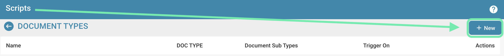

# Tworzenie i edytowanie skryptów


DocBits Document Scripts Explained: Automate Custom Logic in Your Document Workflow


## Aby utworzyć nowy skrypt w DocBits, postępuj zgodnie z poniższymi szczegółowymi instrukcjami:

**Wybierz język skryptowy:**

Najpierw musisz wybrać język skryptowy, którego chcesz użyć. DocBits zazwyczaj obsługuje popularne języki skryptowe, takie jak Python, JavaScript czy SQL. Wybór języka zależy od potrzeb Twojego projektu i Twoich własnych kompetencji.

**Otwórz środowisko programistyczne skryptów:**

Zaloguj się do DocBits i przejdź do środowiska programistycznego skryptów. Znajduje się ono w obszarze administracyjnym.

<figure><figcaption></figcaption></figure>

**Utwórz nowy skrypt:**

Kliknij przycisk "+ New", aby otworzyć nowy edytor skryptów.

<figure><figcaption></figcaption></figure>

**Napisz kod:**

Użyj edytora, aby napisać kod swojego skryptu. Zacznij od podstawowej składni wybranego języka skryptowego.

Na przykład, jeśli używasz Pythona, Twój skrypt może wyglądać następująco:

## 1. Przykładowy skrypt w Pythonie

<figure><figcaption></figcaption></figure>

## Funkcja czyszczenia nazwisk pacjentów

def clean\_patient\_name(name): cleaned\_name = name.strip().title() # Usuń spacje i zastosuj wielkie litery

return cleaned\_name

## Program główny

if **name** == "**main**": patient\_name = " john doe " cleaned\_name = clean\_patient\_name(patient\_name) print("Cleaned patient name:", cleaned\_name)

## 2. Przykładowy skrypt

<figure><figcaption></figcaption></figure>

**Przetestuj skrypt:**

Sprawdź kod pod kątem błędów i przetestuj go w środowisku testowym. Upewnij się, że skrypt daje oczekiwane wyniki i działa prawidłowo.

<figure><figcaption></figcaption></figure>

**Zapisz skrypt:**

Zapisz skrypt w DocBits i nadaj mu znaczącą nazwę opisującą jego przeznaczenie.

<figure><figcaption></figcaption></figure>

**Mapowanie skryptu do typów dokumentów:**

Ważnym krokiem jest zmapowanie skryptu do odpowiednich typów dokumentów. Określa to, kiedy i w jaki sposób skrypt jest stosowany. Zazwyczaj można to zrobić w interfejsie konfiguracji DocBits, w którym możesz przypisać skrypt do konkretnego typu dokumentu i określić, w jakich warunkach ma być stosowany.

<figure><figcaption></figcaption></figure>

**Przejrzyj i opublikuj:**

Po utworzeniu, przetestowaniu i zmapowaniu skryptu sprawdź go ponownie pod kątem błędów i niespójności. Jeśli wszystko jest w porządku, możesz opublikować skrypt w środowisku produkcyjnym DocBits.

<figure><figcaption></figcaption></figure>

<figure><figcaption></figcaption></figure>

Dzięki tym krokom możesz z powodzeniem utworzyć, przetestować i wdrożyć nowy skrypt w DocBits, aby automatyzować procesy i poprawić efektywność dokumentacji medycznej.
