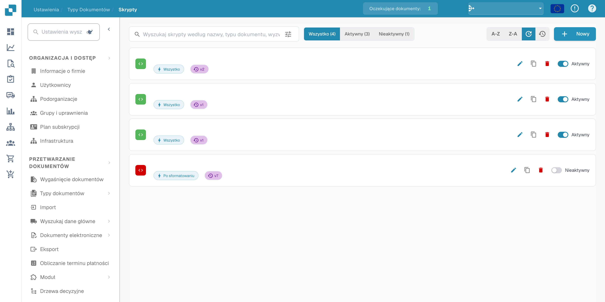
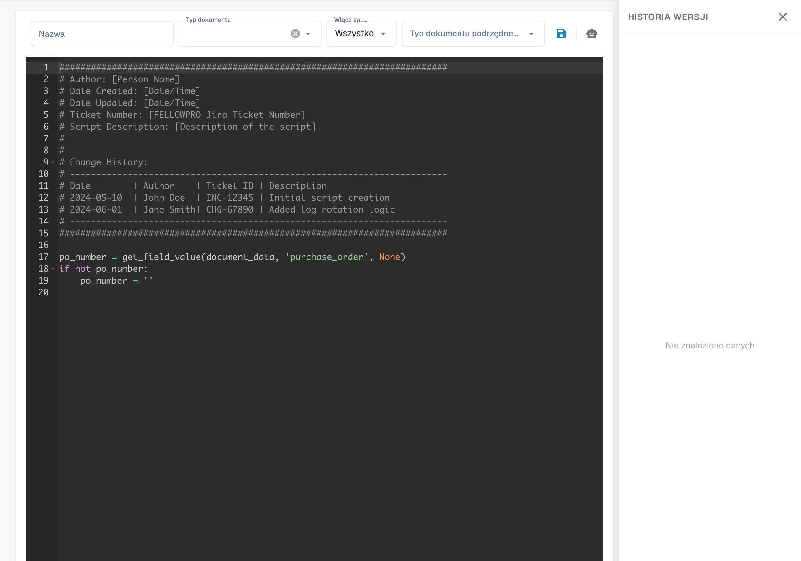

# Tworzenie i edytowanie skryptów


DocBits Wyjaśnienie skryptów dokumentów: Zautomatyzuj niestandardową logikę w obiegu dokumentów


## Aby utworzyć nowy skrypt w DocBits, postępuj zgodnie z poniższymi szczegółowymi instrukcjami:

**Wybierz język skryptowy:**

Wybierz typ skryptu i język rzeczywiście dostępne w edytorze oraz środowisku wykonawczym swojej instalacji DocBits. Dostępne typy i konteksty wykonania zależą od wdrożonej wersji.

**Otwórz środowisko programistyczne skryptów:**

Zaloguj się do DocBits i przejdź do środowiska programistycznego skryptów. Znajduje się ono w obszarze administracyjnym.

<figure><figcaption><p>Lista skryptów z ukrytymi nazwami, datami i danymi organizacji.</p></figcaption></figure>

**Utwórz nowy skrypt:**

Kliknij przycisk "+ New", aby otworzyć nowy edytor skryptów.

<figure><figcaption><p>Edytor nowego skryptu z dostarczonym szablonem początkowym; nie jest to samodzielny przykład w Pythonie przedstawiony poniżej.</p></figcaption></figure>

**Napisz kod:**

Użyj edytora, aby napisać kod swojego skryptu. Zacznij od podstawowej składni wybranego języka skryptowego.

Na przykład, jeśli używasz Pythona, Twój skrypt może wyglądać następująco:

## 1. Przykładowy skrypt w Pythonie


## Funkcja czyszczenia nazwisk pacjentów

Ten samodzielny przykład w Pythonie ilustruje składnię. Nie jest to zweryfikowany punkt wykonania w cyklu życia DocBits; przed użyciem dostosuj go do udokumentowanego kontekstu skryptu.

```python
def clean_patient_name(name):
    cleaned_name = name.strip().title()
    return cleaned_name

if __name__ == "__main__":
    patient_name = " john doe "
    cleaned_name = clean_patient_name(patient_name)
    print("Cleaned patient name:", cleaned_name)
```

## 2. Przykładowy skrypt


**Przetestuj skrypt:**

Sprawdź kod pod kątem błędów i przetestuj go w środowisku testowym. Upewnij się, że skrypt daje oczekiwane wyniki i działa prawidłowo.


**Zapisz skrypt:**

Zapisz skrypt w DocBits i nadaj mu znaczącą nazwę opisującą jego przeznaczenie.


**Mapowanie skryptu do typów dokumentów:**

Ważnym krokiem jest zmapowanie skryptu do odpowiednich typów dokumentów. Określa to, kiedy i w jaki sposób skrypt jest stosowany. Zazwyczaj można to zrobić w interfejsie konfiguracji DocBits, w którym możesz przypisać skrypt do konkretnego typu dokumentu i określić, w jakich warunkach ma być stosowany.


**Przejrzyj i opublikuj:**

Po utworzeniu, przetestowaniu i zmapowaniu skryptu sprawdź go ponownie pod kątem błędów i niespójności. Jeśli wszystko jest w porządku, możesz opublikować skrypt w środowisku produkcyjnym DocBits.


Dzięki tym krokom możesz z powodzeniem utworzyć, przetestować i wdrożyć nowy skrypt w DocBits, aby automatyzować procesy i poprawić efektywność dokumentacji medycznej.
