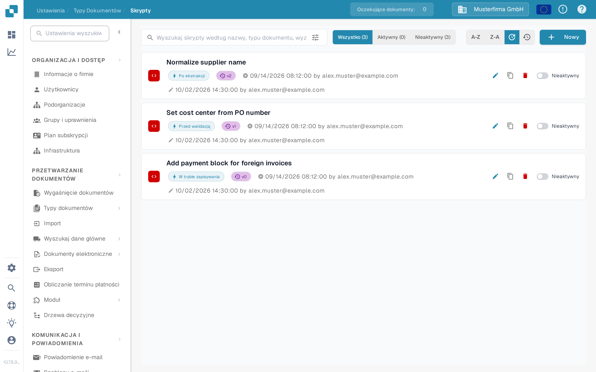
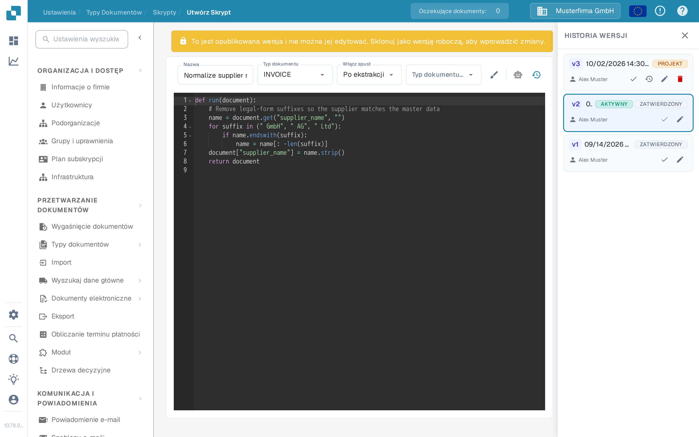
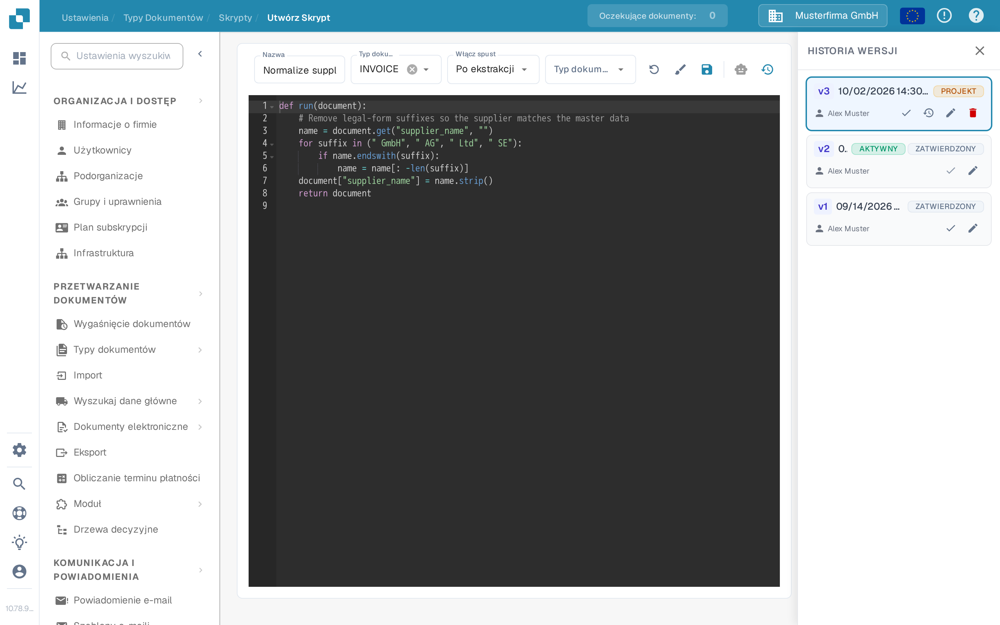

# Aktywacja i zarządzanie skryptami

Administratorzy mogą używać **Skryptów** do zarządzania regułami przetwarzania dla typu dokumentu. Ten przewodnik pokazuje, gdzie znaleźć skrypty, jak je włączać lub wyłączać oraz jak bezpiecznie zmienić opublikowany skrypt.

## Znajdź skrypt

1. Otwórz **Ustawienia → Typy dokumentów**.
2. Dla typu dokumentu, którym chcesz zarządzać, wybierz **Skrypty**. Strona wyświetla listę skryptów tego typu dokumentu.
3. Szukaj według nazwy lub zawęź listę, używając opcji **Wszystko**, **Aktywny** i **Nieaktywny**. Listę można też sortować według nazwy lub daty modyfikacji.

Każda karta pokazuje nazwę skryptu, wyzwalacz, wersję i status. Ikona ołówka otwiera edytor; ikona kopiowania duplikuje skrypt. **Nowy** otwiera edytor dla nowego skryptu.

<figure><figcaption>
Sprawdź status po prawej stronie karty skryptu, zanim coś zmienisz.
</figcaption></figure>

## Włączanie lub wyłączanie skryptu

Użyj przełącznika **Aktywny/Nieaktywny** na karcie skryptu. Zmiana jest zapisywana natychmiast; liczniki listy aktualizują się, aby pokazać wynik. Skrypt nieaktywny nadal można przeglądać i edytować, ale nie jest uruchamiany podczas przetwarzania dokumentów.

**Sprawdź status po utworzeniu skryptu.** W aktualnym interfejsie Sandbox zapisanie nowego skryptu tworzy wersję aktywną i ustawia kartę na **Aktywny**. Przełącz ją na **Nieaktywny**, jeśli to tylko szkic lub przykład testowy.

## Zmiana istniejącego skryptu

1. Wybierz kartę skryptu lub jej ikonę ołówka. Opublikowana wersja jest tylko do odczytu, więc nie można jej bezpośrednio nadpisywać.
2. W **Historii wersji** wybierz ikonę ołówka przy wersji, którą chcesz zmienić. Spowoduje to utworzenie **Projektu** na podstawie tej wersji.
3. Edytuj projekt i wybierz ikonę zapisu. Przed zapisaniem sprawdź nazwę, typ dokumentu, wyzwalacz i kod.
4. Przetestuj zmieniony skrypt na reprezentatywnych dokumentach w środowisku testowym. Gdy będzie gotowy, wybierz ikonę znacznika przy projekcie w **Historii wersji**, aby uczynić tę wersję aktywną.
5. Wróć do listy Skrypty i sprawdź przełącznik **Aktywny/Nieaktywny** na karcie. Wersja oznaczona w Historii wersji jako **AKTYWNY** wskazuje wybraną wersję; przełącznik na karcie steruje tym, czy skrypt jest uruchamiany.

<figure><figcaption>
Opublikowanej wersji nie można edytować bezpośrednio. Użyj ołówka w Historii wersji, aby utworzyć projekt.
</figcaption></figure>

<figure><figcaption>
Zapisz i sprawdź projekt, zanim stanie się wersją aktywną.
</figcaption></figure>

Przykłady skryptów i dostępne funkcje opisuje strona [Skrypty w DocBits](scripting-in-docbits/README.md).

Jak utworzyć skrypt, obsługiwać edytor (formatowanie, cofnięcie projektu, asystent AI) i wprowadzić kod, opisuje strona [Tworzenie i edytowanie skryptów](creating-and-editing-scripts.md).

Ikona kosza na liście skryptów trwale usuwa skrypt; ikona strzałki w wierszu wersji Historii wersji wczytuje starszą wersję jako projekt do edytora.
