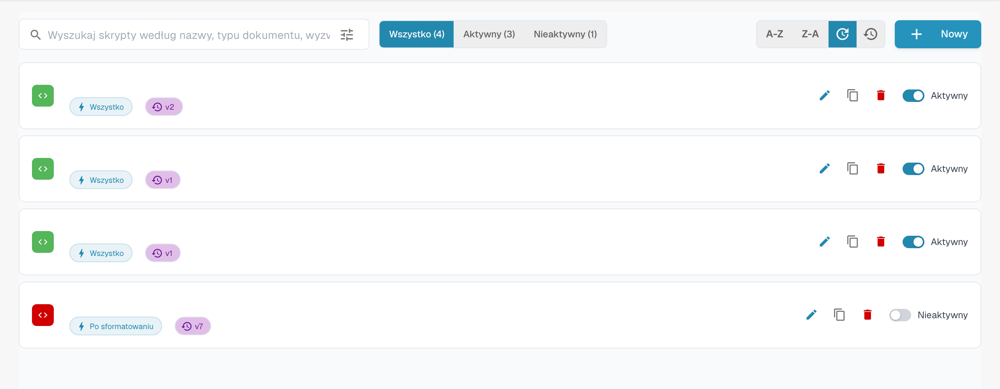

# Aktywowanie skryptów i zarządzanie nimi

Otwórz typ dokumentu i zarządzanie skryptami. Lista udostępnia skrypty oraz działania edycji, kopiowania i statusu. Nazwy w przykładzie są ukryte.

<figure><figcaption>
Zarządzanie skryptami i działania edycji; nazwy są ukryte.
</figcaption></figure>

Przefiltruj według statusu lub wyszukaj skrypt przed jego otwarciem. Sprawdź typ dokumentu, moment wykonania i kod przed zapisaniem.

Dostępne działania zależą od uprawnień. Przetestuj zamierzone zmiany na reprezentatywnych dokumentach przed użyciem w rzeczywistym przepływie.
