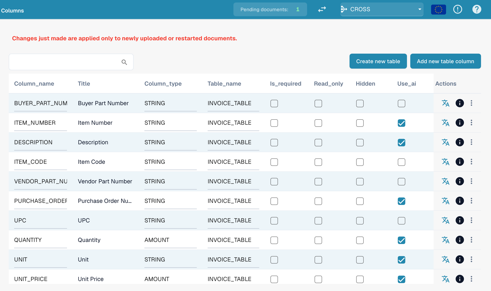

# Kolumny tabeli

Kolumny tabeli określają, jakie kolumny ma tabela pozycji dokumentu danego typu: co DocBits wyodrębnia do każdej kolumny, co użytkownik widzi na ekranie walidacji oraz co jest wysyłane do systemu ERP podczas eksportu.

**Gdzie:** Settings → Global Settings → Document Types → Table Columns

<figure><figcaption>
Table Columns: jeden wiersz na kolumnę, flagi przełącza się bezpośrednio na liście
</figcaption></figure>

## Co widzisz

Każdy wiersz to jedna kolumna jednej tabeli. Lista pokazuje:

| Kolumna | Znaczenie |
|---|---|
| **Column name** | Nazwa techniczna, generowana z tytułu (wielkie litery, podkreślenia). Używana w skryptach, mapowaniach eksportu i API. Nie można jej później zmienić. |
| **Title** | Etykieta wyświetlana na ekranie walidacji. Zmienisz ją ikoną tłumaczenia w kolumnie *Actions* (*Update translation key*). |
| **Column Type** | `AMOUNT`, `STRING`, `DATE`, `NUMBER`, `BOOLEAN` lub `CURRENCY`. Określa walidację i formatowanie. |
| **Table name** | Tabela, do której należy kolumna, na przykład `INVOICE_TABLE`. |
| **Is Required** | Dokumentu nie można zatwierdzić, dopóki ta kolumna jest pusta w którymkolwiek wierszu. |
| **Read Only** | Użytkownicy widzą wartość, ale nie mogą jej edytować. |
| **Hidden** | Kolumna nie jest ani wyświetlana, ani eksportowana. Służy do wyłączania domyślnych kolumn, których nie potrzebujesz. |
| **Use AI** | Wyodrębnianie tabel przez AI wypełnia tę kolumnę, nawet jeśli dostawca ma wytrenowane reguły. |
| **Actions** | Ikona tłumaczenia: zmiana tytułu. Ikona informacji: skąd pochodzi wyświetlana etykieta (Twoje tłumaczenie, wartość domyślna, klucz). Menu z trzema kropkami: *Delete*, tylko dla kolumn utworzonych przez Twoją organizację; kolumny domyślne można jedynie ukryć. |

Dwa przyciski nad listą:

* **Create new table**: druga tabela pozycji dla danego typu dokumentu (na przykład tabela opłat obok tabeli pozycji towarowych).
* **Add new table column**: otwiera okno opisane w [Dodawanie nowej kolumny](adding-a-new-column.md).

## Kolumny domyślne i własne kolumny

Każdy typ dokumentu jest dostarczany z zestawem kolumn domyślnych (dla faktur: numer pozycji, opis, ilość, cena jednostkowa, kwota całkowita, podatek, …). Należą one do DocBits, a nie do Twojej organizacji, więc nie można ich usunąć, można je jedynie ukryć. Kolumny dodane przez Ciebie należą do Twojej organizacji i można je usunąć.


**Zmiany dotyczą tylko nowych dokumentów.** Kolumna, którą dodasz, ukryjesz lub usuniesz, pojawi się w dokumentach przesłanych lub zrestartowanych po zmianie. Dokumenty znajdujące się już na pulpicie zachowują tabelę w takiej postaci, w jakiej została wyodrębniona. Zrestartuj dokument, aby zastosować nową konfigurację.


## Powiązane strony

* [Cel i zastosowanie](purpose-and-use.md): gdzie widoczne są kolumny tabeli
* [Dodawanie nowej kolumny](adding-a-new-column.md)
* [Edytowanie i usuwanie kolumn](editing-and-deleting-columns.md)
* [Najlepsze praktyki](best-practices-2.md)
* [Rozwiązywanie problemów](troubleshooting-1.md)
* [Training Line Fields / Table Training](../../../../setup/document-training/training-line-fields-table-training/README.md): naucz DocBits, gdzie znajduje się tabela dostawcy
* [AI Table](../../../../../end-user-and-partner-section/end-user-section/ai-table/README.md): co użytkownik widzi na ekranie walidacji
