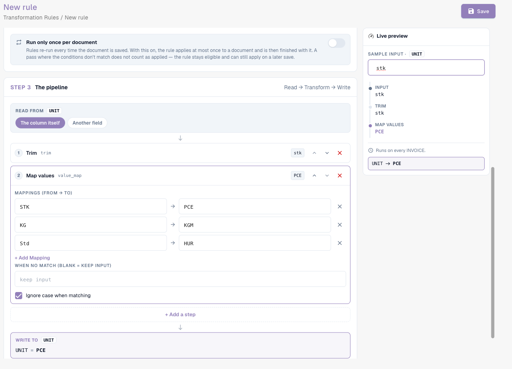

# Zasady transformacji

## Przegląd

Zasady transformacji **automatycznie** oczyszczają lub przepisują wyodrębnione dane, za każdym razem, gdy dokument jest przetwarzany i za każdym razem, gdy jest zapisywany. Zasada może zmieniać:

* **pole nagłówka** (numer faktury, walutę, numer NIP dostawcy …),
* **kolumnę** w każdym wierszu tabeli (jednostkę, numer artykułu, podstawę ceny …),
* **wiersze** tabeli (wyczyścić je, dodać wiersz),
* **atrybut dokumentu** — obecnie podorganizację, do której dokument należy (**Routing**).

Każda zasada **odczytuje** wartość, przepuszcza ją przez krótki **potok** kroków i **zapisuje** wynik z powrotem. Zasady uruchamiają się **przed** walidacją, skryptami i dopasowaniem zamówień zakupu, więc wszystko dalej widzi już poprawione wartości.

Zasady transformacji zastępują większość małych skryptów, które organizacje pisały dla „zawsze przytnij to pole”, „zamapuj kody jednostek tego dostawcy”, „dodaj prefiks, którego oczekuje nasz ERP” lub „zsumuj pozycje tego dostawcy do jednej linii łącznej” — za pomocą formularza, podglądu na żywo i bez kodu.

### Problemy, które rozwiązują

| Wymaganie | Zasada |
| --- | --- |
| Dostawca drukuje numer faktury bez prefiksu `INV-`, którego oczekuje nasz ERP | Pole nagłówka *Invoice Number*, tylko dla tego dostawcy: Trim → UPPERCASE → Affix: add prefix `INV-` |
| Dostawcy wysyłają niemieckie kody jednostek (`STK`, `Std`), a ERP oczekuje kodów UN/ECE (`PCE`, `HUR`) | Kolumna tabeli *UNIT*: Map values `STK → PCE`, `KG → KGM`, `Std → HUR` |
| Numery artykułów mają prefiks, np. `Art.-Nr. 4711` | Kolumna tabeli *ITEM_NUMBER*: Affix: strip prefix `Art.-Nr. ` |
| Numery NIP zawierają spacje i kropki | Pole nagłówka *Supplier Tax ID*: Sanitise, keep alphanumeric |
| Dostawca jest dopasowywany na podstawie sumy, a nie pozycji | Wiersze tabeli: Clear all rows → Add a row z kwotą netto |
| Wszystkie dokumenty wybranych dostawców należą do podorganizacji | Routing: ustaw podorganizację, gdy *Supplier ID is one of …* |
| Daty muszą być zapisane w stałym formacie w polu tekstowym | Pole nagłówka: Reformat date `%d.%m.%Y` |


Dopóki funkcja jest w wersji beta, opisane poniżej ustawienia pojawiają się tylko wtedy, gdy strona ustawień **Document Types** zostanie otwarta z dopisanym do adresu `?beta=true`.


## Włączanie zasad transformacji

Zasady transformacji włącza **administrator organizacji** **dla każdego typu dokumentu** osobno.

1. Przejdź do **Settings → Global Settings → Document Types**.
2. Kliknij ikonę **ustawień** (koło zębate) na karcie typu dokumentu.
3. Otwórz **Transformation Rules** i włącz przełącznik. Kliknij **Manage transformation rules**, aby otworzyć listę.

<figure><figcaption>
Przełącznik Transformation Rules w ustawieniach dodatkowych typu dokumentu
</figcaption></figure>

Karta typu dokumentu pokazuje teraz link **Transformation Rules** oraz link **Logs** do logów wykonania.

## Lista zasad

Lista pokazuje wszystkie zasady typu dokumentu w kolejności ich uruchamiania, każdą z jednozdaniowym podsumowaniem („When invoice_id is abcd, take invoice_id, make it UPPERCASE, and save it back.”), jej zakresem (**Header**, **Table**, **Column**, **Routing**), liczbą kroków, źródłem oraz informacją, czy opcja **Log execution** jest włączona. Możesz filtrować według zakresu oraz **Active / Inactive**, wyszukiwać, a menu **⋮** pozwala zduplikować lub usunąć zasadę.

Zasady pochodzą z trzech źródeł, tak jak reguły walidacji: zasady **System default** dostarczane z DocBits (kliknij **Customize**, aby otrzymać edytowalną kopię), zasady systemowe **Customized** (**Reset to Default** przywraca oryginał) oraz zasady **Custom** utworzone przez Ciebie.

## Tworzenie zasady

Kliknij **New rule**. Kreator ma trzy kroki po lewej stronie i **Live preview** po prawej. U góry podsumowuje zasadę w jednym zdaniu w trakcie jej budowania.

<figure><figcaption>
Krok 1: co zasada zmienia. Zdanie u góry opisuje zasadę prostym językiem
</figcaption></figure>

### Krok 1 — What & where

**What does this rule change?** — zakres:

| Zakres | Zmienia | Cel | Uruchamia się |
| --- | --- | --- | --- |
| **Header field** | jedną wartość na dokument | pole nagłówka, np. *Invoice Number* | raz na dokument |
| **Table rows** | całe wiersze pozycji — usuwa je lub dodaje wiersze | tabelę, np. `INVOICE_TABLE` | raz na dokument |
| **Table column** | wartość w każdym wierszu pozycji | tabelę i kolumnę, np. `INVOICE_TABLE` / `UNIT` | raz na wiersz |
| **Routing** | atrybut dokumentu — obecnie podorganizację | *podorganizację* | raz na dokument |

Następnie wpisz **Rule Name** (**Rule key** jest generowany na jego podstawie), wybierz **Target field** / **Table name** / **Target column** i opcjonalnie **Description**. **Log execution** zapisuje jeden wpis logu na każde zastosowanie — przydatne podczas dopracowywania zasady.

### Krok 2 — When it runs

* **Always** — zasada uruchamia się dla każdego dokumentu tego typu.
* **Only when…** — zasada uruchamia się tylko wtedy, gdy warunek jest prawdziwy, na przykład *Supplier ID is HP0000278*. W zasadach **Table column** warunek może korzystać z kolumn bieżącego wiersza i jest sprawdzany wiersz po wierszu. Wszystkie pola, operatory i przykłady znajdziesz w [Rule Conditions (Applies when)](rule-conditions-applies-when.md).

Dwie opcje określają, jak często zasada jest stosowana:

| Opcja | Efekt |
| --- | --- |
| **Run only once per document** | Zwykle zasady uruchamiają się ponownie przy każdym zapisie. Gdy opcja jest włączona, zasada stosuje się do dokumentu **co najwyżej raz** i na tym kończy. Przebieg, w którym warunki nie są spełnione, nie jest liczony, więc zasada może jeszcze zadziałać przy późniejszym zapisie. Wymagane dla kroków, które zmieniałyby wartość ponownie przy każdym zapisie (zobacz [Idempotentność](#uruchom-raz-i-idempotentnosc)) oraz dla zasad tabeli, które nie powinny ponownie budować pozycji. |
| **Run after lookup population (before PO match)** | *(nowsze wersje)* Uruchamia zasadę w dodatkowym przebiegu po uzupełnieniu danych wyszukiwania (na przykład danych podstawowych dostawcy), a przed dopasowaniem zamówień zakupu. Użyj, gdy zasada potrzebuje wartości dostarczanej przez wyszukiwanie. Zasada nadal uruchamia się także na zwykłych etapach; zasada run-once z tą opcją czeka na ten przebieg zamiast uruchamiać się zaraz po ekstrakcji. |

### Krok 3 — The pipeline

<figure><figcaption>
Read → Trim → Change case → Affix → Write, z wartością po każdym kroku w podglądzie na żywo
</figcaption></figure>

* **Read from** — **samo pole (lub kolumna)** albo **inne pole**. Odczyt z innego pola pozwala wypełnić pole na podstawie innego, na przykład skopiować numer zamówienia zakupu z pola tekstowego.
* **Steps** — wartość przechodzi przez kroki **od góry do dołu**; wynik jednego kroku jest wejściem następnego. Kroki dodajesz przez **+ Add a step**, zmieniasz ich kolejność strzałkami, usuwasz przez **✕**. Każdy krok pokazuje po prawej stronie wartość pośrednią próbki.
* **Write to** — cel z kroku 1. DocBits zapisuje przechowywaną wartość, a następnie automatycznie odświeża wartość wyświetlaną.

### Kroki

<figure><figcaption>
Wszystkie kroki, pogrupowane według przeznaczenia
</figcaption></figure>

| Krok | Ustawienia | Przykład wejście → wyjście |
| --- | --- | --- |
| **Change case** | UPPERCASE, lowercase, Title Case, Capitalise first | `inv-4711` → `INV-4711` |
| **Trim** | strona (obie, lewa, prawa); znaki (puste = białe znaki) | `  4711 ` → `4711`; ze znakiem `0` i stroną lewą: `004711` → `4711` |
| **Pad** | długość, znak wypełnienia, strona | długość 10, `0`, lewa: `4711` → `0000004711` |
| **Truncate** | maksymalna długość | 10: `ABCDEFGHIJKL` → `ABCDEFGHIJ` |
| **Affix** | add prefix, add suffix, strip prefix, strip suffix; tekst | add prefix `INV-`: `4711` → `INV-4711`; strip prefix `Art.-Nr. `: `Art.-Nr. 4711` → `4711` |
| **Sanitise** | zachowaj tylko (alfanumeryczne, litery, cyfry, alfanumeryczne + spacja) lub usuń podane znaki | keep alphanumeric: `DE 123.456.789` → `DE123456789` |
| **Take a slice** | początek, długość lub koniec | początek 0, długość 4: `2026-09-29` → `2026` |
| **Extract** | wzorzec, grupa przechwytująca | wzorzec `PO[- ]?(\d+)`, grupa 1: `Order PO-45001234` → `45001234` |
| **Find & replace** | wzorzec, zamień na, liczba (0 = wszystkie) | wzorzec `\s+`, zamień na ` `: `ACME    GmbH` → `ACME GmbH` |
| **Map values** | mapowania (z → na), wartość przy braku dopasowania (puste = zachowaj wejście), ignoruj wielkość liter | `STK → PCE`: `stk` → `PCE` |
| **Reformat date** | wzorzec wyjściowy (`%d.%m.%Y`, `%m/%d/%Y`, `%Y-%m-%d`, `%d %b %Y`) | `%d.%m.%Y`: `2026-09-29` → `29.09.2026` |
| **Format number** | ustawienia regionalne (de_DE, en_US, en_GB, fr_FR), min. i maks. liczba miejsc po przecinku | de_DE, 2 miejsca po przecinku: `1234.5` → `1.234,50` |
| **Fix value** | wartość | zawsze zapisuje tę wartość, niezależnie od zawartości pola |
| **Clear** | – | opróżnia pole |

Zasady **Table rows** używają dwóch innych kroków, które działają na wierszach zamiast na wartościach:

| Krok | Efekt |
| --- | --- |
| **Clear all rows** | usuwa każdy wyodrębniony wiersz. Wiersze dodane przez późniejszy krok pozostają. |
| **Add a row** | dodaje jeden wiersz **po ostatnim wierszu** lub **przed pierwszym wierszem**. Dla każdej kolumny wybierz **Value** (stała wartość) lub **Field** (wartość pola nagłówka). Pominięte kolumny pozostają puste. |


**Reformat date** oczekuje daty w postaci, w jakiej DocBits przechowuje ją wewnętrznie (`YYYY-MM-DD`). Stosuj ją do samego pola, a nie do tekstu, który już zawiera sformatowaną datę.


### Live preview

Podgląd na żywo uruchamia zasadę na próbce w trakcie jej budowania:

* **Sample input** — wpisz wartość taką, jaka pochodziłaby z dokumentu. W zasadach tabeli podaj liczbę wyodrębnionych wierszy (**Sample table**) oraz wartości pól, które odczytują nowe wiersze (**Row source values**).
* **Condition values** — w zasadach z warunkiem wpisz wartości pól warunku. Podgląd pokazuje **Conditions match — rule runs** lub **Conditions do not match — rule is skipped**.
* Poniżej widzisz wartość po **każdym kroku** oraz wynik końcowy, który zostałby zapisany („invoice_id → INV-230620-03A” lub „unchanged”).

Podczas korzystania z podglądu nic nie jest zapisywane. Kliknij **Save**, aby zapisać zasadę.

## Przykłady

### Oczyszczenie numeru faktury dostawcy

Pole nagłówka **Invoice Number** · tylko gdy *Supplier ID is HP0000278* · Trim → Change case UPPERCASE → Affix add prefix `INV-`.
Próbka `  230620-03a ` → `INV-230620-03A`. Zobacz zrzut ekranu potoku powyżej.

### Mapowanie kodów jednostek

Kolumna tabeli **INVOICE_TABLE / UNIT** · zawsze · Trim → Map values `STK → PCE`, `KG → KGM`, `Std → HUR`, **Ignore case when matching** włączone, wartość przy braku dopasowania pusta (zachowaj wejście).

<figure><figcaption>
Map values w kolumnie UNIT: <code>stk</code> staje się <code>PCE</code>
</figcaption></figure>

### Jedna linia łączna dla dostawcy dopasowywanego na sumę

Table rows **INVOICE_TABLE** · tylko gdy *Supplier ID is HP0000278* · Clear all rows → Add a row z `POSITION` = wartość `001`, `QUANTITY` = wartość `1`, `NET_AMOUNT` = pole *Total Net Amount*.

<figure><figcaption>
Trzy wyodrębnione wiersze zostają zastąpione jednym wierszem z kwotą netto
</figcaption></figure>

Kolejność ma znaczenie: **Clear all rows** musi być **przed** **Add a row**. Kreator ostrzega, jeśli tak nie jest („Clear all rows runs after Add a row …”), a także gdy krok **Add a row** nie jest poprzedzony krokiem **Clear all rows**, ponieważ zasada dodawałaby wtedy kolejną kopię wiersza przy każdym zapisie. Połącz tę zasadę z regułą dopasowania zamówień zakupu na sumę, aktywną dla dokumentów jednowierszowych.

### Więcej przykładów

| Cel | Zakres | Warunek | Kroki |
| --- | --- | --- | --- |
| Usunięcie spacji i kropek z numeru NIP | Header *Supplier Tax ID* | always | Sanitise: keep alphanumeric |
| Usunięcie prefiksu artykułu | Column *ITEM_NUMBER* | always | Affix: strip prefix `Art.-Nr. ` |
| 10-cyfrowe numery dostawców | Header *Supplier ID* | always | Trim → Pad length 10 with `0`, left |
| Wyciągnięcie numeru zamówienia z tekstu referencyjnego | Header *Purchase Order*, odczyt z innego pola | only when *Purchase Order is empty* | Extract `PO[- ]?(\d+)`, group 1 |
| Zawsze jedna waluta dla dostawcy | Header *Currency* | only when *Supplier ID is 10040* | Fix value `CHF` |
| Usunięcie błędnie wyodrębnionej wartości | Header *Discount Term* | only when *Supplier ID is 20723* | Clear |
| Podstawa ceny na jednostkę | Column *UNIT_PRICE_PER* | only when *row.UNIT_PRICE_PER is empty* | Fix value `1` |
| Kierowanie dostawców do podorganizacji | Routing | *Supplier ID is one of* `10040, 10041` | przypisz stałą podorganizację |

## Zasady Routing (podorganizacja)

Zasada **Routing** nie zmienia pola. Ustawia atrybut dokumentu, gdy jej warunki są spełnione — obecnie **podorganizację**. Wybierz **Assign a fixed sub-organisation** i wskaż ją na liście albo **Map from a field**, aby zmapować wartości wyodrębnionego pola na podorganizacje. Dokument należy wtedy do tej podorganizacji, wraz z jej użytkownikami, uprawnieniami i ustawieniami. Wartość, która nie jest prawidłową podorganizacją, nigdy nie jest zapisywana.

## Kiedy zasady się uruchamiają

* **Podczas przetwarzania**, po ekstrakcji i przed wyszukiwaniem danych podstawowych, walidacją, skryptami i dopasowaniem zamówień zakupu.
* Przy **każdym zapisie** dokumentu, w którym zmieniły się wyodrębnione dane. Zasady bez **Run only once per document** są stosowane ponownie za każdym razem.
* W jednym przebiegu zasady uruchamiają się zakres po zakresie w tej kolejności: **Header → Routing → Table rows → Table column**. Zasada kolumny stosuje się więc także do wierszy, które właśnie dodała zasada tabeli. W obrębie zakresu zasady uruchamiają się według priorytetu, a następnie według klucza.

### Uruchom raz i idempotentność

Większość kroków daje ten sam wynik, gdy działa na własnym wyniku — przycięcie przyciętej wartości, ponowne zmapowanie `PCE`, dodanie prefiksu, który już tam jest. Takie zasady mogą bezpiecznie uruchamiać się przy każdym zapisie.

**Take a slice**, **Extract** i **Find & replace** są inne: uruchomione ponownie na własnym wyniku, wciąż go zmieniają (wycinek bierze pierwsze cztery znaki z pierwszych czterech znaków …). Dlatego DocBits nie pozwala zapisać zasady, która stosuje te kroki do własnego pola docelowego. Należy albo:

* włączyć **Run only once per document**, albo
* użyć **Read from another field**, aby wejście pozostało niezmienione.

## Zasady transformacji a dopasowanie zamówień zakupu

Zasady tabeli i kolumn zmieniają to, co widzi moduł dopasowania zamówień (PO matcher):

* Zasada tabeli, która **przebudowuje** pozycje (na przykład czyści wszystkie wiersze i dodaje jedną linię łączną), zachowuje istniejące dopasowanie zamówienia zakupu, dopóki ponownie tworzy **te same pozycje** — wartości są porównywane według znaczenia, więc `1.0` i `1.00` to ta sama pozycja. Pozycje zachowują tożsamość, a dopasowanie przetrwa każdy zapis.
* Jeśli zasada **zastępuje lub usuwa dopasowane pozycje**, dopasowania nie można zachować. Dokument zapisuje wtedy, która zasada je usunęła, ekran Purchase Order Matching pokazuje to jako przyczynę („_The PO match could not be saved: the transformation rule "…" rebuilt the table_”), a administratorzy otrzymują link do zasady. **Matching history** dokumentu pokazuje krok _Transformation rules_ przed pierwszym etapem dopasowania, wraz z zasadami, które się uruchomiły.
* Liczba pozycji po zastosowaniu zasad jest tym, co liczą [warunki aktywacji](more-settings/purchase-order/purchase-order-matching-rules.md#warunki-aktywacji) reguł dopasowania. Zasada, która zwija fakturę do **jednej** pozycji, ma sens tylko razem z regułą dopasowania na sumę, aktywną dla dokumentów jednowierszowych (`[[count(table_lines)]] >= 1`).

## Logi

Gdy **Log execution** jest włączone, każde zastosowanie zasady jest zapisywane w **Document Types → (typ dokumentu) → Logs**, wraz z wynikiem (applied, no change, skipped), dokumentem oraz — dla pominiętych zasad — śladem warunku, który wyjaśnia dlaczego. Zobacz [Read the condition trace](rule-conditions-applies-when.md#odczyt-sladu-warunku-w-logach).

## Najlepsze praktyki

* **Jeden cel na zasadę.** „Clean up invoice number” i „Map unit codes” to dwie zasady, a nie jedna.
* **Buduj z podglądem na żywo**, używając prawdziwych wartości skopiowanych z dokumentów, także nietypowych (spacje, małe litery, prefiksy).
* **Ogranicz zasady specyficzne dla dostawcy warunkiem**, zamiast pozwalać im działać na wszystkim.
* **Preferuj kroki idempotentne.** Używaj run once tylko tam, gdzie jest potrzebne.
* **Obserwuj dopasowanie zamówienia zakupu** po dodaniu zasad tabeli; sprawdź historię dopasowania kilku dokumentów.
* **Wyłącz Log execution**, gdy zasada działa.

## Rozwiązywanie problemów

| Objaw | Co sprawdzić |
| --- | --- |
| Zasada niczego nie zmieniła | Czy jest aktywna i czy funkcja jest włączona dla typu dokumentu? Czy warunek jest prawdziwy dla tego dokumentu (dokładna wartość, łącznie ze spacjami i wielkością liter)? Czy zasada **run once** została już zastosowana do dokumentu? Sprawdź ślad w logu. |
| Wartość zmienia się ponownie przy każdym zapisie | Potok zawiera Take a slice, Extract lub Find & replace. Włącz **Run only once per document** albo odczytuj z innego pola. |
| Tabela dostaje o jeden wiersz więcej przy każdym zapisie | Krok **Add a row** bez **Clear all rows** przed nim. Dodaj najpierw krok czyszczenia albo włącz run once. |
| Dopasowanie zamówienia zakupu znika po zapisie | Zasada tabeli zastąpiła dopasowane pozycje. Przyczyna na dokumencie wskazuje zasadę; zmień zasadę tak, aby odtwarzała te same pozycje, albo ustaw ją na run once. |
| Reguła dopasowania nigdy się nie uruchamia po transformacji | Zasada zmieniła liczbę pozycji; dostosuj warunek aktywacji reguły dopasowania. |
| Zasada potrzebuje wartości z danych podstawowych dostawcy, ale jest ona nadal pusta | Włącz **Run after lookup population (before PO match)**. |
| Data nie jest przeformatowywana | Reformat date oczekuje na wejściu `YYYY-MM-DD`. |

## Powiązane

* [Rule Conditions (Applies when)](rule-conditions-applies-when.md) — warunki szczegółowo
* [Custom Validation Rules](custom-validation-rules.md) — sprawdzanie przekształconych wartości
* [Layout Selection Rules](layout-manager/layout-selection-rules.md) — wybór layoutu używanego przez dokument
* [Purchase Order Matching Rules](more-settings/purchase-order/purchase-order-matching-rules.md)
