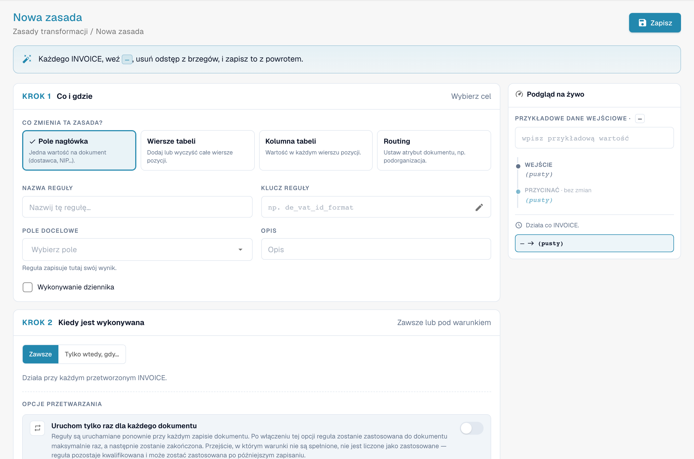
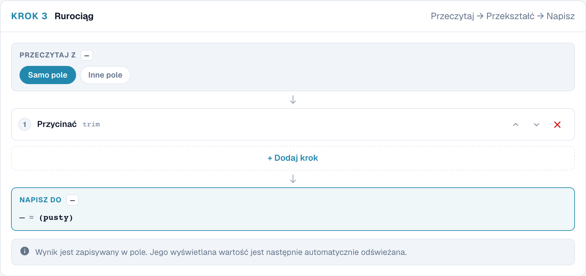
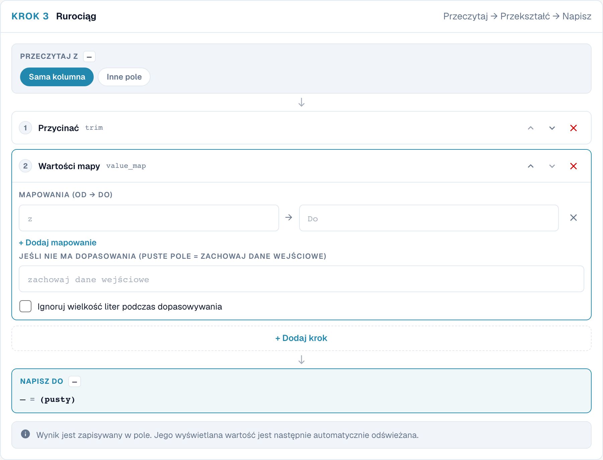
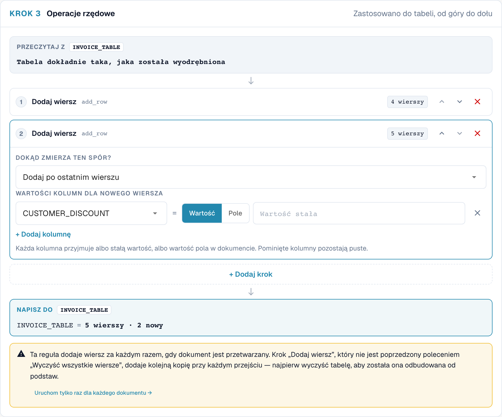
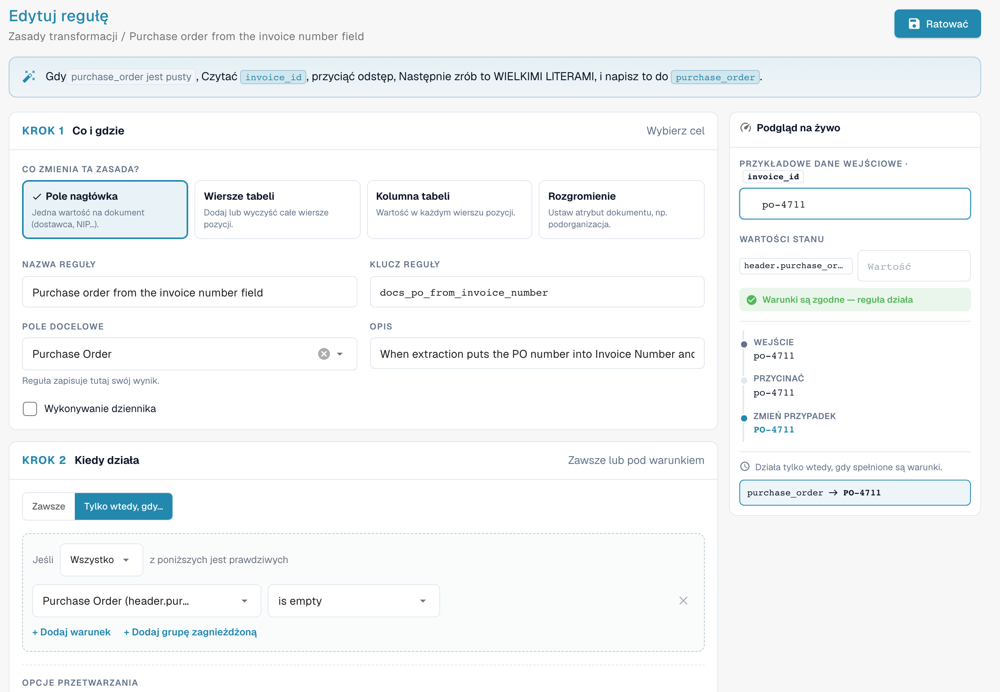
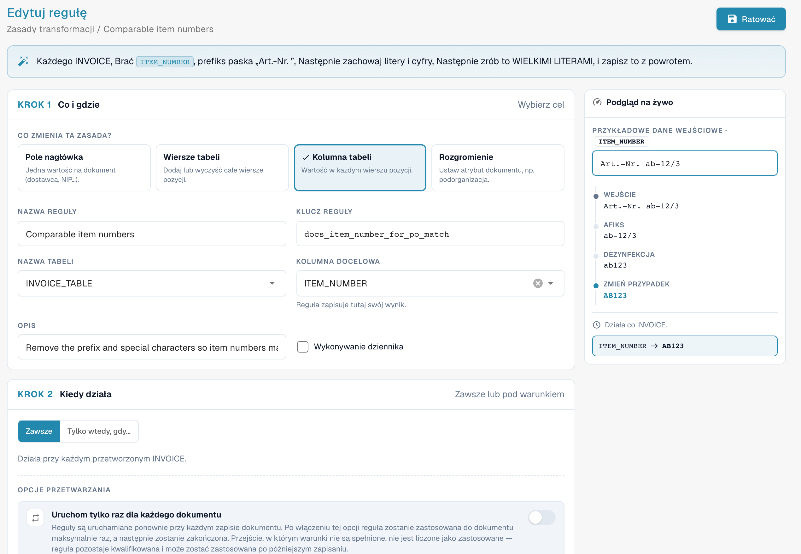

# Zasady transformacji



## Przegląd

Zasady transformacji **automatycznie** oczyszczają lub przepisują wyodrębnione dane, za każdym razem, gdy dokument jest przetwarzany i za każdym razem, gdy jest zapisywany. Zasada może zmieniać:

* **pole nagłówka** (numer faktury, walutę, numer NIP dostawcy …),
* **kolumnę** w każdym wierszu tabeli (jednostkę, numer artykułu, podstawę ceny …),
* **wiersze** tabeli (wyczyścić je, dodać wiersz),
* **atrybut dokumentu** — obecnie podorganizację, do której dokument należy (**Routing**).

Każda zasada **odczytuje** wartość, przepuszcza ją przez krótki **potok** kroków i **zapisuje** wynik z powrotem. Zasady uruchamiają się **przed** walidacją, skryptami i dopasowaniem zamówień zakupu, więc wszystko dalej widzi już poprawione wartości.

Zasady transformacji zastępują większość małych skryptów, które organizacje pisały dla „zawsze przytnij to pole”, „zamapuj kody jednostek tego dostawcy”, „dodaj prefiks, którego oczekuje nasz ERP” lub „zsumuj pozycje tego dostawcy do jednej linii łącznej” — za pomocą formularza, podglądu na żywo i bez kodu.

### Problemy, które rozwiązują

| Wymaganie | Zasada |
| --- | --- |
| Dostawca drukuje numer faktury bez prefiksu `INV-`, którego oczekuje nasz ERP | Pole nagłówka *Invoice Number*, tylko dla tego dostawcy: Przycinać → UPPERCASE → Afiks: add prefix `INV-` |
| Dostawcy wysyłają niemieckie kody jednostek (`STK`, `Std`), a ERP oczekuje kodów UN/ECE (`PCE`, `HUR`) | Kolumna tabeli *UNIT*: Map values `STK → PCE`, `KG → KGM`, `Std → HUR` |
| Numery artykułów mają prefiks, np. `Art.-Nr. 4711` | Kolumna tabeli *ITEM_NUMBER*: Afiks: strip prefix `Art.-Nr. ` |
| Numery NIP zawierają spacje i kropki | Pole nagłówka *Supplier Tax ID*: Dezynfekcja, keep alphanumeric |
| Dostawca jest dopasowywany na podstawie sumy, a nie pozycji | Wiersze tabeli: Clear all rows → Add a row z kwotą netto |
| Wszystkie dokumenty wybranych dostawców należą do podorganizacji | Routing: ustaw podorganizację, gdy *Supplier ID is one of …* |
| Daty muszą być zapisane w stałym formacie w polu tekstowym | Pole nagłówka: Reformat date `%d.%m.%Y` |
| Numer zamówienia jest w niewłaściwym polu (na przykład w *Invoice Number*) | Pole nagłówka *Purchase Order*: odczyt z *Invoice Number*, tylko gdy *Purchase Order is empty* |
| Numer zamówienia ma wiodące zera lub prefiks, których nie ma w zamówieniu zakupu | Pole nagłówka *Purchase Order*: Przycinać znak `0` z lewej strony albo Afiks: strip prefix |
| Numery artykułów różnią się od pozycji zamówienia zakupu wielkością liter, spacjami lub prefiksami | Kolumna tabeli *ITEM_NUMBER*: Afiks: strip prefix → Dezynfekcja → UPPERCASE |

## Włączanie zasad transformacji

Zasady transformacji włącza **administrator organizacji** **osobno dla każdego typu dokumentu**.

1. Przejdź do **Ustawienia → Ustawienia ogólne → Typy dokumentów**.
2. Kliknij ikonę **ustawień** (koło zębate) na karcie typu dokumentu.
3. Otwórz **Zasady transformacji** i włącz przełącznik. Kliknij **Zarządzaj regułami transformacji**, aby otworzyć listę.

<figure><figcaption>
Przełącznik Transformation Rules w ustawieniach dodatkowych typu dokumentu
</figcaption></figure>

Karta typu dokumentu pokazuje teraz link **Zasady transformacji** oraz link **Dzienniki** do logów wykonania.

## Lista zasad

Lista pokazuje wszystkie zasady typu dokumentu w kolejności ich uruchamiania, każdą z jednozdaniowym podsumowaniem („When invoice_id is abcd, take invoice_id, make it UPPERCASE, and save it back.”), jej zakresem (**Nagłówek**, **Tabela**, **Kolumna**, **Routing**), liczbą kroków, źródłem oraz informacją, czy opcja **Wykonywanie dziennika** (Log execution) jest włączona. Możesz filtrować według zakresu oraz **Active / Inactive**, wyszukiwać, a menu **⋮** pozwala zduplikować lub usunąć zasadę.

Zasady pochodzą z trzech źródeł, tak jak w przypadku reguł walidacji: zasady **Domyślne ustawienie systemu** dostarczane z DocBits (kliknij **Dostosuj**, aby otrzymać edytowalną kopię), zasady systemowe **Dostosowane** (**Przywróć ustawienia domyślne** przywraca oryginał) oraz zasady **Niestandardowy** utworzone przez Ciebie.

## Tworzenie zasady

Kliknij **Nowa zasada**. Kreator ma trzy kroki po lewej stronie i **Podgląd na żywo** (Live preview) po prawej. U góry podsumowuje zasadę w jednym zdaniu w trakcie jej budowania.

<figure><figcaption>
Zakres transformacji: pole nagłówka, wiersze tabeli, kolumna i przekierowanie.
</figcaption></figure>

### Krok 1 — Co i gdzie

**Co zmienia ta zasada?** — zakres:

| Zakres | Zmienia | Cel | Uruchamia się |
| --- | --- | --- | --- |
| **Pole nagłówka** (Header field) | jedną wartość na dokument | pole nagłówka, np. *Invoice Number* | raz na dokument |
| **Wiersze tabeli** (Table rows) | całe wiersze pozycji — usuwa je lub dodaje wiersze | tabelę, np. `INVOICE_TABLE` | raz na dokument |
| **Kolumna tabeli** (Table column) | wartość w każdym wierszu pozycji | tabelę i kolumnę, np. `INVOICE_TABLE` / `UNIT` | raz na wiersz |
| **Rozgromienie** (Routing) | atrybut dokumentu — obecnie podorganizację | *podorganizację* | raz na dokument |

Następnie wpisz **Nazwa reguły** (**Klucz reguły** jest generowany na jego podstawie), wybierz **Pole docelowe** / **Nazwa tabeli** / **Kolumna docelowa** i opcjonalnie **Opis**. **Wykonywanie dziennika** zapisuje jeden wpis logu na każde zastosowanie — przydatne podczas dopracowywania zasady.

### Krok 2 — Kiedy działa

* **Zawsze** — zasada uruchamia się dla każdego dokumentu tego typu.
* **Tylko wtedy, gdy…** — zasada uruchamia się tylko wtedy, gdy warunek jest prawdziwy, na przykład *Supplier ID is HP0000278*. W zasadach **Kolumna tabeli** warunek może korzystać z kolumn bieżącego wiersza i jest sprawdzany wiersz po wierszu. Wszystkie pola, operatory i przykłady znajdziesz w [Rule Conditions (Applies when)](rule-conditions-applies-when.md).

Dwie opcje w sekcji **Opcje przetwarzania** określają, jak często zasada jest stosowana:

| Opcja | Efekt |
| --- | --- |
| **Uruchom tylko raz dla każdego dokumentu** | Zwykle zasady uruchamiają się ponownie przy każdym zapisie. Gdy opcja jest włączona, zasada stosuje się do dokumentu **co najwyżej raz** i na tym kończy. Przebieg, w którym warunki nie są spełnione, nie jest liczony, więc zasada może jeszcze zadziałać przy późniejszym zapisie. Wymagane dla kroków, które zmieniałyby wartość ponownie przy każdym zapisie (zobacz [Idempotentność](#uruchom-raz-i-idempotentnosc)) oraz dla zasad tabeli, które nie powinny ponownie budować pozycji. |
| **Run after lookup population (before PO match)** | *(nowsze wersje)* Uruchamia zasadę w dodatkowym przebiegu po uzupełnieniu danych wyszukiwania (na przykład danych podstawowych dostawcy), a przed dopasowaniem zamówień zakupu. Użyj, gdy zasada potrzebuje wartości dostarczanej przez wyszukiwanie. Zasada nadal uruchamia się także na zwykłych etapach; zasada uruchamiana tylko raz z tą opcją czeka na ten przebieg zamiast uruchamiać się zaraz po ekstrakcji. |

### Krok 3 — The pipeline

<figure><figcaption>
Kroki reguły transformacji. Rurociąg oznacza tutaj sekwencję kroków przetwarzania.
</figcaption></figure>

* **Przeczytaj z** — **samo pole (lub kolumna)** albo **inne pole**. Odczyt z innego pola pozwala wypełnić pole na podstawie innego, na przykład skopiować numer zamówienia zakupu z pola tekstowego.
* **Kroki** — wartość przechodzi przez kroki **od góry do dołu**; wynik jednego kroku jest wejściem następnego. Kroki dodajesz przez **+ Add a step**, zmieniasz ich kolejność strzałkami, usuwasz przez **✕**. Każdy krok pokazuje po prawej stronie wartość pośrednią próbki.
* **Napisz do** — cel z kroku 1. DocBits zapisuje przechowywaną wartość, a następnie automatycznie odświeża wartość wyświetlaną.

### Kroki

<figure><figcaption>
Wszystkie kroki, pogrupowane według przeznaczenia
</figcaption></figure>

| Krok | Ustawienia | Przykład wejście → wyjście |
| --- | --- | --- |
| **Zmień przypadek** (Change case) | UPPERCASE, lowercase, Title Case, Capitalise first | `inv-4711` → `INV-4711` |
| **Przycinać** (Trim) | strona (obie, lewa, prawa); znaki (puste = białe znaki) | `  4711 ` → `4711`; ze znakiem `0` i stroną lewą: `004711` → `4711` |
| **Podkładka** | długość, znak wypełnienia, strona | długość 10, `0`, lewa: `4711` → `0000004711` |
| **Ścięty** | maksymalna długość | 10: `ABCDEFGHIJKL` → `ABCDEFGHIJ` |
| **Afiks** (Affix) | add prefix, add suffix, strip prefix, strip suffix; tekst | add prefix `INV-`: `4711` → `INV-4711`; strip prefix `Art.-Nr. `: `Art.-Nr. 4711` → `4711` |
| **Dezynfekcja** (Sanitise) | zachowaj tylko (alfanumeryczne, litery, cyfry, alfanumeryczne + spacja) lub usuń podane znaki | keep alphanumeric: `DE 123.456.789` → `DE123456789` |
| **Wybór fragmentu** | początek, długość lub koniec | początek 0, długość 4: `2026-09-29` → `2026` |
| **Ekstrakt** | wzorzec, grupa przechwytująca | wzorzec `PO[- ]?(\d+)`, grupa 1: `Order PO-45001234` → `45001234` |
| **Znajdź i zamień** | wzorzec, zamień na, liczba (0 = wszystkie) | wzorzec `\s+`, zamień na ` `: `ACME    GmbH` → `ACME GmbH` |
| **Mapowanie wartości** | mapowania (z → na), wartość przy braku dopasowania (puste = zachowaj wejście), ignoruj wielkość liter | `STK → PCE`: `stk` → `PCE` |
| **Data formatowania** | wzorzec wyjściowy (`%d.%m.%Y`, `%m/%d/%Y`, `%Y-%m-%d`, `%d %b %Y`) | `%d.%m.%Y`: `2026-09-29` → `29.09.2026` |
| **Formatowanie liczby** | ustawienia regionalne (de_DE, en_US, en_GB, fr_FR), min. i maks. liczba miejsc po przecinku | de_DE, 2 miejsca po przecinku: `1234.5` → `1.234,50` |
| **Ustal wartość** | wartość | zawsze zapisuje tę wartość, niezależnie od zawartości pola |
| **Wyczyść** | – | opróżnia pole |

Zasady **Wiersze tabeli** używają dwóch innych kroków, które działają na wierszach zamiast na wartościach:

| Krok | Efekt |
| --- | --- |
| **Wyczyść wszystkie wiersze** | usuwa każdy wyodrębniony wiersz. Wiersze dodane przez późniejszy krok pozostają. |
| **Dodaj wiersz** | dodaje jeden wiersz **po ostatnim wierszu** lub **przed pierwszym wierszem**. Dla każdej kolumny wybierz **Wartość** (stała wartość) lub **Pole** (wartość pola nagłówka). Pominięte kolumny pozostają puste. |


**Data formatowania** oczekuje daty w postaci, w jakiej DocBits przechowuje ją wewnętrznie (`YYYY-MM-DD`). Stosuj ją do samego pola, a nie do tekstu, który już zawiera sformatowaną datę.


### Podgląd na żywo

Podgląd na żywo uruchamia zasadę na próbce w trakcie jej budowania:

* **Przykładowe dane wejściowe** (Sample input) — wpisz wartość taką, jaka pochodziłaby z dokumentu. W zasadach tabeli podaj liczbę wyodrębnionych wierszy (**Przykładowa tabela**) oraz wartości pól, które odczytują nowe wiersze (**Wartości źródłowe wierszy**).
* **Wartości stanu** (Condition values) — w zasadach z warunkiem wpisz wartości pól warunku. Podgląd pokazuje **Warunki są zgodne — reguła działa** lub **Warunki nie pasują — reguła jest pomijana**.
* Poniżej widzisz wartość po **każdym kroku** oraz wynik końcowy, który zostałby zapisany („invoice_id → INV-230620-03A” lub „unchanged”).

Podczas korzystania z podglądu nic nie jest zapisywane. Kliknij **Ratować** (Save), aby zapisać zasadę.

## Przykłady

### Oczyszczenie numeru faktury dostawcy

Pole nagłówka **Numer faktury** · tylko gdy *Supplier ID is HP0000278* · Przycinać → Zmień przypadek UPPERCASE → Afiks add prefix `INV-`.
Próbka `  230620-03a ` → `INV-230620-03A`. Zobacz zrzut ekranu potoku powyżej.

### Mapowanie kodów jednostek

Kolumna tabeli **INVOICE_TABLE / UNIT** · zawsze · Przycinać → Map values `STK → PCE`, `KG → KGM`, `Std → HUR`, **Ignoruj wielkość liter podczas dopasowywania** włączone, wartość przy braku dopasowania pusta (zachowaj wejście).

<figure><figcaption>
Mapowanie wartości kolumny tabeli. Rurociąg oznacza tutaj sekwencję kroków przetwarzania. Wartości mapy oznaczają mapowanie wartości.
</figcaption></figure>

### Jedna linia łączna dla dostawcy dopasowywanego na sumę

Wiersze tabeli **INVOICE_TABLE** · tylko gdy *Supplier ID is HP0000278* · Clear all rows → Add a row z `POSITION` = wartość `001`, `QUANTITY` = wartość `1`, `NET_AMOUNT` = pole *Total Net Amount*.

<figure><figcaption>
Niezapisany krok transformacji dodający wiersz tabeli. Pytanie Dokąd zmierza ten spór dotyczy tutaj miejsca dodania wiersza.
</figcaption></figure>

Kolejność ma znaczenie: **Wyczyść wszystkie wiersze** musi być **przed** **Dodaj wiersz**. Kreator ostrzega, jeśli tak nie jest („Clear all rows runs after Add a row …”), a także gdy krok **Dodaj wiersz** nie jest poprzedzony krokiem **Wyczyść wszystkie wiersze**, ponieważ zasada dodawałaby wtedy kolejną kopię wiersza przy każdym zapisie. Połącz tę zasadę z regułą dopasowania zamówień zakupu na sumę, aktywną dla dokumentów jednowierszowych.

### Wypełnij zamówienie zakupu na podstawie pola numeru faktury

Pole nagłówka **Zamówienie zakupu** · tylko gdy *Purchase Order is empty* · **Przeczytaj z** *Invoice Number* → Przycinać → Zmień przypadek UPPERCASE.

<figure><figcaption>
Zasada i jej podgląd na żywo: <code>po-4711</code> staje się <code>PO-4711</code> w <code>purchase_order</code>. Przykładowa zasada na testowym typie dokumentu.
</figcaption></figure>

Niektórzy dostawcy drukują numer zamówienia tam, gdzie ekstrakcja oczekuje numeru faktury. Wtedy **Numer faktury** zawiera numer zamówienia, a **Zamówienie zakupu** jest puste, więc moduł dopasowania zamówień zakupu nie ma czego dopasować. Ta zasada kopiuje wartość, zanim rozpocznie się dopasowanie. W teście na systemie deweloperskim dokument z dokładnie takim problemem przeszedł ze stanu *niedopasowany* do *w pełni dopasowany* (2 z 2 pozycji) po zapisaniu z tą zasadą. Zasada uruchamia się tylko wtedy, gdy **Zamówienie zakupu** jest puste, więc nigdy nie nadpisuje numeru, który został wyodrębniony poprawnie.

### Uczyń numery artykułów porównywalnymi do dopasowania zamówień zakupu

Kolumna tabeli **INVOICE_TABLE / ITEM_NUMBER** · zawsze · Afiks: strip prefix `Art.-Nr. ` → Dezynfekcja: keep alphanumeric → Zmień przypadek UPPERCASE.

<figure><figcaption>
Podgląd na żywo pokazuje każdy krok: <code>Art.-Nr. ab-12/3</code> staje się <code>AB123</code>
</figcaption></figure>

Jeśli faktura zawiera `Art.-Nr. ab-12/3`, a zamówienie zakupu `AB123`, pozycje się nie zgadzają. Zasada doprowadza wartość z faktury do postaci używanej w zamówieniu zakupu. Sprawdź, jakiej postaci używają Twoje zamówienia zakupu, i dostosuj kroki.

### Więcej przykładów

| Cel | Zakres | Warunek | Kroki |
| --- | --- | --- | --- |
| Usunięcie spacji i kropek z numeru NIP | Pole nagłówka *Supplier Tax ID* | zawsze | Dezynfekcja: keep alphanumeric |
| Usunięcie prefiksu artykułu | Kolumna tabeli *ITEM_NUMBER* | zawsze | Afiks: strip prefix `Art.-Nr. ` |
| 10-cyfrowe numery dostawców | Pole nagłówka *Supplier ID* | zawsze | Przycinać → Pad length 10 with `0`, left |
| Wyciągnięcie numeru zamówienia z tekstu referencyjnego | Pole nagłówka *Purchase Order*, odczyt z innego pola | tylko gdy *Purchase Order is empty* | Extract `PO[- ]?(\d+)`, group 1 |
| Zawsze jedna waluta dla dostawcy | Pole nagłówka *Currency* | tylko gdy *Supplier ID is 10040* | Fix value `CHF` |
| Usunięcie błędnie wyodrębnionej wartości | Pole nagłówka *Discount Term* | tylko gdy *Supplier ID is 20723* | Clear |
| Podstawa ceny na jednostkę | Kolumna tabeli *UNIT_PRICE_PER* | tylko gdy *row.UNIT_PRICE_PER is empty* | Fix value `1` |
| Kierowanie dostawców do podorganizacji | Rozgromienie | *Supplier ID is one of* `10040, 10041` | przypisz stałą podorganizację |
| Usunięcie wiodących zer z numeru zamówienia | Pole nagłówka *Purchase Order* | zawsze | Przycinać znaki `0`, strona lewa |
| Pozostawienie tylko cyfr numeru zamówienia | Pole nagłówka *Purchase Order* | zawsze | Dezynfekcja: keep digits only (`PO-45001234` → `45001234`) |
| Skrócenie zbyt długiej referencji zamówienia | Pole nagłówka *Purchase Order* | tylko gdy *Supplier ID is 20723* | Truncate do 10 znaków |
| Dodanie do numeru zamówienia prefiksu oczekiwanego przez ERP | Pole nagłówka *Purchase Order* | tylko gdy *Supplier ID is 10040* | Afiks: add prefix `4500` |
| Zapis kwot w sposób, w jaki odczytuje je ERP | Pole nagłówka *Total Amount* | zawsze | Format number, ustawienia regionalne `de_DE`, 2 miejsca po przecinku |
| Usunięcie spacji wewnątrz numerów artykułów | Kolumna tabeli *ITEM_NUMBER* | zawsze | Dezynfekcja: strip the characters ` ` (spacja) |
| Wielkie litery w numerach artykułów | Kolumna tabeli *ITEM_NUMBER* | zawsze | Zmień przypadek UPPERCASE |
| Kierowanie zamówień jednego zakładu do podorganizacji | Rozgromienie | *Purchase Order starts with* `4500` | przypisz stałą podorganizację |

## Zasady Rozgromienie (Routing, podorganizacja)

Zasada **Rozgromienie** (Routing) nie zmienia pola. Ustawia atrybut dokumentu, gdy jej warunki są spełnione — obecnie **podorganizację**. Wybierz **Przypisz stałą podorganizację** i wskaż ją na liście albo **Mapowanie z pola**, aby zmapować wartości wyodrębnionego pola na podorganizacje. Dokument należy wtedy do tej podorganizacji, wraz z jej użytkownikami, uprawnieniami i ustawieniami. Wartość, która nie jest prawidłową podorganizacją, nigdy nie jest zapisywana.

## Kiedy zasady się uruchamiają

* **Podczas przetwarzania**, po ekstrakcji i przed wyszukiwaniem danych podstawowych, walidacją, skryptami i dopasowaniem zamówień zakupu.
* Przy **każdym zapisie** dokumentu, w którym zmieniły się wyodrębnione dane. Zasady bez **Uruchom tylko raz dla każdego dokumentu** są stosowane ponownie za każdym razem.
* W jednym przebiegu zasady uruchamiają się zakres po zakresie w tej kolejności: **Pole nagłówka → Rozgromienie → Wiersze tabeli → Kolumna tabeli**. Zasada kolumny stosuje się więc także do wierszy, które właśnie dodała zasada tabeli. W obrębie zakresu zasady uruchamiają się według priorytetu, a następnie według klucza.

### Uruchom raz i idempotentność

Większość kroków daje ten sam wynik, gdy działa na własnym wyniku — przycięcie przyciętej wartości, ponowne zmapowanie `PCE`, dodanie prefiksu, który już tam jest. Takie zasady mogą bezpiecznie uruchamiać się przy każdym zapisie.

**Wybór fragmentu**, **Ekstrakt** i **Znajdź i zamień** są inne: uruchomione ponownie na własnym wyniku, wciąż go zmieniają (wycinek bierze pierwsze cztery znaki z pierwszych czterech znaków …). Dlatego DocBits nie pozwala zapisać zasady, która stosuje te kroki do własnego pola docelowego. Należy albo:

* włączyć **Uruchom tylko raz dla każdego dokumentu**, albo
* użyć **Odczytaj z innego pola**, aby wejście pozostało niezmienione.

## Zasady transformacji a dopasowanie zamówień zakupu

Zasady uruchamiają się **przed** dopasowaniem zamówień zakupu, więc mogą przygotować dokładnie to, co odczytuje moduł dopasowania:

| Moduł dopasowania odczytuje | Zasada może | Przykład |
| --- | --- | --- |
| Numer zamówienia zakupu w nagłówku | skopiować go z innego pola, wyodrębnić z tekstu, usunąć prefiksy i wiodące zera | [Wypełnij zamówienie zakupu na podstawie pola numeru faktury](#wypelnij-zamowienie-zakupu-na-podstawie-pola-numeru-faktury) |
| Numery artykułów pozycji | usunąć prefiksy, usunąć znaki specjalne, ujednolicić wielkość liter | [Uczyń numery artykułów porównywalnymi](#uczyn-numery-artykulow-porownywalnymi-do-dopasowania-zamowien-zakupu) |
| Kody jednostek | zamapować kody dostawcy na Twoje | [Mapowanie kodów jednostek](#mapowanie-kodow-jednostek) |
| Liczbę pozycji | zwinąć pozycje do jednej linii łącznej | [Jedna linia łączna](#jedna-linia-laczna-dla-dostawcy-dopasowywanego-na-sume) |

Zasady tabeli i kolumn zmieniają to, co widzi moduł dopasowania zamówień (PO matcher):

* Zasada tabeli, która **przebudowuje** pozycje (na przykład czyści wszystkie wiersze i dodaje jedną linię łączną), zachowuje istniejące dopasowanie zamówienia zakupu, dopóki ponownie tworzy **te same pozycje** — wartości są porównywane według znaczenia, więc `1.0` i `1.00` to ta sama pozycja. Pozycje zachowują tożsamość, a dopasowanie przetrwa każdy zapis.
* Jeśli zasada **zastępuje lub usuwa dopasowane pozycje**, dopasowania nie można zachować. Dokument zapisuje wtedy, która zasada je usunęła, ekran Purchase Order Matching pokazuje to jako przyczynę („_The PO match could not be saved: the transformation rule "…" rebuilt the table_”), a administratorzy otrzymują link do zasady. **Historia dopasowania** dokumentu pokazuje krok _Transformation rules_ przed pierwszym etapem dopasowania, wraz z zasadami, które się uruchomiły.
* Liczba pozycji po zastosowaniu zasad jest tym, co liczą [warunki aktywacji](more-settings/purchase-order/purchase-order-matching-rules.md#warunki-aktywacji) reguł dopasowania. Zasada, która zwija fakturę do **jednej** pozycji, ma sens tylko razem z regułą dopasowania na sumę, aktywną dla dokumentów jednowierszowych (`[[count(table_lines)]] >= 1`).

## Logi

Gdy **Wykonywanie dziennika** jest włączone, każde zastosowanie zasady jest zapisywane w **Typy dokumentów → (typ dokumentu) → Dzienniki**, wraz z wynikiem (applied, no change, skipped), dokumentem oraz — dla pominiętych zasad — śladem warunku, który wyjaśnia dlaczego. Zobacz [Read the condition trace](rule-conditions-applies-when.md#odczyt-sladu-warunku-w-logach).

## Najlepsze praktyki

* **Jeden cel na zasadę.** „Clean up invoice number” i „Map unit codes” to dwie zasady, a nie jedna.
* **Buduj z podglądem na żywo**, używając prawdziwych wartości skopiowanych z dokumentów, także nietypowych (spacje, małe litery, prefiksy).
* **Ogranicz zasady specyficzne dla dostawcy warunkiem**, zamiast pozwalać im działać na wszystkim.
* **Preferuj kroki idempotentne.** Używaj opcji **Uruchom tylko raz dla każdego dokumentu** tylko tam, gdzie jest potrzebna.
* **Obserwuj dopasowanie zamówienia zakupu** po dodaniu zasad tabeli; sprawdź historię dopasowania kilku dokumentów.
* **Wyłącz Wykonywanie dziennika**, gdy zasada działa.

## Rozwiązywanie problemów

| Objaw | Co sprawdzić |
| --- | --- |
| Zasada niczego nie zmieniła | Czy jest aktywna i czy funkcja jest włączona dla typu dokumentu? Czy warunek jest prawdziwy dla tego dokumentu (dokładna wartość, łącznie ze spacjami i wielkością liter)? Czy zasada z opcją **Uruchom tylko raz dla każdego dokumentu** została już zastosowana do dokumentu? Sprawdź ślad w logu. |
| Wartość zmienia się ponownie przy każdym zapisie | Potok zawiera Take a slice, Extract lub Find & replace. Włącz **Uruchom tylko raz dla każdego dokumentu** albo odczytuj z innego pola. |
| Tabela dostaje o jeden wiersz więcej przy każdym zapisie | Krok **Dodaj wiersz** bez **Wyczyść wszystkie wiersze** przed nim. Dodaj najpierw krok czyszczenia albo włącz opcję **Uruchom tylko raz dla każdego dokumentu**. |
| Dopasowanie zamówienia zakupu znika po zapisie | Zasada tabeli zastąpiła dopasowane pozycje. Przyczyna na dokumencie wskazuje zasadę; zmień zasadę tak, aby odtwarzała te same pozycje, albo włącz dla niej opcję **Uruchom tylko raz dla każdego dokumentu**. |
| Reguła dopasowania nigdy się nie uruchamia po transformacji | Zasada zmieniła liczbę pozycji; dostosuj warunek aktywacji reguły dopasowania. |
| Zasada potrzebuje wartości z danych podstawowych dostawcy, ale jest ona nadal pusta | Włącz **Run after lookup population (before PO match)**. |
| Data nie jest przeformatowywana | Reformat date oczekuje na wejściu `YYYY-MM-DD`. |

## Powiązane

* [Rule Conditions (Applies when)](rule-conditions-applies-when.md) — warunki szczegółowo
* [Custom Validation Rules](custom-validation-rules.md) — sprawdzanie przekształconych wartości
* [Layout Selection Rules](layout-manager/layout-selection-rules.md) — wybór layoutu używanego przez dokument
* [Purchase Order Matching Rules](more-settings/purchase-order/purchase-order-matching-rules.md)
