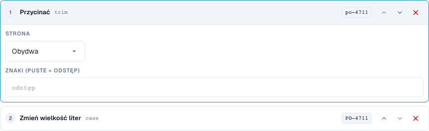
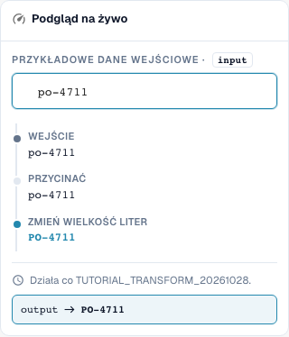
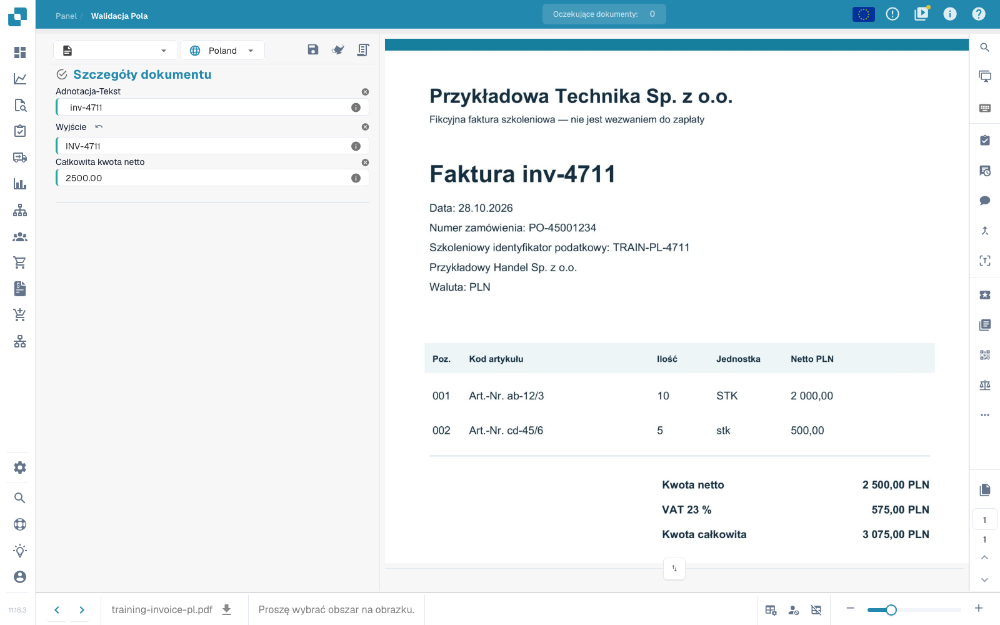

# Podstawy, zakresy zastosowania i bezpieczne testy

[Powrót do pełnego przeglądu praktycznego](complete-practical-guide.md)

Pole nagłówka · Cel Wynik · Źródło Tekst oryginalny · Przycięcie → Wielkie litery → Prefiks INV-.

## Etykiety widoczne w edytorze

Niektóre etykiety w aktualnym interfejsie są przetłumaczone niedokładnie. Tabela podaje faktycznie wyświetlany tekst, aby ułatwić znalezienie właściwego kroku; opis działania używa terminologii technicznej. Zrzuty pokazują niezmieniony interfejs.

| Operacja | Widoczna etykieta |
| --- | --- |
| trim | Przycinać |
| case | Zmień wielkość liter |

## Postępowanie w edytorze

1. W izolowanym typie dokumentu szkoleniowego utworzyć nową regułę dla **pole nagłówka**. Jako cel `output`, a jako oddzielne źródło `header.input` wybrać; faktyczne nazwy pól w organizacji mogą się różnić.
2. Dodać kroki **Przycinanie**, strona obie, puste pole znaku, a następnie **Zmień wielkość liter**, tryb upper. Kolejność musi być Przycinanie → Wielkie litery.
3. Wprowadzić wartość testową `  inv-4711  `. Ostatnia wartość podglądu musi brzmieć `INV-4711`; wartości pośrednie najpierw pokazują `inv-4711`.
4. Aktywować regułę wyłącznie w zakresie szkoleniowym i zapisać. Ponownie otworzyć wpis i skontrolować źródło, cel i oba kroki.
5. Zapisać dokument ćwiczeniowy, ponownie załadować i sprawdzić oba pola: Źródło nadal zawiera pierwotne spacje, wyjście brzmi `INV-4711`. Ponownie zapisać i powtórzyć tę samą kontrolę.

<figure><figcaption>
Konfiguracja kroków. Rzeczywisty interfejs w języku polskim. Podgląd nie zmienia zapisanych dokumentów.
</figcaption></figure>


Konfiguracja kroków. Rzeczywisty interfejs w języku polskim. Podgląd nie zmienia zapisanych dokumentów.


<figure><figcaption>
Podgląd na żywo z wartościami treningowymi. Rzeczywisty interfejs w języku polskim. Podgląd nie zmienia zapisanych dokumentów.
</figcaption></figure>


Podgląd na żywo z wartościami treningowymi. Rzeczywisty interfejs w języku polskim. Podgląd nie zmienia zapisanych dokumentów.


## 1. Zakres zastosowania

Transformacja zmienia już wyodrębnione dane. Nie zastępuje rozpoznawania tekstu. W edytorze najpierw wybieram zakres zastosowania. Pole nagłówka jest przetwarzane raz na dokument. Kolumna tabeli jest przetwarzana dla każdego wiersza. Reguły tabeli zmieniają całe pozycje. Routing przypisuje dokument do podjednostki organizacyjnej. Te cztery zadania mają różne cele i różne kroki. Moje przykłady tworzę we własnym typie dokumentu testowego, aby nie zmieniać produkcyjnych faktur.

## 2. Źródło i przetwarzanie

Następnie wybieram pole docelowe. Źródło może być tym samym polem lub innym polem. Kroki wykonują się od góry do dołu. Każda wartość pośrednia staje się wejściem następnego kroku. Mój przykład odczytuje numer faktury, usuwa zewnętrzne spacje i zapisuje wielkie litery. Z małej litery staje się wielka. Warunkiem ograniczam regułę do odpowiedniego dostawcy. W przypadku kolumny tabeli warunek może dodatkowo sprawdzać wartości bieżącego wiersza. Wiele warunków można łączyć za pomocą I, Lub i grup.

## 3. Sprawdzanie działania

Podgląd na żywo jeszcze nic nie zapisuje. Sprawdzam odpowiednią wartość, przypadek przeciwny i już skorygowany wynik. Następnie zapisuję regułę, ponownie ją otwieram i kontroluję zapisane ustawienia. Dla rzeczywistego działania na dokumencie potrzebuję dodatkowo dokumentu testowego, operacji zapisu i ponownie załadowanego wyniku. Podgląd nie dowodzi ani przeprowadzonego eksportu, ani udanego dopasowania zamówienia. Protokoły wykonania pomagają mi rozróżnić zastosowane i pominięte warunki. W kolejnych odcinkach przejdziemy przez poszczególne transformacje i ich ograniczenia.

## Sprawdzone przykłady i przypadki przeciwne

Te wartości zostały sprawdzone po stronie serwera jako suchy test. Taki test nie zmienia zapisanych dokumentów.

| Przypadek | Wejście | Wynik serwerowy |
| --- | --- | --- |
| copy | `  po-4711  ` | `PO-4711` |

## Akceptacja

Sprawdź odpowiedni przypadek, przypadek przeciwny, pustą wartość i już przetworzony wynik. Powtórz operację zapisu dokumentu. Sprawdź dodatkowo dopasowanie PO i odbiór ERP, jeśli należą do celu merytorycznego.

## Zapisane działanie na dokumencie ćwiczeniowym

<figure><figcaption>
Przygotowana wartość oryginalna pozostaje zachowana; wyjście pokazuje INV-4711. Dwie natywne operacje zapisu, ponowne załadowanie i osobne zapytanie serwerowe potwierdzają stabilny wynik. Dowodzi to działania reguły na przygotowanych wartościach testowych, a nie dokładności automatycznego wyodrębniania.
</figcaption></figure>


Przygotowana wartość oryginalna pozostaje zachowana; wyjście pokazuje INV-4711. Dwie natywne operacje zapisu, ponowne załadowanie i osobne zapytanie serwerowe potwierdzają stabilny wynik. Dowodzi to działania reguły na przygotowanych wartościach testowych, a nie dokładności automatycznego wyodrębniania.


## Samouczek wideo


Konfiguracja, przykłady praktyczne i przypadki przeciwne.


[Otwórz wideo z polskimi napisami i rozdziałami](https://docbits-videos.fra1.cdn.digitaloceanspaces.com/settings-assistant/transformation-rules-01-foundations-preview-admin/v1/pl.html). Ta wersja do przeglądu oczekuje na ocenę merytoryczną i pełny odsłuch.
