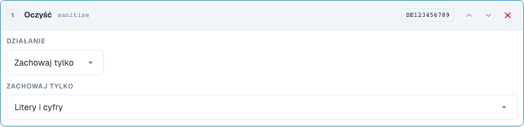
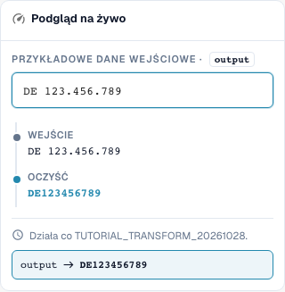

# Czyszczenie tekstu: wielkość liter, przycinanie i znaki

[Powrót do pełnego przeglądu praktycznego](complete-practical-guide.md)

Pole nagłówka · Docelowy wynik · Kroki testować pojedynczo: case, trim, sanitize.

## Etykiety widoczne w edytorze

Niektóre etykiety w aktualnym interfejsie są przetłumaczone niedokładnie. Tabela podaje faktycznie wyświetlany tekst, aby ułatwić znalezienie właściwego kroku; opis działania używa terminologii technicznej. Zrzuty pokazują niezmieniony interfejs.

| Operacja | Widoczna etykieta |
| --- | --- |
| case | Zmień wielkość liter |
| trim | Przycinać |
| sanitize | Oczyść |

## Postępowanie w edytorze

1. Dla szkoleniowego pola nagłówka utworzyć pojedynczy krok **Zmiana wielkości liter**. Tryby upper, lower, title i capitalize kolejno sprawdzić z przykładami z tabeli.
2. Dla numeru faktury nowy potok rozpocząć od **Przycinania**. Strona obie i puste pole znakowe usuwają zewnętrzną spację; `47 11` musi zachować swoją wewnętrzną lukę.
3. Jako osobna próba kontrolna przy przycinaniu ustawić stronę lewą i znak `0`: `004711` stanie się `4711`, `000` stanie się pusty. Tego kroku nie przyjmować bez sprawdzenia dla rzeczywistych identyfikatorów.
4. Przy identyfikatorze podatkowym użyć **Czyszczenie znaków** z zachowaniem alfanumerycznym. `DE 123.456.789` musi dać `DE123456789`. Pozostałe tryby zachowania sprawdzić z `DE-123` oraz `ACME GmbH!`.
5. Dla capitalize wyraźnie porównać podgląd i serwer: Przy sprawdzonym `aCME GMBH` te wyniki są różne. Wynik serwerowy to `Acme gmbh`; sama odpowiednia prezentacja przeglądarkowa nie wystarcza.

<figure><figcaption>
Konfiguracja kroków. Rzeczywisty interfejs w języku polskim. Podgląd nie zmienia zapisanych dokumentów.
</figcaption></figure>


Konfiguracja kroków. Rzeczywisty interfejs w języku polskim. Podgląd nie zmienia zapisanych dokumentów.


<figure><figcaption>
Podgląd na żywo z wartościami treningowymi. Rzeczywisty interfejs w języku polskim. Podgląd nie zmienia zapisanych dokumentów.
</figcaption></figure>


Podgląd na żywo z wartościami treningowymi. Rzeczywisty interfejs w języku polskim. Podgląd nie zmienia zapisanych dokumentów.


## 1. Wielkość liter

Wielkie litery ujednolicają na przykład numer faktury. Małe litery mogą ujednolicić techniczny klucz porównawczy. Title Case oraz wielkość pierwszego znaku mogą również zmienić resztę słowa. Z firmowego skrótu może więc powstać inna pisownia. Dla nazw własnych używam tych wariantów tylko przy jasnym wymogu merytorycznym. Przy trybie Capitalise first występuje w sprawdzonym stanie odchylenie: podgląd przeglądarki pozostawia pozostałą pisownię, podczas gdy serwer zapisuje resztę małymi literami. Nie polegam więc tu tylko na podglądzie, lecz wyraźnie porównuję wartość serwerową.

## 2. Przycinanie

Przycinanie usuwa znaki na brzegu. Obie strony usuwają zewnętrzne spacje, ale nie spację w środku numeru. Lewa ze znakiem zero usuwa wszystkie wiodące zera. Wartość składająca się tylko z zer staje się przez to pusta. Prawa działa odpowiednio na końcu. Pole Znak to zbiór pojedynczych znaków, a nie pełny prefiks. Stały prefiks artykułowy usuwam więc za pomocą Affix. Wypełnianie i obcinanie omawiamy w następnym odcinku.

## 3. Czyszczenie znaków

Przy czyszczeniu mogę zachować tylko litery i cyfry, tylko litery, tylko cyfry lub dodatkowo spacje. Niemiecki identyfikator podatkowy ze spacjami i kropkami staje się w ten sposób spójnym kluczem. Przy numerze artykułu myślniki mogą jednak być merytorycznie ważne. Usuwanie takich znaków musi odpowiadać pisowni w systemie docelowym. Alternatywne usuwanie znaków działa z wyrażeniem regularnym z klasą znaków. Myślnik wymaga w nim szczególnej uwagi. Dla mojego przykładu sprawdzam więc rzeczywistą wartość serwerową dodatkowo do podglądu. Już oczyszczone wartości i puste wejścia należą do każdego testu.

## Sprawdzone przykłady i przypadki kontrolne

Te wartości zostały sprawdzone po stronie serwera jako suchy test. Taki test nie zmienia zapisanych dokumentów.

| Przypadek | Wejście | Wynik serwerowy |
| --- | --- | --- |
| case-upper | `inv-4711` | `INV-4711` |
| case-upper | `INV-4711` | `INV-4711` |
| case-lower | `INFO@BEISPIEL.DE` | `info@beispiel.de` |
| case-title | `acme gmbh` | `Acme Gmbh` |
| case-capitalize | `aCME GMBH` | `Acme gmbh` |
| trim | `  4711  ` | `4711` |
| trim | `47 11` | `47 11` |
| trim-zero | `004711` | `4711` |
| trim-zero | `000` | `` |
| sanitize | `DE 123.456.789` | `DE123456789` |
| sanitize-alpha | `DE-123` | `DE` |
| sanitize-numeric | `DE-123` | `123` |
| sanitize-space | `ACME GmbH!` | `ACME GmbH` |
| sanitize-strip | `ab-12/3.` | `ab123` |

## Akceptacja

Sprawdź odpowiedni przypadek, przypadek kontrolny, pustą wartość i już przetworzony wynik. Powtórz operację zapisu dokumentu. Sprawdź dodatkowo dopasowanie PO i odbiór ERP, jeśli należą do celu merytorycznego.

## Samouczek wideo


Konfiguracja, przykłady praktyczne i przypadki przeciwne.


[Otwórz wideo z polskimi napisami i rozdziałami](https://docbits-videos.fra1.cdn.digitaloceanspaces.com/settings-assistant/transformation-rules-02-text-cleaning-preview-admin/v1/pl.html). Ta wersja do przeglądu oczekuje na ocenę merytoryczną i pełny odsłuch.
