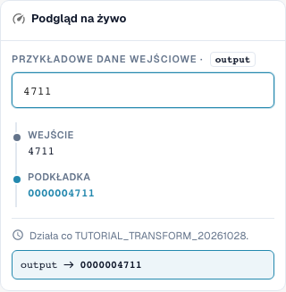

# Kształtowanie numerów: uzupełnianie, skracanie, prefiks i sufiks

> Znane ograniczenie podglądu (sprawdzone 29 października 2026 r., wersja 11.15.2): podczas dodawania prefiksu `INV-` podgląd błędnie zmienia `INV-4711` na `INV-INV-4711`. Niezależny test serwera zachowuje `INV-4711`. Sprawdź również wielokrotne wykonanie za pomocą testu serwera; poprawny wynik podglądu sam w sobie nie potwierdza pełnego wykonania podczas zapisywania.

[Powrót do pełnego przeglądu praktycznego](complete-practical-guide.md)

Pole nagłówka · pad: długość 10, znak 0, lewa; truncate: długość 10; affix: dokładna operacja prefiksowa/sufiksowa.

## Etykiety widoczne w edytorze

Niektóre etykiety w aktualnym interfejsie są przetłumaczone niedokładnie. Tabela podaje faktycznie wyświetlany tekst, aby ułatwić znalezienie właściwego kroku; opis działania używa terminologii technicznej. Zrzuty pokazują niezmieniony interfejs.

| Operacja | Widoczna etykieta |
| --- | --- |
| pad | Podkładka |
| truncate | Ścięty |
| affix | Afiks |

## Postępowanie w edytorze

1. Wybierz krok uzupełniania dla liczby. Ustaw minimalną długość 10, znak wypełniający `0` i stronę lewą. `4711` musi stać się `0000004711`.
2. Sprawdzić z już jedenastocyfrowym wejściem: uzupełnianie nie może niczego obcinać. Dla uzupełnień prawych osobno przetestować długość 6, znak `_` i wejście `ABC`.
3. W osobnej regule ustawić **skracanie** z maksymalną długością 10. `ABCDEFGHIJKL` stanie się `ABCDEFGHIJ`, `ABC` pozostanie zachowane. Sprawdzić, czy różne wejścia mogą po skróceniu dać ten sam identyfikator.
4. Przetestować **Affix** z dodaniem prefiksu `INV-`. Następnie sprawdzić wejście `INV-4711`: dokładny istniejący prefiks nie może być dodany ponownie.
5. Pozostałe warianty Affix skonfigurować osobno: dodanie sufiksu `-DE`, usunięcie prefiksu `Art.-Nr. ` i usunięcie sufiksu ` EUR`. Przy usuwaniu przetestować również niepasujący brzeg i odmienny zapis wielkimi literami.
6. Użyć wyjścia ponownie jako wejścia. Szczególnie przy usuwaniu wielokrotnie występujących afiksów drugie przejście może dalej zmienić wynik.

<figure><figcaption>
Konfiguracja kroków. Rzeczywisty interfejs w języku polskim. Podgląd nie zmienia zapisanych dokumentów.
</figcaption></figure>


Konfiguracja kroków. Rzeczywisty interfejs w języku polskim. Podgląd nie zmienia zapisanych dokumentów.


<figure><figcaption>
Podgląd na żywo z wartościami treningowymi. Rzeczywisty interfejs w języku polskim. Podgląd nie zmienia zapisanych dokumentów.
</figcaption></figure>


Podgląd na żywo z wartościami treningowymi. Rzeczywisty interfejs w języku polskim. Podgląd nie zmienia zapisanych dokumentów.


## 1. Długość

Uzupełnianie dopełnia z lewej lub prawej strony pojedynczym znakiem wypełniającym do minimalnej długości. Przy dziesięciu pozycjach i zerze z lewej z czterocyfrowego numeru powstaje dziesięciocyfrowy identyfikator. Już dłuższy numer pozostaje dłuższy. Uzupełnianie nie jest więc sprawdzaniem długości. Skracanie zachowuje natomiast tylko pierwsze znaki do wybranej maksymalnej długości. Te informacje przepadają. Przed wdrożeniem w ERP sprawdzam, czy różne numery mogą po skróceniu stać się identyczne. Krótkie wartości pozostają niezmienione.

## 2. Prefiks i sufiks

Poniższe wyniki operacji na prefiksach i sufiksach opisują zweryfikowane wykonanie po stronie serwera.

Affix oferuje cztery warianty: dodanie prefiksu, dodanie sufiksu, usunięcie prefiksu i usunięcie sufiksu. Dodany prefiks nie zostanie dołączony ponownie, gdy wartość już dokładnie nim zaczyna się. Odpowiednio dotyczy to sufiksu. Usuwanie sprawdza natomiast dokładnie początek lub koniec. Odmienny zapis wielkimi literami nie jest automatycznie utożsamiany. Tekst znajdujący się w środku wartości pozostaje zachowany. Do dowolnych wystąpień używam funkcji wyszukaj i zamień.

## 3. Ponowne zastosowanie

Nawet prosta potrzebuje testu powtórzeniowego. Jeśli usunę prefiks z podwójnie poprzedzonego prefiksem, po pierwszym przejściu pozostaje jeszcze jeden. Przy następnym przejściu również ten zniknie. Dlatego sprawdzam całą regułę, a nie tylko każdy krok osobno. Typowy potok numeracji faktur brzmi: przycięcie, zamiana na wielkie litery, dołączenie prefiksu. Testuję surowy numer, już gotowy numer i odmiennego dostawcę. Warunek zapewnia, że zmieniany jest tylko uzgodniony przypadek.

## Sprawdzone przykłady i przypadki przeciwne

Te wartości zostały sprawdzone po stronie serwera jako suchy test. Taki test nie zmienia zapisanych dokumentów.

| Przypadek | Wejście | Wynik serwera |
| --- | --- | --- |
| pad | `4711` | `0000004711` |
| pad | `12345678901` | `12345678901` |
| pad-right | `ABC` | `ABC___` |
| truncate | `ABCDEFGHIJKL` | `ABCDEFGHIJ` |
| truncate | `ABC` | `ABC` |
| prefix-add | `4711` | `INV-4711` |
| prefix-add | `INV-4711` | `INV-4711` |
| suffix-add | `4711` | `4711-DE` |
| suffix-add | `4711-DE` | `4711-DE` |
| prefix-strip | `Art.-Nr. 4711` | `4711` |
| prefix-strip | `ART.-NR. 4711` | `ART.-NR. 4711` |
| prefix-strip | `Art.-Nr. Art.-Nr. 4711` | `Art.-Nr. 4711` |
| suffix-strip | `123 EUR` | `123` |
| suffix-strip | `123 EUR netto` | `123 EUR netto` |

## Akceptacja

Sprawdź pasujący przypadek, przypadek przeciwny, pustą wartość i już przetworzony wynik. Powtórz operację zapisu dokumentu. Sprawdź dodatkowo dopasowanie PO i odbiór ERP, jeśli należą one do celu merytorycznego.

## Samouczek wideo


Konfiguracja, przykłady praktyczne i przypadki przeciwne.


[Otwórz wideo z polskimi napisami i rozdziałami](https://docbits-videos.fra1.cdn.digitaloceanspaces.com/settings-assistant/transformation-rules-03-numbers-and-affixes-preview-admin/v1/pl.html). Ta wersja do przeglądu oczekuje na ocenę merytoryczną i pełny odsłuch.
