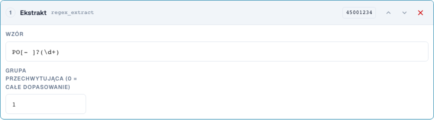
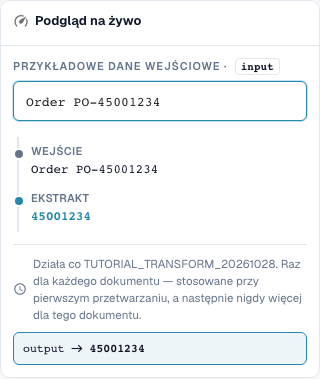

# Fragmenty i wzorce: wycinanie, ekstrahowanie, zamienianie

[Powrót do pełnego przeglądu praktycznego](complete-practical-guide.md)

Pole nagłówka · Źródło header.input · Cel output · regex_extract: PO[- ]?(\d+), grupa 1. Źródło i cel pozostają rozdzielone.

## Etykiety widoczne w edytorze

Niektóre etykiety w aktualnym interfejsie są przetłumaczone niedokładnie. Tabela podaje faktycznie wyświetlany tekst, aby ułatwić znalezienie właściwego kroku; opis działania używa terminologii technicznej. Zrzuty pokazują niezmieniony interfejs.

| Operacja | Widoczna etykieta |
| --- | --- |
| substring | Weź kawałek |
| regex_extract | Ekstrakt |
| regex_replace | Znajdź i zamień |

## Postępowanie w edytorze

1. Dla wszystkich trzech kroków wybrać cel, np. `output` oraz **osobne źródło oryginalne**, np. `header.input`. Również opcja „Tylko raz na dokument” nie zezwala na źródło własne.
2. Dla **fragmentu** najpierw ustawić początek 0 i długość 4: `2026-10-28` daje `2026`. Następnie sprawdzić początek 3 i koniec 7 z `DE-4711-X`; koniec nie wchodzi do wyniku.
3. Jako wariant własny przetestować początek −4 bez długości/końca: `INV-4711` daje `4711`. Krótsze wejście stanowi konieczny przypadek przeciwny.
4. Dla **ekstrahowania** użyć wzorca `PO[- ]?(\d+)` i grupy przechwytującej 1. `Order PO-45001234` daje `45001234`; `Invoice 4711` daje pusty. Grupa 0 dostarcza natomiast całe dopasowanie.
5. Dla **szukaj i zamień** skonfigurować wzorzec `\s+`, zamiennik jedna spacja i liczbę 0. `ACME    GmbH` musi dać `ACME GmbH`. Następnie sprawdzić wzorzec `-`, zamiennik `/`, liczbę 1 z `AB-CD-EF`: zamieniony zostanie tylko pierwszy myślnik.
6. Konkretne wzorce przetestować również po stronie serwera. Samodzielnie udany wzorzec w przeglądarce nie potwierdza identycznej obróbki serwerowej przy wyrażeniach złożonych.

<figure><figcaption>
Konfiguracja kroków. Rzeczywisty interfejs w języku polskim. Podgląd nie zmienia zapisanych dokumentów.
</figcaption></figure>


Konfiguracja kroków. Rzeczywisty interfejs w języku polskim. Podgląd nie zmienia zapisanych dokumentów.


<figure><figcaption>
Podgląd na żywo z wartościami treningowymi. Rzeczywisty interfejs w języku polskim. Podgląd nie zmienia zapisanych dokumentów.
</figcaption></figure>


Podgląd na żywo z wartościami treningowymi. Rzeczywisty interfejs w języku polskim. Podgląd nie zmienia zapisanych dokumentów.


## 1. Fragment

Fragment określa się przez początek i długość lub przez początek i koniec. Pierwszy indeks jest zerowy. Koniec nie należy już do wyniku. Ujemny początek liczy się od prawej krawędzi. Dla ostatnich czterech znaków używam początku minus cztery i brak końca. Wybieram inną źródło niż cel. Dzięki temu każde przejście ponownie odczytuje tekst oryginalny. Serwer odrzuca te kroki na własnym polu docelowym, ponieważ wartość mogłaby być wówczas przy ponownym przetwarzaniu zmieniana w nieskończoność. Wykonanie jednorazowe nie zastępuje tu tego rozdzielonego źródła.

## 2. Ekstrahowanie

Ekstrahowanie wyszukuje pierwsze dopasowanie wyrażenia regularnego. Mój wzorzec rozpoznaje litery P i O, opcjonalnie myślnik lub spację, a następnie cyfry. Grupa pierwsza dostarcza tylko cyfry, grupa zerowa całe dopasowanie. Bez dopasowania zwracany jest pusty ciąg znaków. Stosuję zatem odpowiedni warunek lub świadomie sprawdzam, czy pusta wartość docelowa jest w tym przypadku pożądana. Wiele numerów zamówień w jednym tekście nie zamienia się automatycznie na wiele wyników.

## 3. Zamienianie

Szukaj i zamień przetwarza dopasowania wzorca. Przy liczbie zero zamieniane są wszystkie dopasowania. Jeden zmienia tylko pierwsze dopasowanie. Wielokrotne spacje mogę zamienić na pojedynczą spację. Również tu używam osobnego źródła oryginalnego. Podgląd w przeglądarce i obróbka na serwerze mogą przy wymagających wyrażeniach regularnych stosować różne reguły. Dlatego testuję najpierw proste wzorce, a następnie porównuję faktyczną wartość serwerową. Odpowiedni przypadek, brak dopasowania i wiele dopasowań stanowią moją minimalną weryfikację.

## Sprawdzone przykłady i przypadki przeciwne

Wartości te zostały sprawdzone po stronie serwera jako suchy test. Taki test nie zmienia zapisanych dokumentów.

| Przypadek | Wejście | Wynik serwerowy |
| --- | --- | --- |
| substring | `2026-10-28` | `2026` |
| substring | `AB` | `AB` |
| substring-end | `DE-4711-X` | `4711` |
| substring-negative | `INV-4711` | `4711` |
| regex-extract | `Order PO-45001234` | `45001234` |
| regex-extract | `Invoice 4711` | `` |
| regex-replace | `ACME    GmbH` | `ACME GmbH` |
| regex-count | `AB-CD-EF` | `AB/CD-EF` |

## Akceptacja

Sprawdź odpowiedni przypadek, przypadek przeciwny, pustą wartość oraz już przetworzony wynik. Powtórz operację zapisu dokumentu. Sprawdź dodatkowo dopasowanie PO i odbiór ERP, jeśli należą do celu merytorycznego.

## Samouczek wideo


Konfiguracja, przykłady praktyczne i przypadki przeciwne.


[Otwórz wideo z polskimi napisami i rozdziałami](https://docbits-videos.fra1.cdn.digitaloceanspaces.com/settings-assistant/transformation-rules-04-substrings-and-patterns-preview-admin/v1/pl.html). Ta wersja do przeglądu oczekuje na ocenę merytoryczną i pełny odsłuch.
