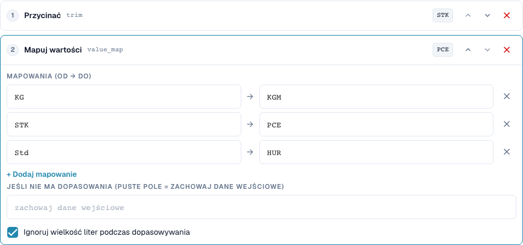
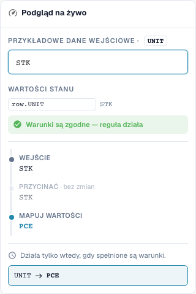

# Mapowania wartości i reguły dla każdego wiersza tabeli

[Powrót do pełnego przeglądu praktycznego](complete-practical-guide.md)

Kolumna tabeli UNIT · Przycięcie → value_map: STK→PCE, KG→KGM, Std→HUR · Ignorowanie wielkości liter.

## Etykiety widoczne w edytorze

Niektóre etykiety w aktualnym interfejsie są przetłumaczone niedokładnie. Tabela podaje faktycznie wyświetlany tekst, aby ułatwić znalezienie właściwego kroku; opis działania używa terminologii technicznej. Zrzuty pokazują niezmieniony interfejs.

| Operacja | Widoczna etykieta |
| --- | --- |
| trim | Przycinać |
| value_map | Mapuj wartości |

## Postępowanie w edytorze

1. Wybrać zakres **kolumna tabeli**, tabelę `INVOICE_TABLE` i kolumnę docelową `UNIT`. Tutaj każdy wiersz tabeli jest przetwarzany osobno.
2. Ustawić **Przycięcie** przed **Mapowaniem wartości**. Wprowadzić pary `STK→PCE`, `KG→KGM` i `Std→HUR` oraz aktywować ignorowanie wielkości liter.
3. Pozostawić puste pole dla wartości zastępczej bez dopasowania, aby nieznane kody zostały zachowane. `stk` musi dać `PCE`, `BOX` musi pozostać `BOX`.
4. Sprawdzić podgląd z pasującym warunkiem wiersza oraz z niepasującym warunkiem. Warunek nie może niechcący przechwycić innych wierszy.
5. Dla prawdziwej próby wielowierszowej przygotować wartości wyjściowe `STK`, `STK`, `BOX`. W sprawdzonym teście serwerowym powstaje `PCE`, `PCE`, `BOX`; ilość i cena wymagają oddzielnej weryfikacji merytorycznej.
6. Sprawdzić każdy kod docelowy ponownie jako wejście. Powszechna wartość zastępcza jak `C62` oraz połączone mapowania mogą ukryć nieznane wartości lub przy kolejnych przebiegach dalej je zmieniać.

<figure><figcaption>
Konfiguracja kroków. Rzeczywisty interfejs w języku polskim. Podgląd nie zmienia zapisanych dokumentów.
</figcaption></figure>


Konfiguracja kroków. Rzeczywisty interfejs w języku polskim. Podgląd nie zmienia zapisanych dokumentów.


<figure><figcaption>
Podgląd na żywo z wartościami treningowymi. Rzeczywisty interfejs w języku polskim. Podgląd nie zmienia zapisanych dokumentów.
</figcaption></figure>


Podgląd na żywo z wartościami treningowymi. Rzeczywisty interfejs w języku polskim. Podgląd nie zmienia zapisanych dokumentów.


## 1. Pary wartości

Mapowanie wartości tłumaczy całe wartości wejściowe. Mój przykład przypisuje kod P C E sztuce, kod K G M kilogramowi i kod H U R godzinie. Wprowadzam rzeczywiste kody dostawcy oraz oczekiwane kody docelowe jako pary. Przy zignorowanej wielkości liter rozpoznawany jest również małymi literami zapisany kod. Nie usuwa to jeszcze spacji. Dlatego umieszczam krok przycięcia przed mapowaniem. Nieznanego kodu testuję wyraźnie.

## 2. Bez dopasowania

Puste pole dla wartości bez dopasowania oznacza: zachowaj wejście. Nie oznacza: usuń wejście. Wpisana na stałe wartość zastępcza zastępuje natomiast każdy nieznany kod. Może to ukryć błędy. Przy różnych jednostkach merytorycznie nie przypisywałbym powszechnego kodu zastępczego. Mapowanie nie jest też automatycznie idempotentne w każdej kombinacji. Jeśli wyjście jednej pary jest jednocześnie wejściem innej pary, kolejny przebieg może dalej mapować. Dlatego testuję również każdy kod docelowy jako nowe wejście.

## 3. Dla każdego wiersza tabeli

Dla tabel wybieram konkretną tabelę i kolumnę docelową. Potok uruchamia się wtedy dla każdego wiersza. Warunek może połączyć kod jednostki bieżącego wiersza z atrybutem dostawcy z nagłówka. W przykładzie dwie pasujące wiersze są zmieniane, podczas gdy nieznany kod jednostki pozostaje zachowany. Nie zmienia to ilości ani cen przez przeliczenie jednostkowe. Zmiana ciągu znaków nie jest przeliczeniem matematycznym. Rzeczywiste sprawdzenie zgodności zamówienia oraz eksport weryfikuję oddzielnie od transformacji.

## Sprawdzone przykłady i przypadki przeciwne

Wartości te zostały sprawdzone po stronie serwera jako suchy test. Taki test nie zmienia zapisanych dokumentów.

| Przypadek | Wejście | Wynik serwera |
| --- | --- | --- |
| map | `stk` | `PCE` |
| map | `PCE` | `PCE` |
| map | `BOX` | `BOX` |
| map-fallback | `BOX` | `C62` |
| item-pipeline | `Art.-Nr. ab-12/3` | `AB123` |

## Akceptacja

Sprawdź przypadek pasujący, przypadek przeciwny, pustą wartość oraz już przetworzony wynik. Powtórz operację zapisu dokumentu. Sprawdź dodatkowo zgodność PO i odbiór ERP, jeśli należą do celu merytorycznego.

## Samouczek wideo


Konfiguracja, przykłady praktyczne i przypadki przeciwne.


[Otwórz wideo z polskimi napisami i rozdziałami](https://docbits-videos.fra1.cdn.digitaloceanspaces.com/settings-assistant/transformation-rules-05-value-mapping-preview-admin/v1/pl.html). Ta wersja do przeglądu oczekuje na ocenę merytoryczną i pełny odsłuch.
