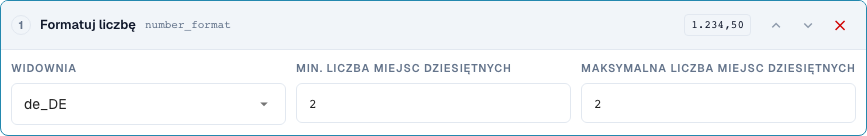
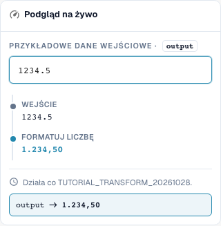

# Prawidłowe formatowanie dat i liczb

[Powrót do pełnego przeglądu praktycznego](complete-practical-guide.md)

Cel tekstowy · date_format: %d.%m.%Y; number_format: de_DE, min. 2, max. 2 miejsc po przecinku.

## Etykiety widoczne w edytorze

Niektóre etykiety w aktualnym interfejsie są przetłumaczone niedokładnie. Tabela podaje faktycznie wyświetlany tekst, aby ułatwić znalezienie właściwego kroku; opis działania używa terminologii technicznej. Zrzuty pokazują niezmieniony interfejs.

| Operacja | Widoczna etykieta |
| --- | --- |
| date_format | Data formatowania |
| number_format | Formatuj liczbę |

## Postępowanie w edytorze

1. Dla dobrze czytelnej pierwszej próby użyć **celu tekstowego** i kroku **Formatowanie daty**. Ustawić wzorzec wyjściowy `%d.%m.%Y` i wejście `2026-10-28`; oczekiwane jest `28.10.2026`.
2. Porównać warianty `%m/%d/%Y`, `%Y-%m-%d` oraz `%d %b %Y` z tym samym jednoznacznym wejściem. Wzorce nie stanowią niezawodnego rozpoznawania każdego dowolnego formatu daty.
3. Sprawdzić kontrsprawdzeniem za pomocą `kein Datum` oraz wejścia wieloznacznego. Przy rzeczywistym polu nagłówka DATE dodatkowo oddzielnie skontrolować zapisaną wartość ISO oraz widoczną prezentację.
4. W osobnej regule **Formatowanie liczby**, wybrać ustawienia regionalne `de_DE`, minimalną i maksymalną liczbę miejsc po przecinku odpowiednio 2. Wejście serwerowe `1234.5` musi dać `1234,50`.
5. Sprawdzić to samo wejście za pomocą `en_US`: wynik serwerowy `1234.50`. Separator tysięcy w weryfikowanym podglądzie przeglądarki nie jest zapisywany po stronie serwera.
6. Sprawdzić zero, ujemną kwotę oraz dodatkowe miejsca po przecinku. Następnie ponownie przetworzyć wyjście i skontrolować faktycznie zapisaną wartość.

<figure><figcaption>
Konfiguracja kroków. Rzeczywisty interfejs w języku polskim. Podgląd nie zmienia zapisanych dokumentów.
</figcaption></figure>


Konfiguracja kroków. Rzeczywisty interfejs w języku polskim. Podgląd nie zmienia zapisanych dokumentów.


<figure><figcaption>
Podgląd na żywo z wartościami treningowymi. Rzeczywisty interfejs w języku polskim. Podgląd nie zmienia zapisanych dokumentów. Widoczny separator tysięcy należy do podglądu przeglądarki; zweryfikowany wynik serwera to 1234,50.
</figcaption></figure>


Podgląd na żywo z wartościami treningowymi. Rzeczywisty interfejs w języku polskim. Podgląd nie zmienia zapisanych dokumentów. Widoczny separator tysięcy należy do podglądu przeglądarki; zweryfikowany wynik serwera to 1234,50.


## 1. Data i typ danych

Ponowne formatowanie daty zapisuje datę zgodnie z wybranym wzorcem. Jednoznaczna data ISO stanowi dobre wejście testowe. Dzień, miesiąc i rok można na przykład wyświetlić z kropkami. Przy rzeczywistym polu nagłówka daty wartość wewnętrzna może pozostać w formacie ISO, podczas gdy zmienia się wyświetlanie. Pole tekstowe lub komórka tabeli może natomiast zawierać sformatowany tekst. Dlatego porównuję nie tylko widoczne pole, ale także zapisaną wartość i późniejsze wykorzystanie.

## 2. Nieczytelne i wieloznaczne dane

Nieczytelna data nie jest po prostu wymyślana. W moim teście serwerowym tekst pozostaje niezmieniony, a wynik podaje przyczynę. Wieloznaczne dane, takie jak dzień i miesiąc z małymi liczbami, wymagają jednoznacznie uzgodnionego kontekstu. Sformatowana data nie może przy kolejnym zapisaniu zostać odczytana jako inny dzień. Sprawdzam dlatego drugie przejście. Z dowolnego tekstu bez prawidłowej daty ta transformacja nie może stworzyć niezawodnej daty.

## 3. Format liczby

Formatowanie liczb używa ustawień regionalnych oraz minimalnej oraz maksymalnej liczby miejsc po przecinku. Zmienia to prezentację oraz ewentualnie zaokrąglenie, ale nie kurs wymiany ani jednostkę miary. Dla mojego wejścia tysiąc dwieście trzydzieści cztery przecinek pięć aktualny serwer z dwoma miejscami po przecinku dostarcza niemieckiego zapisu z przecinkiem lub angielskiego zapisu z kropką. Separator tysięcy nie jest zawarty w weryfikowanym wyniku serwerowym. Nie przyjmuję dlatego ładniejszej prezentacji przeglądarki jako dowodu dla eksportu. Zero, ujemne kwoty, dodatkowe miejsca po przecinku oraz zapisany wynik wartości wymagają własnych testów.

## Sprawdzone przykłady i przypadki przeciwne

Te wartości zostały sprawdzone po stronie serwera jako suchy test. Taki test nie zmienia zapisanych dokumentów.

| Przypadek | Wejście | Wynik serwerowy |
| --- | --- | --- |
| date | `2026-10-28` | `28.10.2026` |
| date | `kein Datum` | `kein Datum` |
| number-de | `1234.5` | `1234,50` |
| number-us | `1234.5` | `1234.50` |

## Akceptacja

Sprawdź odpowiedni przypadek, przypadek przeciwny, pustą wartość oraz już przetworzony wynik. Powtórz operację zapisu dokumentu. Sprawdź dodatkowo uzgodnienie PO i odbiór ERP, jeśli należą one do celu merytorycznego.

W weryfikowanym stanie podgląd liczb i serwer różnią się w zakresie separatorów tysięcy. Tabela podaje faktyczną wartość serwerową.

## Samouczek wideo


Konfiguracja, przykłady praktyczne i przypadki przeciwne.


[Otwórz wideo z polskimi napisami i rozdziałami](https://docbits-videos.fra1.cdn.digitaloceanspaces.com/settings-assistant/transformation-rules-06-dates-and-numbers-preview-admin/v1/pl.html). Ta wersja do przeglądu oczekuje na ocenę merytoryczną i pełny odsłuch.
