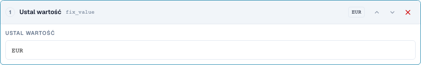
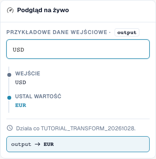
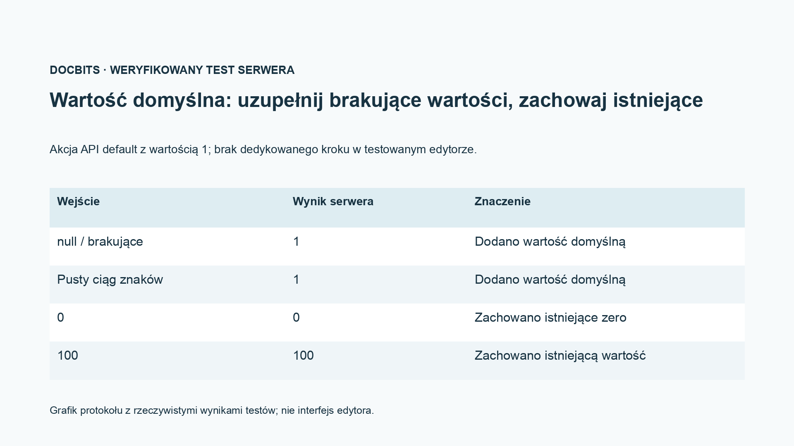

# Przejmowanie pól, wartości stałe, opróżnianie i wartości domyślne

[Powrót do pełnego przeglądu praktycznego](complete-practical-guide.md)

Cel Wynik · Źródło Oryginalny tekst do przejęcia pola; wartość stała tylko przy ścisłym warunku; opróżnianie testować osobno.

## Etykiety widoczne w edytorze

Niektóre etykiety w aktualnym interfejsie są przetłumaczone niedokładnie. Tabela podaje faktycznie wyświetlany tekst, aby ułatwić znalezienie właściwego kroku; opis działania używa terminologii technicznej. Zrzuty pokazują niezmieniony interfejs.

| Operacja | Widoczna etykieta |
| --- | --- |
| trim | Przycinać |
| case | Zmień wielkość liter |
| fix_value | Ustal wartość |
| clear | Wyczyść |

## Postępowanie w edytorze

1. Dla **przejęcia pola** wybrać inne pole źródłowe niż pole docelowe. W zakresie ćwiczenia celem jest `output`, źródłem `header.input`.
2. Skonfigurować kroki Przycięcie → Wielkie litery i przetestować `  po-4711  `. Wyjście będzie `PO-4711`; źródło oryginalne nie może przy tym zostać opróżnione.
3. Dla produkcyjnego numeru zamówienia użyć dodatkowego warunku, który działa tylko przy pustym celu. Przetestować już istniejącą poprawną wartość docelową jako przypadek przeciwny.
4. W osobnej regule utworzyć **wartość stałą** z `EUR`. Nawet wejście `USD` zostanie przez to nadpisane; to nie jest przeliczenie walutowe.
5. **Opróżnianie** sprawdzić osobno za pomocą `Altwert`. Wyjście to pusty ciąg znaków. Zwrócić uwagę na merytoryczną różnicę między celowym opróżnieniem a brakującą wartością wyjściową.
6. Krok interfejsowy `default` testować tylko przez przeznaczony do tego kontrakt API; w sprawdzanym normalnym menu kroków nie ma dla niego osobnego wpisu. Grafika protokołu pokazuje: brakujące i puste są uzupełniane, `0` i `100` pozostają zachowane.

<figure><figcaption>
Konfiguracja kroków. Rzeczywisty interfejs w języku polskim. Podgląd nie zmienia zapisanych dokumentów.
</figcaption></figure>


Konfiguracja kroków. Rzeczywisty interfejs w języku polskim. Podgląd nie zmienia zapisanych dokumentów.


<figure><figcaption>
Podgląd na żywo z wartościami treningowymi. Rzeczywisty interfejs w języku polskim. Podgląd nie zmienia zapisanych dokumentów.
</figcaption></figure>


Podgląd na żywo z wartościami treningowymi. Rzeczywisty interfejs w języku polskim. Podgląd nie zmienia zapisanych dokumentów.


## 1. Przejęcie pola

Dla przejęcia pola wybieram najpierw pole docelowe, a potem inną źródło. Gdy numer zamówienia znajduje się w niewłaściwym polu, mogę go odczytać z tego pola, przyciąć i zapisać we właściwym polu docelowym. Warunek cel jest pusty chroni już istniejący numer zamówienia. Źródło pozostaje zachowane. To jest kopia z przetwarzaniem, a nie przeniesienie. Sprawdzam pusty cel, już wypełniony cel i puste źródło.

## 2. Wartość stała i opróżnianie

Wartość stała ignoruje dotychczasową zawartość. Ustawiając walutę na Euro, reguła nadpisuje również istniejącą inną walutę. Do tego potrzebuję ścisłego warunku merytorycznego. Opróżnianie zapisuje pusty ciąg znaków w polu docelowym. To nie jest usunięcie całego pola lub dokumentu. W podglądzie sprawdzam przede wszystkim przypadek przeciwny, aby reguła nie usuwała prawidłowych wartości. Samo zapisanie reguły jeszcze nie dowodzi zmiany dokumentu.

## 3. Wartości domyślne

Interfejs serwerowy obsługuje dodatkowo akcję wartości domyślnej. Uzupełnia ona wartość tylko przy brakującym lub pustym wejściu. Istniejące zero pozostaje zerem. Ta akcja nie jest obecna w sprawdzanej wyborze kroków normalnego edytora jako osobny krok. W edytorze pożądany przypadek domyślny mogę często odwzorować warunkiem cel jest pusty i wartością stałą. Pokazuję to rozróżnienie otwarcie i nie twierdzę o dodatkowym punkcie menu. Wartość domyślna to zawsze decyzja merytoryczna, szczególnie przy podstawie ceny, ilości lub walucie.

## Sprawdzone przykłady i przypadki przeciwne

Te wartości zostały sprawdzone po stronie serwera jako suchy test. Taki test nie zmienia zapisanych dokumentów.

| Przypadek | Wejście | Wynik serwera |
| --- | --- | --- |
| fixed | `USD` | `EUR` |
| fixed | `null` | `EUR` |
| clear | `Altwert` | `` |
| clear | `` | `` |
| default-api | `null` | `1` |
| default-api | `` | `1` |
| default-api | `0` | `0` |
| default-api | `100` | `100` |
| copy | `  po-4711  ` | `PO-4711` |

## Akceptacja

Sprawdź odpowiedni przypadek, przypadek przeciwny, pustą wartość i już przetworzony wynik. Powtórz operację zapisu dokumentu. Sprawdź dodatkowo uzgodnienie PO i odbiór ERP, jeśli należą one do celu merytorycznego.

<figure><figcaption>
Rzeczywiste wyniki testów serwera i trwałości pokazane jako grafik protokołu. Nie jest to odtworzony interfejs edytora.
</figcaption></figure>


Rzeczywiste wyniki testów serwera i trwałości pokazane jako grafik protokołu. Nie jest to odtworzony interfejs edytora.


## Samouczek wideo


Konfiguracja, przykłady praktyczne i przypadki przeciwne.


[Otwórz wideo z polskimi napisami i rozdziałami](https://docbits-videos.fra1.cdn.digitaloceanspaces.com/settings-assistant/transformation-rules-07-field-copy-and-defaults-preview-admin/v1/pl.html). Ta wersja do przeglądu oczekuje na ocenę merytoryczną i pełny odsłuch.
