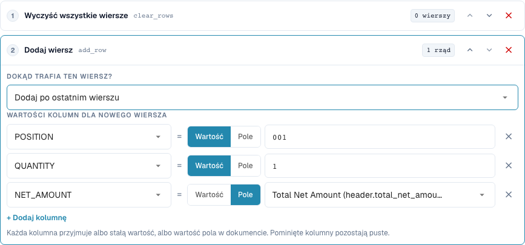
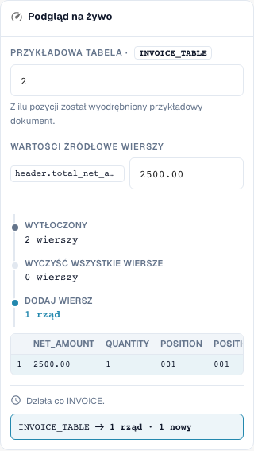

# Odbudowa wierszy tabeli

[Powrót do pełnego przeglądu praktycznego](complete-practical-guide.md)

Tabela INVOICE_TABLE · clear_rows → add_row na końcu · POSITION=001, QUANTITY=1, NET_AMOUNT z header.total_net_amount.

## Etykiety widoczne w edytorze

Niektóre etykiety w aktualnym interfejsie są przetłumaczone niedokładnie. Tabela podaje faktycznie wyświetlany tekst, aby ułatwić znalezienie właściwego kroku; opis działania używa terminologii technicznej. Zrzuty pokazują niezmieniony interfejs.

| Operacja | Widoczna etykieta |
| --- | --- |
| clear_rows | Wyczyść wszystkie wiersze |
| add_row | Dodaj wiersz |

## Postępowanie w edytorze

1. Wybrać zakres **Wiersze tabeli** oraz konkretną tabelę `INVOICE_TABLE`. Odpowiedni warunek dostawcy ogranicza pełną odbudowę.
2. Najpierw skonfigurować **Usuń wszystkie wiersze**, następnie **Dodaj wiersz**. Dla nowego wiersza ustawić wartości stałe `POSITION=001`, `QUANTITY=1` oraz dla `NET_AMOUNT` źródło `header.total_net_amount`.
3. Przetestować z kwotą nagłówkową `2500.00` i dwoma istniejącymi wierszami: pozostaje dokładnie nowo zdefiniowany wiersz sumaryczny. Sprawdzić również brakującą kwotę nagłówkową, zanim reguła zostanie aktywowana.
4. Przy dodawaniu porównać pozycję przed pierwszym lub po ostatnim wierszu. Dla tej próby pozycyjnej usunąć wcześniejsze usuwanie lub przetestować osobno, w przeciwnym razie nie ma istniejącego wiersza jako odniesienia.
5. Celowo sprawdzić odwrotną kolejność kroków **Dodaj → Usuń** jako przypadek przeciwny: wynik jest pusty. Następnie przywrócić zamierzoną kolejność.
6. Sprawdzić dwukrotne zapisanie. Dodawanie bez wcześniejszego usuwania może zwielokrotnić wiersze; odbudowa może nieodwracalnie usunąć pozycje dostawcy z wyniku pracy. Odbiór uzgodnienia zamówień przeprowadzić osobno.

<figure><figcaption>
Konfiguracja kroków. Rzeczywisty interfejs w języku polskim. Podgląd nie zmienia zapisanych dokumentów.
</figcaption></figure>


Konfiguracja kroków. Rzeczywisty interfejs w języku polskim. Podgląd nie zmienia zapisanych dokumentów.


<figure><figcaption>
Podgląd na żywo z wartościami treningowymi. Rzeczywisty interfejs w języku polskim. Podgląd nie zmienia zapisanych dokumentów.
</figcaption></figure>


Podgląd na żywo z wartościami treningowymi. Rzeczywisty interfejs w języku polskim. Podgląd nie zmienia zapisanych dokumentów.


## 1. Budowanie wierszy

Usuń wszystkie wiersze usuwa istniejące wiersze wybranej tabeli. Dodaj wiersz następnie buduje nowy wiersz. Dla każdej kolumny wybieram albo wartość stałą, albo wartość pola nagłówkowego. W moim przykładzie powstaje pozycja sumaryczna z ilością jeden i kwotą netto z nagłówka faktury. Niewypełnione kolumny pozostają puste. Nowy wiersz może stać na początku lub na końcu. To nie jest automatyczne grupowanie lub sumowanie wybranych istniejących pozycji.

## 2. Kolejność kroków

Kolejność jest decydująca. Usunięcie i następnie dodanie daje pożądany nowy wiersz. Dodanie i następnie usunięcie usuwa również właśnie utworzony wiersz. Bez poprzedzającego usunięcia kolejny przebieg dołączyłby kolejny wiersz. Dlatego reguła wymaga odpowiedniego wykonania jednorazowego. Podgląd z liczbą wierszy sprawdza strukturę, ale nie zastępuje jeszcze testu z prawdziwą wyekstrahowaną tabelą. Kontroluję wartości kolumn i liczbę wierszy po zapisaniu.

## 3. Osobne sprawdzenie uzgodnienia zamówień

Reguła tabeli wykonuje się przed regułami kolumn. Dlatego następcza reguła kolumny może również oczyścić nowo dodane wiersze. Odbudowa pozycji może zmienić istniejące identyfikatory wierszy i przypisania zamówień. Dla faktury, która jest świadomie uzgadniana z kwotą całkowitą, potrzebuję dodatkowo odpowiedniej reguły uzgodnienia zamówień. Samo przekształcenie nie potwierdza pełnego uzgodnienia. Testuję to tylko z izolowanym dokumentem i sprawdzam po ponownym zapisaniu liczbę wierszy oraz status uzgodnienia osobno.

## Odbiór

Sprawdź odpowiedni przypadek, przypadek przeciwny, pustą wartość oraz już przetworzony wynik. Powtórz operację zapisu dokumentu. Sprawdź dodatkowo uzgodnienie PO i odbiór ERP, jeśli należą do celu merytorycznego.

## Samouczek wideo


Konfiguracja, przykłady praktyczne i przypadki przeciwne.


[Otwórz wideo z polskimi napisami i rozdziałami](https://docbits-videos.fra1.cdn.digitaloceanspaces.com/settings-assistant/transformation-rules-08-table-rows-preview-admin/v1/pl.html). Ta wersja do przeglądu oczekuje na ocenę merytoryczną i pełny odsłuch.
