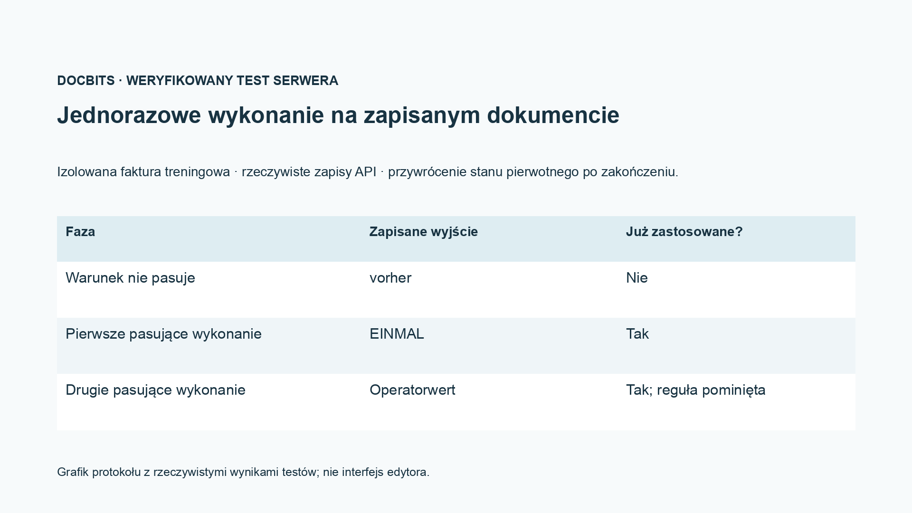
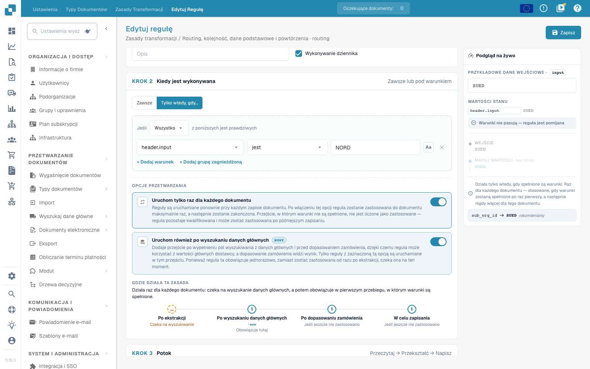

# Routing, kolejność, dane podstawowe i powtórzenia

[Powrót do pełnego przeglądu praktycznego](complete-practical-guide.md)

Routing · Docelowy pododdział · użyj istniejącego celu; warunki, fazy wykonania i powtórzenia sprawdź oddzielnie.

W nagraniu wideo nazwa i wewnętrzny identyfikator istniejącego celu routingu są ukryte. Dla własnej konfiguracji cel musi pochodzić z rzeczywiście dostępnego wyboru pododdziałów.

## Postępowanie w edytorze

1. Dla **Routing** wybrać oferowany atrybut dokumentu `sub_org_id`. Używać wyłącznie rzeczywiście istniejącego pododdziału jako stałego celu lub jako wyniku mapowania wartości.
2. Uzupełnić odpowiedni warunek dostawcy lub identyfikatora. W przykładzie ćwiczeniowym `NORD` musi spełnić warunek, a `SUED` go pominąć. Nagranie pokazuje tylko podgląd i nie przesuwa żadnych produkcyjnych dokumentów.
3. Porównać wskaźnik faz z przebiegiem: pole nagłówka → routing → wiersze tabeli → kolumna tabeli. Priorytet i klucz reguły porządkują tylko w obrębie tego samego obszaru.
4. Aktywować **Wykonaj również po wyszukiwaniu danych podstawowych** i zwrócić uwagę na dodatkową fazę przed porównaniem zamówień. Źródło, które pochodzi dopiero z danych podstawowych, wymaga odpowiedniego przebiegu.
5. **Tylko raz na dokument** najpierw sprawdzić z niespełnionym warunkiem, następnie wykonać po raz pierwszy z pasującym. W zweryfikowanym przypadku szkoleniowym pierwszy pominięty przebieg nie zużywa zastosowania.
6. Po pierwszym pasującym zastosowaniu wprowadzić wartość operatora i zapisać ponownie. Test musi wykazać, że reguła jednorazowa nie nadpisze tej wartości ponownie; sprawdzić warunek, wynik, fazę i dowód zastosowania w protokole.

## 1. Pododdział

Routing zapisuje obecnie pododdział dokumentu. Mogę ustawić stały cel z dostępnego wyboru lub zmapować wartość źródłową na pododdział. Odpowiedni warunek dostawcy ogranicza przypisanie. Nie jest to ani uprawnienie użytkownika, ani decyzja o zatwierdzeniu. Używam tylko ważnych, istniejących pododdziałów i sprawdzam przypadek przeciwny. W tej sekwencji przykład routingu pozostaje podglądem; nie przesuwa produkcyjnych dokumentów.

## 2. Fazy wykonania

Zakresy obowiązywania przebiegają w kolejności: pole nagłówka, routing, wiersze tabeli i kolumna tabeli. W obrębie jednego obszaru obowiązują priorytet i klucz reguły. Wyczyszczone źródło nagłówka może więc być już odczytane przez routing. Dzięki dodatkowemu wykonaniu po wyszukiwaniu w danych podstawowych reguła może używać wartości, które zostaną uzupełnione dopiero z danych podstawowych. Ta opcja dodaje przebieg przed porównaniem zamówień. Nie przesuwa tam wszystkich pozostałych wykonań.

## 3. Reguły jednorazowe i dowód

Wykonaj tylko raz na dokument ogranicza rzeczywiście zastosowaną regułę. Niespełniony warunek jeszcze nie zużywa tego wykonania. Wraz z opcją wyszukiwania reguła czeka przy pierwszym przebiegu ekstrakcji na późniejszą fazę. Dla fragmentów i wyrażeń regularnych oddzielne źródło pozostaje mimo to wymagane. Sprawdzam pierwsze zastosowanie, przypadek niepasujący i ponowne zapisanie. W protokole szukam warunku, wyniku i fazy wykonania. Dopiero nowo załadowany dokument potwierdza zapisany efekt. Wpływ do ERP i porównanie zamówień wymagają każdy własnego dowodu.

## Akceptacja

Sprawdź przypadek pasujący, przypadek przeciwny, pustą wartość i już przetworzony wynik. Powtórz operację zapisu dokumentu. Sprawdź dodatkowo porównanie PO i odbiór ERP, jeśli należą do celu merytorycznego.

<figure><figcaption>
Rzeczywiste wyniki testów serwera i trwałości pokazane jako grafik protokołu. Nie jest to odtworzony interfejs edytora.
</figcaption></figure>


Rzeczywiste wyniki testów serwera i trwałości pokazane jako grafik protokołu. Nie jest to odtworzony interfejs edytora.


W zapisanym teście integracyjnym niespełniony warunek nie zużył wykonania jednorazowego. Przy pierwszym pasującym zapisie zapisano EINMAL. Przy drugim pasującym zapisie zachowano przygotowaną wartość operatora, a zapisany dowód zastosowania pozostał ustawiony. Dokument testowy został następnie przywrócony. Suchy test serwerowy może nadal obliczać hipotetyczny wynik; sprawdź dlatego dodatkowo jego wskazówkę `already_applied` oraz rzeczywiście zapisany dokument.

<figure><figcaption>
Jednorazowe wykonanie i dodatkowa faza wyszukiwania w rzeczywistym edytorze. Niepasujący przykładowy warunek jest pomijany; wewnętrzne identyfikatory celów routingu są ukryte. Te opcje to niezapisany podgląd.
</figcaption></figure>


Jednorazowe wykonanie i dodatkowa faza wyszukiwania w rzeczywistym edytorze. Niepasujący przykładowy warunek jest pomijany; wewnętrzne identyfikatory celów routingu są ukryte. Te opcje to niezapisany podgląd.


## Samouczek wideo


Konfiguracja, przykłady praktyczne i przypadki przeciwne.


[Otwórz wideo z polskimi napisami i rozdziałami](https://docbits-videos.fra1.cdn.digitaloceanspaces.com/settings-assistant/transformation-rules-09-routing-and-execution-preview-admin/v1/pl.html). Ta wersja do przeglądu oczekuje na ocenę merytoryczną i pełny odsłuch.
