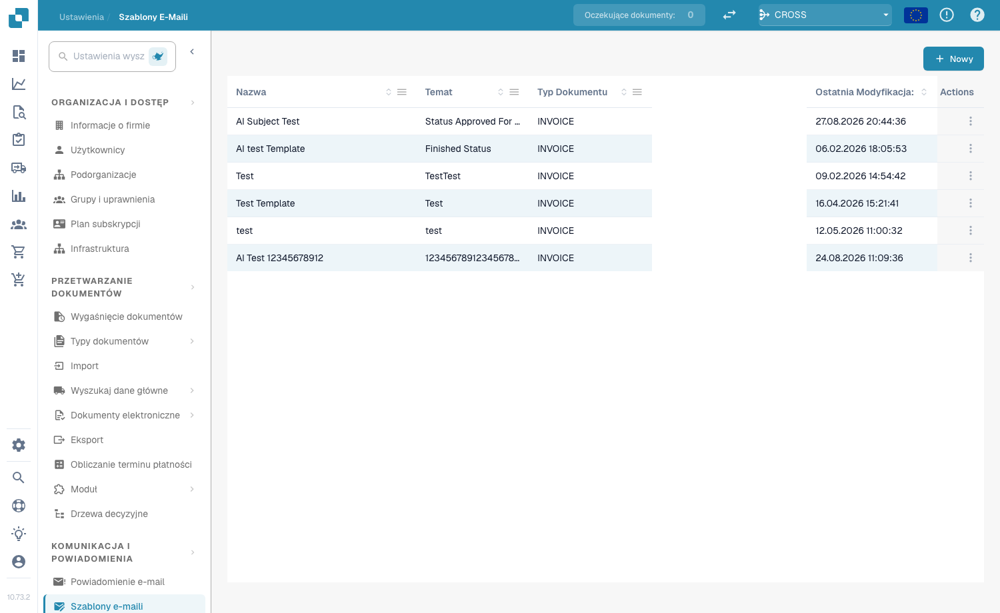
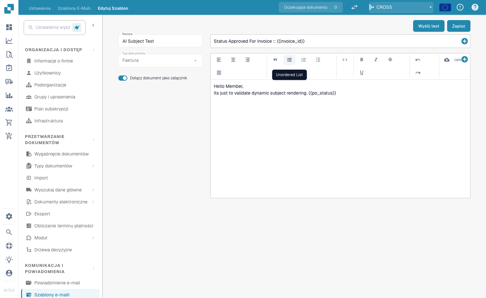
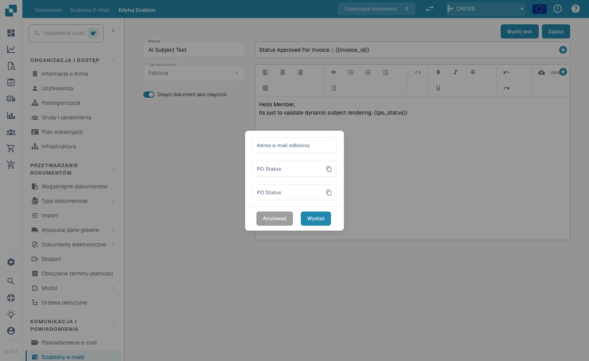

# Szablony e-maili

## **Przegląd**

Email Templates pozwalają dostosować automatyczne e-maile wysyłane przez DocBits — na przykład przypomnienia o zatwierdzeniu lub powiadomienia o błędach. Szablon określa temat i treść wiadomości oraz może zawierać pola dynamiczne (np. `{{InvoiceNumber}}`), obrazy i formatowanie tekstu sformatowanego.

## **Dostęp do szablonów e-maili**

Przejdź do **Settings → Communication & Notifications → Email Templates**. Lista pokazuje każdy szablon wraz z **Name**, **Subject**, **Document Type**, datą **Last Modified** oraz **Actions** (edycja lub usunięcie).

<figure><figcaption>
Lista Email Templates
</figcaption></figure>

## **Tworzenie szablonu**

1. Kliknij **+ New** w prawym górnym rogu.
2. Wypełnij pola:
   * **Name** — opisowy identyfikator (np. „Document Error Notification”).
   * **Document Type** — typ dokumentu, do którego odnosi się szablon (np. `INVOICE`).
   * **Include Document As Attachment** — włącz ten przełącznik, aby dołączyć dokument źródłowy do e-maila.
   * **Subject** — temat e-maila. Kliknij przycisk **+** obok pola, aby wstawić pole dynamiczne, lub wpisz bezpośrednio `{{FieldID}}`.
3. Zaprojektuj treść w edytorze tekstu sformatowanego — formatuj tekst (pogrubienie, kursywa, listy, wyrównanie), wstawiaj obrazy przyciskiem **Upload**, edytuj surowy HTML przyciskiem `<>` i używaj przycisku **+**, aby wstawiać pola dynamiczne.
4. Kliknij **Save**.

<figure><figcaption>
Edytor szablonu — nazwa, typ dokumentu, przełącznik załącznika, temat i treść w edytorze tekstu sformatowanego
</figcaption></figure>

## **Pola dynamiczne**

Pola dynamiczne są zastępowane danymi dokumentu podczas wysyłania e-maila. Wstawiaj je przyciskiem **+** lub wpisz ręcznie, używając podwójnych nawiasów klamrowych:

* `{{invoice_id}}` — numer faktury
* `{{supplier_name}}` — nazwa dostawcy
* `{{total_amount}}` — kwota całkowita
* `{{status}}` — bieżący status dokumentu

## **Wysyłanie testowego e-maila**

Kliknij **Send Test** w edytorze, wpisz adres e-mail w polu **Receiver Email** i kliknij **Send**. DocBits wysyła podgląd szablonu, abyś przed zapisaniem mógł sprawdzić układ i upewnić się, że pola dynamiczne są poprawnie rozwiązywane.

<figure><figcaption>
Okno Send Test
</figcaption></figure>

## **Używanie szablonów w powiadomieniach**

Zapisane szablony można powiązać z przepływami [**Email Notification**](email-notification/) — na przykład z przypomnieniami o zatwierdzeniu lub aktualizacjami przy zmianie statusu.
