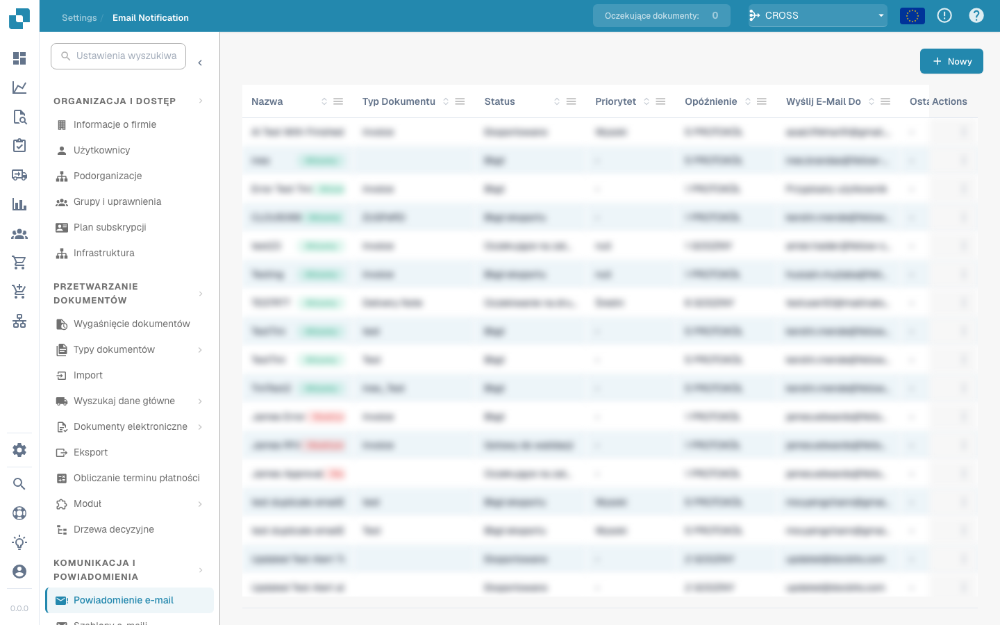

# Powiadomienie e-mail


DocBits Samouczek dotyczący zadań i powiadomień: przydzielaj pracę, śledź status i obsługuj zadania przepływu pracy


<figure><figcaption></figcaption></figure>

Konfiguracja powiadomień e-mailowych ma kluczowe znaczenie. Powiadomienia e-mail w DocBits można skonfigurować tak, aby powiadamiały użytkowników o różnych zdarzeniach związanych z dokumentami, takich jak: zakończenie przetwarzania, błędy importu lub eksportu lub prośby o interwencję użytkownika. Narzędzie to jest niezbędne do utrzymania skutecznej komunikacji i ciągłości operacyjnej w środowiskach przetwarzania dokumentów. Oto kilka powodów, dla których jest to ważne:

**Komunikacja w czasie rzeczywistym:**

* Alerty e-mailowe umożliwiają natychmiastowe powiadamianie użytkowników o ważnych zdarzeniach lub zmianach w ich systemie zarządzania dokumentami. Dzięki temu wszystkie zainteresowane strony zostaną natychmiast poinformowane o ważnych aktualizacjach.

**Przejrzystość i identyfikowalność:**

* Konfigurując powiadomienia e-mail, użytkownicy mogą śledzić i monitorować status zdarzeń związanych z przetwarzaniem dokumentów. Poprawia to przejrzystość i identyfikowalność w systemie zarządzania dokumentami.

**Timely reactions:**

* Automatyczne powiadamianie o zdarzeniach, takich jak udostępnienie dokumentów, komentarze lub zatwierdzenia, pozwala użytkownikom szybko reagować na prośby lub aktualizacje. Pomaga to zwiększyć wydajność i produktywność.

**Automatyzacja przepływów pracy:**

* Powiadomienia e-mail można zintegrować z przepływami pracy, aby automatycznie wysyłać powiadomienia do odpowiednich użytkowników po podjęciu określonych działań. Umożliwia to bezproblemową automatyzację procesów biznesowych.

**Przypomnienia i terminy:**

* Konfiguracja powiadomień e-mail może służyć do przypominania użytkownikom o nadchodzących terminach lub zaległych zadaniach. Pomaga to zapewnić terminową realizację ważnych zadań.

Ogólnie rzecz biorąc, konfiguracja powiadomień e-mail odgrywa ważną rolę w poprawie komunikacji, zwiększeniu wydajności i zapewnieniu terminowego i skutecznego zarządzania zdarzeniami związanymi z przetwarzaniem dokumentów. Automatyzując powiadomienia, organizacje mogą mieć pewność, że ważne informacje nie zostaną utracone i że wszystkie zainteresowane strony będą zawsze aktualne.

To ustawienie ma kluczowe znaczenie dla zapewnienia, że zainteresowane strony będą na bieżąco informowane o statusie przetwarzania ważnych dokumentów, co pomaga w szybkim podejmowaniu decyzji i efektywnym zarządzaniu obiegiem dokumentów.
