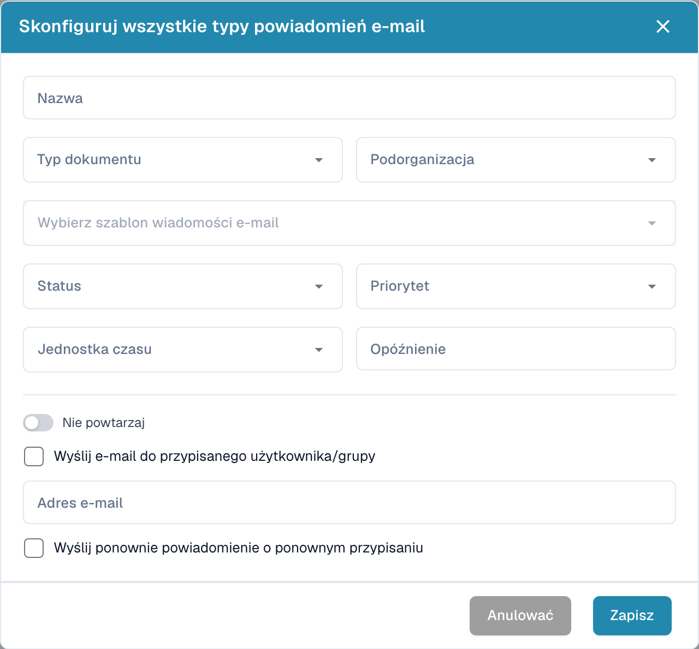

# Konfigurowanie powiadomień e-mail

Otwórz ustawienia powiadomień e-mail i utwórz konfigurację. Określ moment wysłania i odbiorców.

<figure><figcaption>
Okno konfiguracji powiadomienia e-mail.
</figcaption></figure>

1. Wprowadź nazwę, wybierz typ dokumentu i ewentualnie podorganizację.
2. Wybierz szablon wiadomości i status dokumentu.
3. Ustaw priorytet, jednostkę czasu i opóźnienie.
4. Sprawdź, czy powiadomienie ma być powtarzane.
5. Wybierz przypisanego użytkownika lub grupę albo wprowadź właściwy adres e-mail.
6. Określ, czy nowe przypisanie ma spowodować ponowne wysłanie.

Sprawdź odbiorców, opóźnienia i treść przed zapisaniem. Obraz pokazuje pustą, niezapisaną konfigurację i nie potwierdza wysłania wiadomości.
