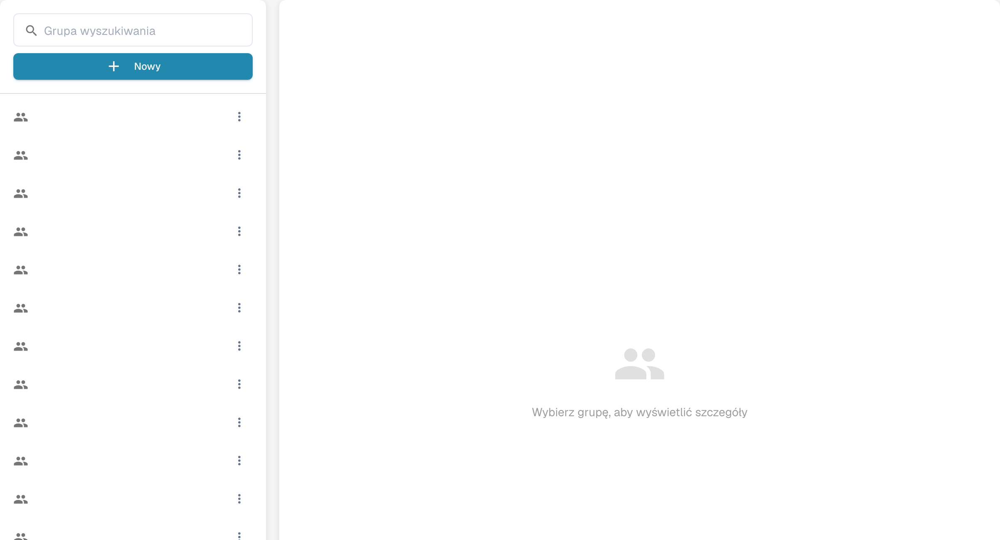

# Grupy, użytkownicy i uprawnienia

## Tworzenie grupy i sprawdzanie dostępu do dokumentów

Gdy uprawnienia grupowe są już włączone, utwórz grupę sprawdzającą i dodaj użytkownika testowego bez uprawnień administratora. Zezwól na wyświetlanie na liście, przeglądanie i edycję przypisanych faktur; pozostaw wyłączone usuwanie, zmiany zbiorcze i zatwierdzanie. Zapisz i ponownie otwórz ustawienia, a następnie zaloguj się jako zwykły użytkownik: przypisana faktura jest widoczna, a nieprzypisany dokument kontrolny nie jest.



[Obejrzyj z napisami](https://docbits-videos.fra1.cdn.digitaloceanspaces.com/settings-assistant/groups-permissions-admin/v1/pl.html)

Te ustawienia odpowiadają na trzy różne pytania: kto może się zalogować, w której podorganizacji pracuje oraz co może robić jego grupa.

| Jeśli chcesz… | Otwórz… |
| --- | --- |
| Dodać lub edytować konto osoby | **Ustawienia** → **Użytkownicy**; następnie przeczytaj [Użytkownicy](users/README.md). |
| Uporządkować dostęp między jednostkami firmy | **Ustawienia** → **Podorganizacje**; następnie przeczytaj [Podorganizacje](sub-organizations/README.md). |
| Kontrolować dostęp według grup | **Ustawienia** → **Grupy i uprawnienia**; następnie przeczytaj [Grupy i uprawnienia](groups-and-permissions/README.md). |

<figure><figcaption>
Panel wyboru grupy.
</figcaption></figure>

Jeśli użytkownik nie widzi dokumentu lub akcji, sprawdź najpierw jego konto i organizację. Następnie sprawdź uprawnienia odpowiedniej grupy. Zanim zmienisz działającą organizację, użyj konta testowego bez uprawnień administratora, aby potwierdzić dostęp, jaki faktycznie będzie miał zwykły użytkownik.
