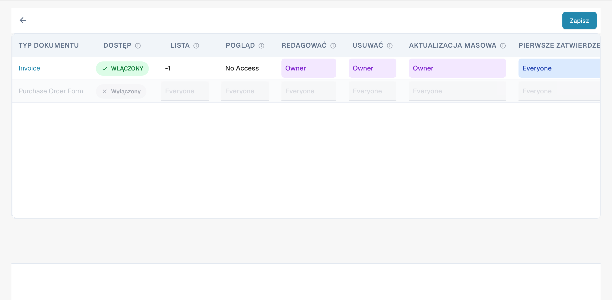
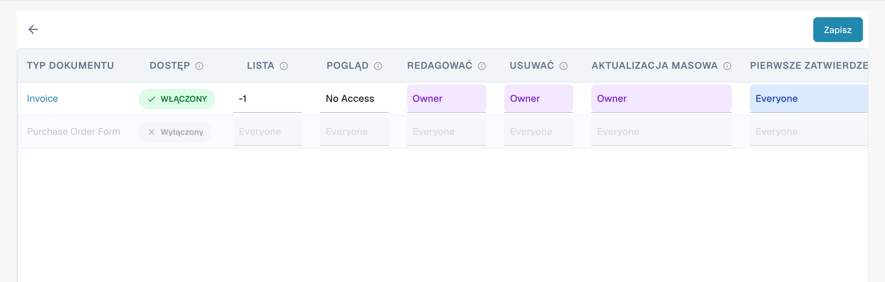

# Aktywacja uprawnień


DocBits Groups & Permissions Tutorial: Set User Roles, Access Rights & Secure Your Workspace


Włączenie lub wyłączenie systemu uprawnień za pomocą przełącznika ma różne skutki dla funkcjonalności w DocBits.

## **Włączenie systemu uprawnień:**

<figure><figcaption>
Wybór grupy do sprawdzenia uprawnień.
</figcaption></figure>

* Gdy system uprawnień jest włączony, stosowane są uprawnienia dostępu dla użytkowników i grup.
* Użytkownicy mają dostęp tylko do zasobów, do których mają wyraźne uprawnienia na podstawie przypisanych uprawnień.
* Administratorzy mogą zarządzać uprawnieniami dla poszczególnych użytkowników i grup oraz zapewnić, że tylko uprawnione osoby mogą przeglądać lub edytować dane.

<figure><figcaption>
Macierz uprawnień według typu dokumentu i działania. Poziomy Owner, Everyone i No Access pozostają w języku angielskim.
</figcaption></figure>

## Only Assigned Documents

<figure><figcaption>
Poziomy dostępu dla działań w macierzy uprawnień. Poziomy Owner, Everyone i No Access pozostają w języku angielskim.
</figcaption></figure>

Przełącznik **Only Assigned Documents** kontroluje widoczność dokumentów dla użytkowników na podstawie przypisań do grup. Gdy jest włączony, użytkownicy widzą tylko dokumenty przypisane bezpośrednio do nich lub do grupy, do której należą. Gdy jest wyłączony, użytkownicy z odpowiednim uprawnieniem do przeglądania widzą wszystkie dokumenty, niezależnie od przypisania.

#### Działanie

* **Stan wyłączony (domyślny)**:
  * Gdy przełącznik jest wyłączony, użytkownicy należący do grupy mogą przeglądać wszystkie dokumenty, jeśli mają odpowiednie uprawnienie do przeglądania. Przypisanie dokumentu nie wpływa na widoczność.
* **Stan włączony**:
  * Gdy przełącznik jest włączony, użytkownicy widzą tylko dokumenty przypisane wprost do nich lub do grupy, do której należą. Wymusza to ściślejszą widoczność dokumentów opartą na przypisaniach do grup.

#### Przykładowy scenariusz

1. **Domyślnie (stan wyłączony)**:
   * Użytkownik należący do grupy „Sales” widzi wszystkie dokumenty w systemie, do których ma uprawnienie do przeglądania, nawet jeśli nie są mu przypisane.
2. **Włączone (stan włączony)**:
   * Użytkownik z grupy „Sales” widzi tylko dokumenty przypisane do niego lub do grupy „Sales”, co ogranicza dostęp do dokumentów spoza jego przypisań.

## Wyłączenie systemu uprawnień:

<figure><figcaption>
Opcja aktywacji zarządzania uprawnieniami.
</figcaption></figure>

* Gdy system uprawnień jest wyłączony, wszystkie uprawnienia dostępu są usuwane, a użytkownicy zazwyczaj mają nieograniczony dostęp do wszystkich zasobów.
* Może to być przydatne, gdy tymczasowo wymagana jest otwarta współpraca bez ograniczeń kontroli dostępu.
* Jednak może wystąpić zwiększone ryzyko wycieku danych lub nieautoryzowanego dostępu, ponieważ użytkownicy mogą mieć dostęp do wrażliwych informacji, do których nie są uprawnieni.

Włączenie lub wyłączenie systemu uprawnień to ważna decyzja oparta na wymaganiach bezpieczeństwa i sposobie działania organizacji. W środowiskach, w których prywatność i kontrola dostępu są kluczowe, powszechnie pozostawia się system uprawnień włączony, aby zapewnić integralność i poufność danych. W innych przypadkach wyłączenie systemu uprawnień może być tymczasowo konieczne w celu ułatwienia współpracy, ale powinno być stosowane ostrożnie, aby zminimalizować potencjalne ryzyko bezpieczeństwa.

Aktualny interfejs używa macierzy uprawnień według typu dokumentu i działania. Niektóre poziomy dostępu mogą pozostać angielskie. Instrukcje dawnego przełącznika Only Assigned Documents dotyczą wyłącznie wersji, które go udostępniają.
