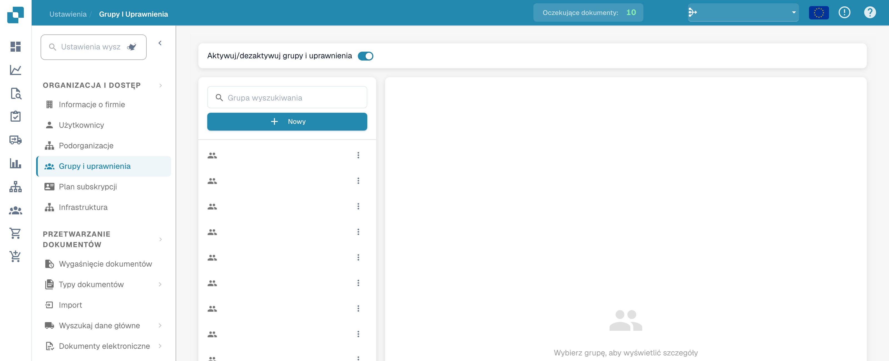
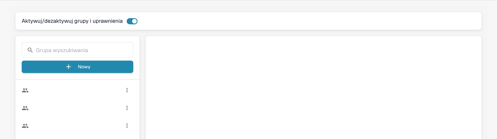
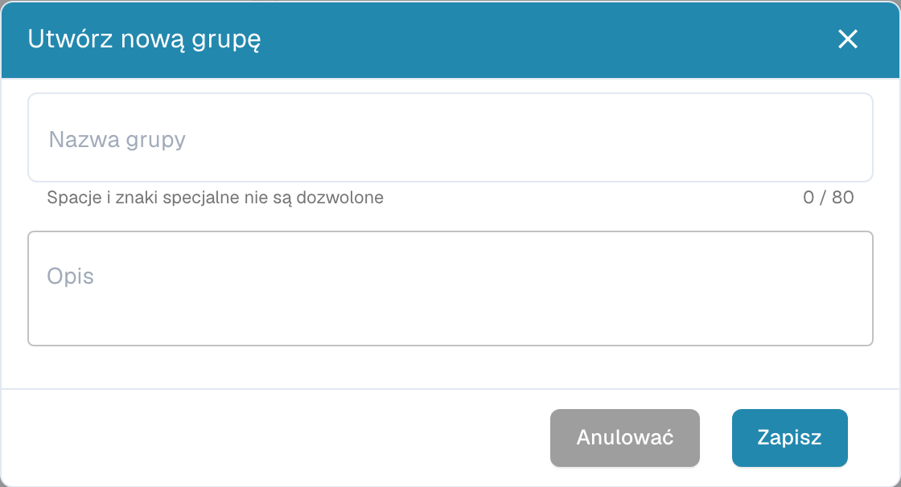
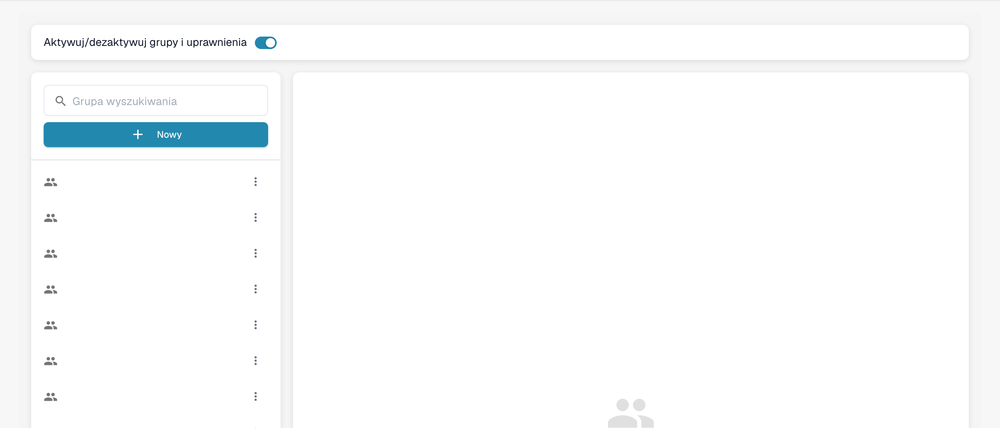

# Dodawanie/Edytowanie Grup


DocBits Groups & Permissions Tutorial: Set User Roles, Access Rights & Secure Your Workspace


## Aby dodać nową grupę lub zmienić uprawnienia istniejącej grupy, wykonaj następujące czynności:

* **Przejdź do ustawień grup:** Zaloguj się na swoje konto administratora i przejdź do Group Settings w panelu administracyjnym.

<figure><figcaption>
Dostęp do ustawień grup i uprawnień.
</figcaption></figure>

Otworzy się to okno:

<figure><figcaption>
Lista grup z ukrytymi nazwami.
</figcaption></figure>

* **Kliknij przycisk + New:** Jeśli chcesz dodać nową grupę, kliknij przycisk + New, aby rozpocząć proces dodawania nowej grupy.

<figure><figcaption>
Okno nowej grupy przed zapisaniem.
</figcaption></figure>

* **Wypełnij formularz:** Podaj nazwę grupy oraz jej opis.
* **Zapisz szczegóły:** Po wypełnieniu nazwy grupy i opisu kliknij przycisk „Save”.

<figure><figcaption>
Zarządzanie grupami i uprawnieniami.
</figcaption></figure>

## Edytowanie grup:

* **Edytuj grupy:** Aby edytować grupy, kliknij „edit”, tutaj możesz zmienić nazwę grupy.

<figure><figcaption></figcaption></figure>

<figure><figcaption></figcaption></figure>

* **Włącz Groups & permissions:** Aby grupa była widoczna, „Groups & permissions” musi być włączone.

<figure><figcaption></figcaption></figure>

* **Sprawdź wyniki:** Po zapisaniu przejrzyj wyniki, aby upewnić się, że grupa została pomyślnie dodana, edytowana lub zaktualizowana.
