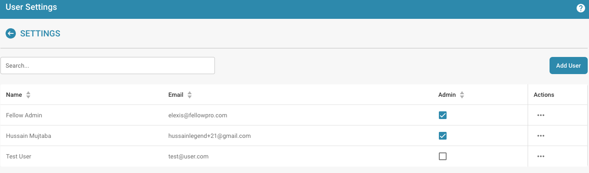

# Modyfikowanie szczegółów użytkownika

<figure><figcaption>
Ustawienia użytkownika
</figcaption></figure>

* **Logowanie jako administrator:** Zaloguj się z uprawnieniami administratora.
* **Dostęp do zarządzania użytkownikami:** Przejdź do ustawień użytkowników, gdzie możesz edytować istniejących użytkowników.
* **Wybieranie użytkowników:** Znajdź i wybierz użytkownika, którego szczegóły chcesz zmienić. Można to zrobić, klikając nazwę użytkownika lub przycisk edycji obok użytkownika.

<figure><figcaption></figcaption></figure>

*   **Edycja szczegółów użytkownika:** Pojawi się formularz zawierający aktualne szczegóły użytkownika. Edytuj wymagane pola zgodnie z wprowadzanymi zmianami. Typowe szczegóły do edytowania to:

    * Imię i nazwisko
    * Adres e-mail
    * Rola użytkownika lub poziom uprawnień

    <figure><figcaption></figcaption></figure>
* **Zapisywanie zmian:** Przejrzyj wprowadzone zmiany i kliknij Save, aby zapisać nowe szczegóły użytkownika.

<figure><figcaption></figcaption></figure>

* **Przejrzyj wpływ zmian roli:** Jeśli zmieniono rolę użytkownika, przejrzyj wpływ tej zmiany na poziomy dostępu. Upewnij się, że po zmianie roli użytkownik ma uprawnienia wymagane do dalszego wykonywania swoich obowiązków.
* **Wyślij powiadomienie (opcjonalnie):** Możesz wysłać użytkownikowi powiadomienie, aby poinformować go o wprowadzonych zmianach.

Po zakończeniu tych kroków szczegóły użytkownika zostaną pomyślnie zaktualizowane, a użytkownik będzie miał nowe informacje i uprawnienia zgodnie z wprowadzonymi zmianami.

## Usuwanie użytkowników:

* **Wybieranie użytkowników:** Znajdź i wybierz użytkownika, którego dostęp chcesz usunąć. Można to zrobić, klikając nazwę użytkownika lub przycisk edycji obok użytkownika.

<figure><figcaption></figcaption></figure>

* **Usuwanie dostępu:** Kliknij „delete”, aby usunąć użytkownika.

<figure><figcaption></figcaption></figure>

* **Potwierdzenie:** Zostaniesz poproszony o potwierdzenie usunięcia użytkownika.

<figure><figcaption></figcaption></figure>

* **Opcjonalne powiadomienie:** Możesz opcjonalnie wysłać użytkownikowi powiadomienie, aby poinformować go o usunięciu jego dostępu.
* **Przejrzyj zadania i dokumenty:** Przed usunięciem użytkownika przejrzyj, jakie zadania lub dokumenty są mu przypisane. Przenieś lub przekaż odpowiedzialność za te zadania lub dokumenty innemu użytkownikowi, aby upewnić się, że nic nie zostanie zgubione ani niedokończone.
* **Zapisz zmiany:** Potwierdź usunięcie użytkownika i zapisz zmiany.

Postępując zgodnie z tymi krokami, możesz zapewnić, że dostęp użytkownika zostanie bezpiecznie usunięty, jednocześnie właściwie zarządzając wszystkimi istotnymi zadaniami i dokumentami.
