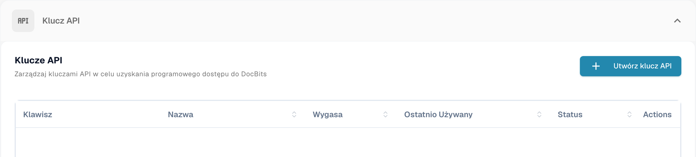
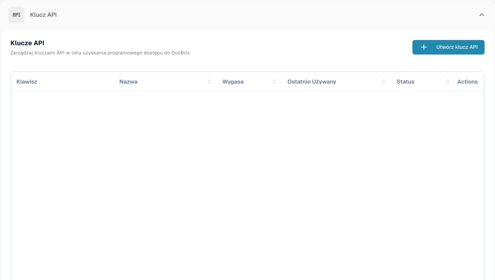
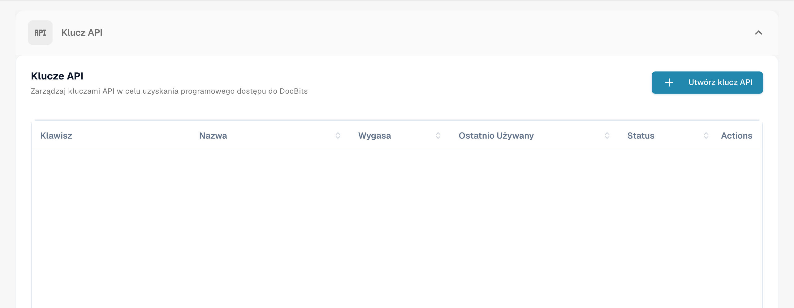
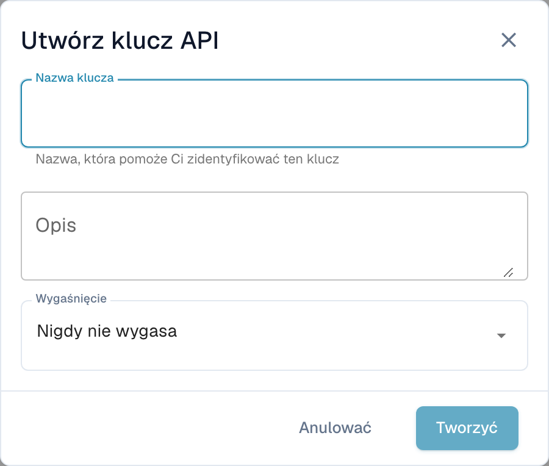

# Zarządzanie kluczami API

Klucz API pozwala innemu systemowi — Twojemu ERP, skryptowi albo aplikacji partnera — rozmawiać z DocBits bez logowania się użytkownika. Twoja organizacja może mieć tyle kluczy, ile potrzebujesz, a każdy z nich jest zarządzany osobno: nadaj mu własną nazwę, zdecyduj, czy ma wygasać, i unieważnij go pojedynczo, jeśli kiedykolwiek zostanie ujawniony.

Ponieważ każda integracja może mieć własny klucz, możesz wyłączyć jeden bez zakłócania pozostałych.

## Otwieranie zarządzania kluczami API

Przejdź do **Ustawienia** i wybierz **Integracja i SSO** w sekcji **System i administracja**.

<figure><figcaption>
Dostęp do zarządzania kluczami API. Etykieta Klawisz oznacza tutaj klucz API, nie klawisz klawiatury.
</figcaption></figure>

Sekcja **Klucz API** na górze strony wymienia każdy klucz, jaki ma Twoja organizacja.

<figure><figcaption>
Lista kluczy API bez kluczy i powiązanych nazw. Etykieta Klawisz oznacza tutaj klucz API, nie klawisz klawiatury.
</figcaption></figure>

## Jak czytać listę

<figure><figcaption>
Lista kluczy API; klucze i dane kont są ukryte. Etykieta Klawisz oznacza tutaj klucz API, nie klawisz klawiatury.
</figcaption></figure>

| Kolumna | Co oznacza |
| --- | --- |
| **Klucz** | Kilka pierwszych znaków klucza, po których następuje `****`. Reszta nigdy nie jest pokazywana ponownie po utworzeniu — zobacz [Tworzenie klucza API](#tworzenie-klucza-api). |
| **Nazwa** | Nazwa nadana kluczowi, a pod nią jego opis. |
| **Wygasa** | Data, w której klucz przestaje działać, albo **Nigdy**, jeśli nie ustawiono żadnej. |
| **Ostatnio używany** | Kiedy ostatnio nadeszło żądanie z tym kluczem. **Nigdy nie używany** oznacza, że żaden system jeszcze go nie użył — przydatne do wychwytywania kluczy, które można bezpiecznie usunąć. |
| **Status** | **Aktywny** oznacza, że klucz działa. Unieważniony klucz jest wyłączony na stałe. |
| **Akcje** | Menu z trzema kropkami, w którym możesz unieważnić klucz. |

Jeśli masz więcej kluczy, niż mieści się na jednej stronie, użyj elementów stronicowania na dole listy.


**Ostatnio używany** to najszybszy sposób na znalezienie kluczy, których już nikt nie potrzebuje. Klucz, który nigdy nie był używany albo nie był używany od miesięcy, to dobry kandydat do unieważnienia.


## Tworzenie klucza API

1. Kliknij **+ Create API Key** w prawym górnym rogu sekcji API Keys.
2. Wypełnij okno dialogowe:

<figure><figcaption>
Okno tworzenia klucza API przed zapisaniem.
</figcaption></figure>

| Pole | Co wpisać |
| --- | --- |
| **Nazwa klucza** | Wymagane. Nazwij go od systemu, który będzie go używać — `M3 Production`, `Invoice Import Script` — żebyś później wiedział, do której integracji należy dany klucz. |
| **Opis** | Opcjonalne. Miejsce na notatkę o tym, do czego służy klucz albo kto go skonfigurował. |
| **Wygaśnięcie** | Wybierz datę wygaśnięcia albo zostaw **Nigdy nie wygasa**. Data wygaśnięcia to bezpieczniejszy wybór: klucz wycofa się sam, jeśli o integracji kiedyś się zapomni. |

3. Kliknij **Tworzyć**. DocBits pokaże Ci nowy klucz:

4. Skopiuj klucz ikoną kopiowania i wklej go prosto do systemu, który będzie go używać, albo do swojego menedżera haseł.
5. Zaznacz **Skopiowałem i zapisałem ten klucz** i kliknij **Zrobione**.


**Pełny klucz jest pokazywany tylko raz.** DocBits zapisuje jednokierunkowy skrót klucza i krótki prefiks identyfikacyjny. Ani Twoi administratorzy, ani pomoc techniczna DocBits nie mogą odzyskać pełnego oryginalnego klucza z tego skrótu. Jeśli go utracisz, unieważnij klucz i utwórz nowy.


Traktuj klucz jak hasło. Każdy, kto go ma, może działać na dokumentach i danych Twojej organizacji.

Zobacz [Bezpieczne przechowywanie danych uwierzytelniających](../../../../security/secure-storage-of-credentials.md).

Pełny klucz API pojawia się tylko raz, podczas tworzenia. Skopiuj go do zatwierdzonego bezpiecznego miejsca i sprawdź zapis przed zamknięciem okna. Lista nie wyświetla później pełnego sekretnego klucza.
