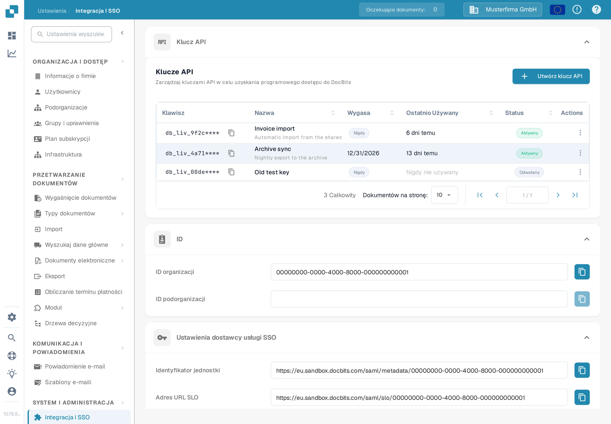

# Klucz API

<figure><figcaption>
Ustawienia → Integracja i SSO → Klucz API. Przedrostek klucza jest na tym zrzucie ukryty.
</figcaption></figure>

Sekcja **Klucz API** na górze strony Integracja i SSO wymienia wszystkie klucze API utworzone przez Twoją organizację. Klucz API pozwala innemu systemowi — Twojemu ERP, skryptowi albo aplikacji partnera — uzyskać dostęp do DocBits bez logowania użytkownika. Instrukcje krok po kroku znajdziesz w sekcji [Zarządzanie Kluczami API](api-key-management.md).

### Lista kluczy API

* **Klawisz:** Kilka pierwszych znaków klucza, po których następuje `****`. Pełny klucz jest pokazywany tylko raz, w momencie utworzenia, więc nie można go później ponownie wyświetlić. Ikona kopiowania obok klucza kopiuje widoczny przedrostek do schowka.
* **Nazwa / Wygasa / Ostatnio Używany / Status:** Każdy wiersz pokazuje nazwę klucza, datę, po której klucz przestaje działać, moment ostatniego użycia klucza przez żądanie oraz informację, czy klucz jest nadal aktywny.
* **Utwórz klucz API:** Otwiera okno dialogowe tworzenia nowego klucza dla integracji. Opis pól i jednorazowe wyświetlenie klucza znajdziesz w sekcji [Zarządzanie Kluczami API](api-key-management.md).
* **Actions (menu z trzema kropkami):** Otwiera działania dostępne dla klucza, w których możesz edytować jego nazwę, odwołać go albo usunąć klucz już odwołany. Odwołanie wyłącza klucz na stałe.

### Ustawienia dostawcy usług SSO (logowanie jednokrotne)

Są to wartości, których Twój dostawca tożsamości potrzebuje, aby użytkownicy mogli logować się do DocBits firmowym loginem. Pełny przewodnik konfiguracji znajdziesz w sekcji [Konfiguracja logowania jednokrotnego (SSO)](configuring-single-sign-on-sso/).

* **Identyfikator jednostki:** Identyfikator DocBits jako dostawcy usług w konfiguracji SSO. Ikona kopiowania kopiuje tę wartość do schowka.
* **Adres URL SLO:** Adres URL używany do jednoczesnego wylogowania użytkownika ze wszystkich aplikacji połączonych przez SSO. Ikona kopiowania kopiuje tę wartość.
* **Adres URL logowania jednokrotnego:** Adres URL używany do rozpoczęcia procesu logowania jednokrotnego. Ikona kopiowania kopiuje tę wartość.
* **Pobierz certyfikat:** Pobiera certyfikat zabezpieczeń, którego Twój dostawca tożsamości potrzebuje, aby zaufać DocBits.
* **Pobierz metadane:** Pobiera plik metadanych SAML, który można zaimportować bezpośrednio w większości dostawców tożsamości.

### Ustawienia dostawcy usług tożsamości

Skonfiguruj DocBits tak, aby do logowania używał Twojego zewnętrznego dostawcy tożsamości (IdP). Pełny przewodnik, na razie tylko w języku angielskim, znajdziesz tutaj: [Identity Service Provider Configuration](https://docs.docbits.com/administration-and-setup/settings/global-settings/integration/identity-service-provider-configuration).

* **ID najemcy:** Identyfikator najemcy Twojego dostawcy tożsamości, używany, gdy DocBits integruje się z usługami chmurowymi zarządzającymi dostępem w podziale na najemców.
* **Prześlij plik:** Przesyła plik metadanych lub konfiguracji otrzymany od Twojego dostawcy tożsamości.
* **Konfiguruj:** Zapisuje ustawienia i stosuje przesłaną konfigurację. Najpierw wpisz ID najemcy albo prześlij plik, a następnie kliknij **Konfiguruj**.
