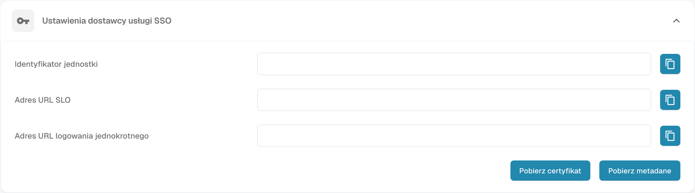

# Konfigurowanie logowania jednokrotnego (SSO)

Skonfiguruj DocBits jako dostawcę usług SAML (SP) i połącz swojego dostawcę tożsamości (IdP). Potrzebujesz uprawnień administratora do odpowiednich ustawień w obu systemach.

## Otwórz ustawienia SSO

Zaloguj się do DocBits jako administrator i otwórz logowanie jednokrotne w ustawieniach integracji.

<figure><figcaption>
Ustawienia dostawcy usług SSO: dane organizacji ukryte; nie zapisano konfiguracji.
</figcaption></figure>

## Sprawdź wartości dostawcy usług DocBits

DocBits wyświetla Entity ID, SSO URL i SLO URL jako wartości tylko do odczytu. Skopiuj je lub użyj metadanych SP podczas konfigurowania aplikacji DocBits u dostawcy IdP. Nie wpisuj wartości zastępczych w te pola DocBits. Entity ID identyfikuje dostawcę usług. Użyj wyświetlonych punktów końcowych zgodnie z wymaganiami SAML dostawcy IdP.

## Pobierz certyfikat i metadane SP

Użyj Download Certificate i pobierania metadanych w ustawieniach dostawcy usług DocBits. Pobrane pliki opisują DocBits jako SP. Przekaż dostawcy IdP metadane SP i, jeśli jest wymagany, pobrany certyfikat SP. Ten certyfikat jest odrębny od metadanych IdP przesyłanych do DocBits.

## Skonfiguruj dostawcę tożsamości

1. U dostawcy IdP skonfiguruj DocBits na podstawie wartości SP wyświetlanych w DocBits lub pobranych metadanych SP.
2. Użyj Tenant ID z DocBits, jeśli dostawca go wymaga. Sprawdź kontekst dzierżawy i dostawcy w ustawieniach dostawcy tożsamości w DocBits.
3. Uzyskaj od dostawcy IdP metadane SAML XML skonfigurowanej aplikacji i prześlij te metadane XML dostawcy IdP do DocBits. Nie zastępuj ich wcześniej pobranymi metadanymi SP DocBits.
4. Zapisz konfigurację za pomocą działania Configure/Save w ustawieniach dostawcy tożsamości w DocBits.

## Przetestuj logowanie i obsługiwane wylogowanie

Sprawdź, czy użytkownik może zalogować się do DocBits przez skonfigurowanego dostawcę IdP. Testuj Single Log-Out tylko wtedy, gdy DocBits i IdP obsługują tę funkcję i jest ona skonfigurowana po obu stronach. Samo wylogowanie z DocBits nie gwarantuje wylogowania ze wszystkich pozostałych połączonych aplikacji.
