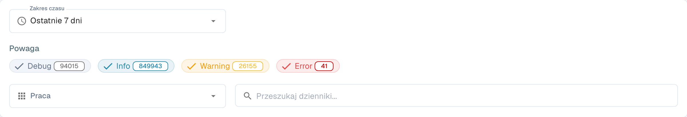

# Dziennik aktywności

<figure><figcaption>
Filtry dziennika aktywności; wpisy są ukryte.
</figcaption></figure>

Activity Logging zapewnia podgląd zdarzeń systemowych we wszystkich usługach DocBits w czasie rzeczywistym. Używaj go do monitorowania przetwarzania, diagnozowania błędów i audytu zachowania systemu.

## Baner analityczny

U góry strony baner prowadzi do **Panel analityczny** z wykresami, metrykami i monitorowaniem w czasie rzeczywistym.

## Filtry

| Filtr | Opis |
|--------|-------------|
| **Zakres czasu** | Wybierz okno czasowe (np. Today, Last 7 Days, Last 30 Days). |
| **Poziom ważności** | Włączaj lub wyłączaj poziomy ważności: **Odpluskwić**, **Informacje**, **Ostrzeżenie**, **Błąd**. Każdy znacznik pokazuje bieżącą liczbę. |
| **Usługa** | Filtruj logi według usługi (np. api, auth, api-service). |
| **Search logs** | Wyszukiwanie pełnotekstowe w komunikatach logów. |

## Tabela logów

| Kolumna | Opis |
|--------|-------------|
| **Znak czasu** | Data i godzina wystąpienia zdarzenia. Z możliwością sortowania. |
| **Poziom ważności** | Kolorowa plakietka: Info (niebieska), Warning (żółta), Error (czerwona), Debug (szara). |
| **Część** | Usługa lub moduł, który wygenerował log (np. api, auth, api-service). |
| **Wiadomość** | Pełny komunikat logu ze szczegółami zdarzenia. |

Wyniki są podzielone na strony — użyj elementów sterujących na dole, aby przechodzić między stronami.

## Akcje w stopce

| Akcja | Opis |
|--------|-------------|
| **Auto-refresh** | Przełącznik automatycznego odświeżania widoku logów w regularnych odstępach. |
| **Refresh Now** | Ręczne odświeżenie danych logów. |
| **Export JSON** | Eksportuje bieżące przefiltrowane logi jako plik JSON. |
| **Download Logs** | Pobiera kompletne dane logów. |
