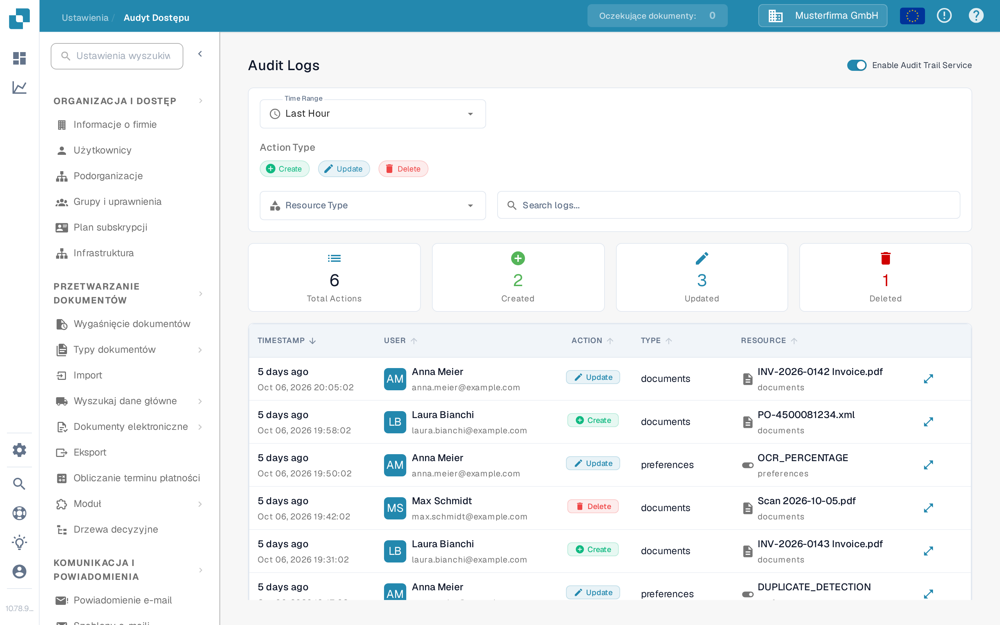
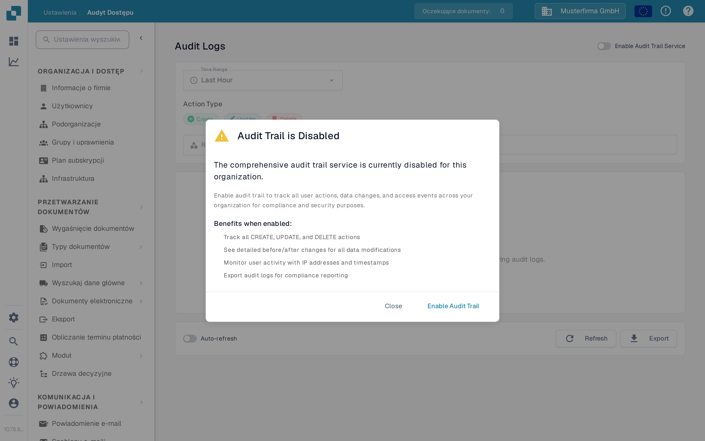

# Audyt Dostępu

## Samouczek wideo: Firma, subskrypcja i audyt


Informacje o firmie, plan subskrypcji i dzienniki audytu w DocBits


Film pokazuje informacje i preferencje firmy, plan subskrypcji, aktywność logowania oraz dzienniki audytu.

<figure><figcaption>
Przykład włączonego dziennika audytu. Nawigacja jest po polsku, a elementy sterujące dziennika na ilustracji pozostają po angielsku.
</figcaption></figure>

Audyt Dostępu rejestruje, kto utworzył, zmodyfikował lub usunął zasób i kiedy. Otwórz **Ustawienia → Rejestrowanie aktywności → Audyt dostępu**, aby przejrzeć dziennik. Włącz usługę dla organizacji tylko wtedy, gdy zamierzasz zbierać zdarzenia audytu.

## Gdy rejestrowanie audytu jest wyłączone

<figure><figcaption>
Okno dialogowe wyjaśnia, co będzie rejestrowane, zanim włączysz usługę.
</figcaption></figure>

Pierwsza wizyta w sesji przeglądarki może pokazać okno **Audit Trail is Disabled**. **Close** zamyka okno dialogowe i pozostawia rejestrowanie audytu wyłączone. **Enable Audit Trail** włącza je dla bieżącej organizacji. Na stronie za oknem dialogowym **Enable Now** oraz przełącznik **Enable Audit Trail Service** również je włączają. Te elementy sterujące zmieniają ustawienie organizacji; nie służą jedynie do podglądu funkcji.

Dopóki usługa jest wyłączona, filtry i tabela dziennika nie mogą pokazywać zdarzeń. Pusty stan wyjaśnia, jak włączyć rejestrowanie. Po włączeniu użyj przełącznika, aby w razie potrzeby wyłączyć ją ponownie. Zdarzenia są dostępne tylko wtedy, gdy usługa jest włączona i zebrała dane.

## Wyszukiwanie zdarzenia

| Element sterujący | Co robi |
|---|---|
| **Time Range** | Ogranicza listę do okresu, takiego jak Last Hour, Today lub Last 7 Days. |
| **Create**, **Update**, **Delete** | Uwzględnia lub wyklucza te rodzaje działań. |
| **Resource Type** | Ogranicza wyniki do typu zasobu, takiego jak documents lub settings. |
| **Search logs** | Wyszukuje widoczne wpisy audytu według tekstu. |
| **Refresh** | Jednorazowo ładuje najnowsze pasujące wpisy. |
| **Auto-refresh** | Aktualizuje listę automatycznie, dopóki strona jest otwarta. |
| **Export** | Pobiera bieżące dane dziennika audytu do pliku JSON. |

Karty podsumowania pokazują łączną liczbę działań oraz liczby działań utworzonych, zaktualizowanych i usuniętych dla wybranych filtrów. W tabeli **Timestamp** wskazuje, kiedy zdarzenie miało miejsce, **User** identyfikuje wykonawcę, **Action** nazywa zmianę, a **Resource** identyfikuje element, którego dotyczy. Otwórz panel szczegółów wiersza, aby przeanalizować zarejestrowaną zmianę. Jeśli nie pojawiają się żadne zdarzenia, sprawdź, czy usługa jest włączona, i poszerz zakres czasu przed zmianą pozostałych filtrów.
