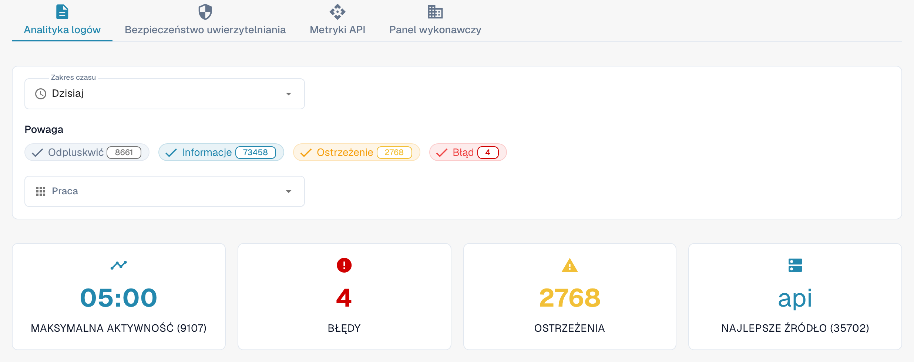

# Analityka

Otwórz **Ustawienia → Rejestrowanie aktywności → Analityka** za pomocą konta administratora organizacji. Strona łączy aktywność dzienników, zdarzenia uwierzytelniania, użycie API i przegląd dla kierownictwa. Zacznij od **Analityka logów**. Wybierz **Wyświetl dzienniki zdarzeń**, aby otworzyć listę zdarzeń i zbadać konkretny wpis.

<figure><figcaption>
Aktualny polski widok Dev. Liczniki pochodzą ze środowiska testowego i będą inne w Twojej organizacji.
</figcaption></figure>

## Zakładki

| Zakładka | Opis |
|----------|------|
| **Analityka logów** | Rozkład poziomów dziennika, przebieg w czasie i podział według usług. |
| **Bezpieczeństwo uwierzytelniania** | Zdarzenia uwierzytelniania, próby logowania i metryki bezpieczeństwa. |
| **Metryki API** | Liczba żądań API, czasy odpowiedzi i wskaźniki błędów. |
| **Panel wykonawczy** | Przegląd dla administratorów organizacji; dostępność zależy od roli. |

Każda zakładka ma własne ustawienia okresu. Po zmianie zakładki ponownie sprawdź wybrany okres.

## Filtry dzienników

| Filtr | Opis |
|-------|------|
| **Zakres czasu** | Wybierz **Ostatnia godzina**, **Dzisiaj**, **Ostatnie 7 dni**, **Ostatnie 30 dni** lub **Niestandardowy**. Własny zakres udostępnia pola daty i godziny początku oraz końca. |
| **Powaga** | Kliknij **Odpluskwić** (Debug), **Informacje**, **Ostrzeżenie** lub **Błąd**, aby uwzględnić lub wykluczyć dany poziom. Liczba na filtrze pokazuje bieżący wynik. |
| **Praca** | Wybierz jedną lub kilka usług, których zdarzenia chcesz przejrzeć. W tym widoku etykieta **Praca** oznacza usługę rejestrującą zdarzenia. |

## Karty podsumowania

Pod filtrami znajdują się cztery karty:

| Karta | Opis |
|-------|------|
| **Maksymalna aktywność** | Moment największej liczby wpisów dziennika wraz z ich liczbą. |
| **Błędy** | Liczba błędów w wybranym okresie. |
| **Ostrzeżenia** | Liczba ostrzeżeń w wybranym okresie. |
| **Najlepsze źródło** | Usługa generująca najwięcej wpisów dziennika wraz z ich liczbą. |

## Monitorowanie rzeczywistych użytkowników (RUM)

Gdy dostępna jest telemetria przeglądarki, sekcja RUM pokazuje metryki wydajności interfejsu. Dostępność danych zależy od środowiska i okresu. Pusty wykres, komunikat o braku danych lub wskaźnik ładowania nie jest wynikiem pomiaru.

## Wykresy dzienników i pobieranie

W **Analityka logów** wybierz jeden z widoków:

| Widok | Opis |
|-------|------|
| **Powaga** | Wykres kołowy rozkładu poziomów dziennika. |
| **Oś czasu** | Wykres liniowy liczby wpisów w czasie. |
| **Praca** | Wykres słupkowy z podziałem według usług. |

Na wykresie **Oś czasu** otwórz menu w prawym górnym rogu i wybierz **Download SVG**, **Download PNG** lub **Download CSV**. Te opcje dotyczą wyświetlanego wykresu; inne wykresy mogą nie udostępniać takiego paska narzędzi.

Jeżeli brakuje danych, spróbuj rozszerzyć **Zakres czasu** lub zmniejszyć liczbę filtrów **Powaga**.

## Błędy JS ze śladami stosu

Jeśli ta karta jest dostępna, etykieta środowiska określa zakres błędów, na przykład **tylko dev**. Karta pokazuje niedawne wyjątki przeglądarki, z ograniczeniem do 24 godzin. **Skopiuj cały JSON** kopiuje wpisy aktualnie wczytane do tej karty, a nie cały dziennik zdarzeń. Przycisk jest nieaktywny, gdy lista jest pusta.

Jeżeli wpis jest dostępny, kliknij jego komunikat, aby rozwinąć ślad stosu. Akcje wiersza kopiują ten wpis jako JSON lub kopiują jego ślad stosu. Łącze do śladu pojawia się tylko wtedy, gdy wpis ma identyfikator śladu.
