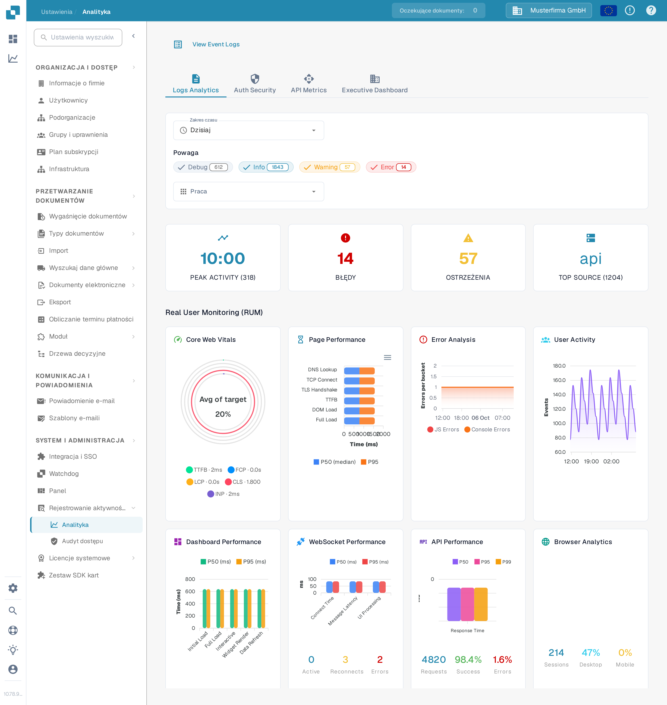

# Analityka

<figure><figcaption>
Używaj zakładek i filtrów, aby zawęzić metryki, które chcesz przejrzeć.
</figcaption></figure>

Strona Analityka pomaga przeanalizować trendy w dziennikach, zdarzenia uwierzytelniania, użycie API i przegląd dla kierownictwa. Zacznij od **Logs Analytics**. Wybierz **View Event Logs**, aby otworzyć listę zdarzeń, gdy musisz zbadać pojedynczy wpis.

## Zakładki

| Zakładka | Opis |
|----------|------|
| **Logs Analytics** | Rozkład powagi dzienników, wykresy chronologiczne i podział na usługi. |
| **Auth Security** | Zdarzenia uwierzytelniania, próby logowania i metryki bezpieczeństwa. |
| **API Metrics** | Wolumeny żądań API, czasy odpowiedzi i wskaźniki błędów. |
| **Executive Dashboard** | Przegląd wyższego poziomu dla administratorów organizacji; inne role mogą nie widzieć tej zakładki. |

## Filtry

| Filtr | Opis |
|-------|------|
| **Zakres czasu** | Wybierz okno czasu (np. Dzisiaj, Ostatnie 7 dni) dla wyświetlanych metryk. |
| **Powaga** | Kliknij Debug, Info, Warning lub Error, aby uwzględnić lub wykluczyć dany poziom. Liczba na etykiecie pokazuje jego bieżącą ilość. |
| **Praca** | Wybierz usługę, której zdarzenia chcesz przeanalizować. |

## Karty podsumowujące

Pod filtrami pojawiają się cztery karty podsumowujące:

| Karta | Opis |
|-------|------|
| **PEAK ACTIVITY** | Pora dnia z największym wolumenem dzienników wraz z liczbą łączną. |
| **BŁĘDY** | Łączna liczba błędów w wybranym okresie. |
| **OSTRZEŻENIA** | Łączna liczba ostrzeżeń w wybranym okresie. |
| **TOP SOURCE** | Usługa generująca najwięcej dzienników wraz z ich liczbą. |

## Real User Monitoring (RUM)

Pod kartami podsumowującymi metryki RUM pokazują dane o wydajności front-endu zebrane z rzeczywistych sesji przeglądarki użytkowników.

## Wykresy analityki

W **Logs Analytics** wybierz jeden z trzech przycisków wykresu, aby zmienić sposób wyświetlania tych samych przefiltrowanych dzienników:

| Widok | Opis |
|-------|------|
| **Severity** | Wykres kołowy pokazujący rozkład poziomów dzienników (Debug, Info, Warning, Error). |
| **Timeline** | Wykres liniowy pokazujący wolumen dzienników w czasie. |
| **Service** | Wykres słupkowy dzielący dzienniki według usług. |

Jeśli wykres informuje, że dane nie są dostępne, wypróbuj szerszy **Zakres czasu** lub mniej filtrów **Powaga**. Liczby na zrzucie ekranu należą do syntetycznej organizacji Sandbox i będą się różnić w Twojej organizacji.
