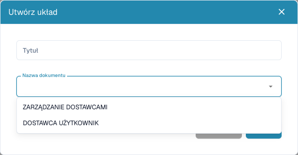

# Konfigurowanie formularzy dostawców

<figure><figcaption>
Wybierz odbiorcę zewnętrznego lub wewnętrznego przed zapisaniem układu.
</figcaption></figure>

Układy dostawców określają formularze zewnętrzne i formularze pracowników. Nie zmieniają wydruku faktury ani nie trenują ekstrakcji. Potrzebujesz praw administratora i uzgodnionych wymagań dla każdej grupy.

## Wybór odbiorcy

1. Otwórz **Ustawienia → Ustawienia dostawców → Układ dostawcy**.
2. Sprawdź istniejące układy i otwórz właściwy przed utworzeniem następnego.
3. Dla nowego wybierz **Nowy**, czytelny tytuł i typ dokumentu: użytkownik dostawcy dla widoku zewnętrznego lub zarządzanie dostawcami dla wewnętrznego.
4. Zapisz definicję, otwórz układ z listy i sprawdź odbiorcę.

## Pola i struktura

1. Otwórz pola dostawców. Sprawdź tytuł, nazwę pola ERP, listę wartości oraz wymagane, tylko do odczytu i ukryte.
2. Utwórz pole z nazwą, tytułem i typem. Wybór/wyszukiwanie/opcje potrzebują właściwej listy wartości. Pliki wymagają typu dokumentu; w innych polach sprawdź nazwę ERP.
3. Zapisz poprawne ustawienia. Definicja i rozmieszczenie to odrębne etapy.
4. Rozmieść grupy i pola przez **Elementy** i **Pola** we właściwym układzie. Wybierz element i sprawdź dostępne właściwości.
5. Nadaj grupom poprawne nazwy i tytuły. Nie ukrywaj/blokuj wymaganego pola bez odpowiedniej wartości lub procesu.
6. Zapisz i otwórz układ ponownie. **Anuluj** opuszcza edytor. Szablon domyślny może zastąpić układ; używaj go świadomie.

## Test obu widoków

Z fikcyjnym dostawcą i kontem testowym osobno sprawdź rejestrację i szczegóły wewnętrzne: komunikaty wymaganych pól, opcje, pliki i ukrycie/tylko odczyt. Zapis w edytorze nie dowodzi rejestracji, zatwierdzenia ani eksportu.

Przy brakujących polach sprawdź definicję, widoczność, układ i odbiorcę. Przy brakujących wartościach ERP sprawdź też mapowanie eksportu.

Zobacz [Portal dostawców](../../setup/supplier-portal/README.md), [Ustawienia ogólne](supplier-general-settings.md) i [Uprawnienia](supplier-permissions.md).
