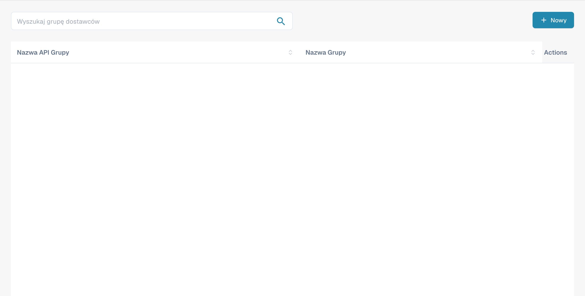
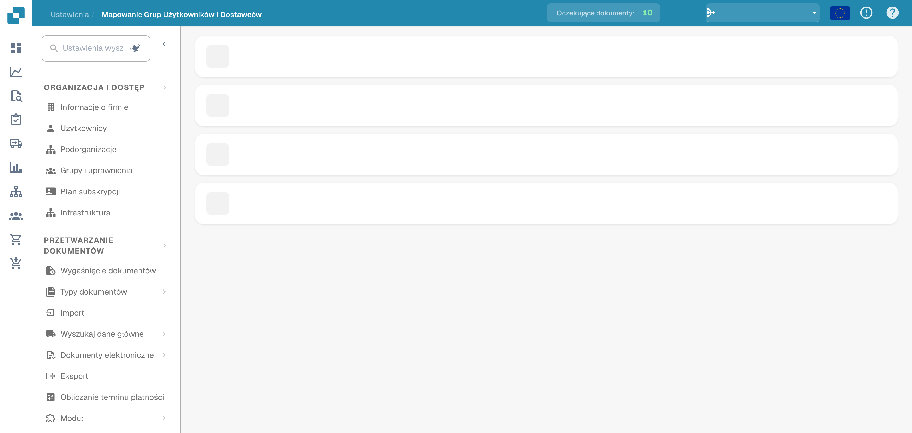

# Uprawnienia dostawcy

### Grupa dostawców

<figure><figcaption>
Grupy dostawców z ukrytymi nazwami.
</figcaption></figure>

Zarządzaj grupami dostawców, aby kategoryzować dostawców według typu, regionu lub roli. Każda grupa ma **Nazwę API grupy** (używaną w integracjach) oraz **Nazwę grupy** (nazwę wyświetlaną).

Kliknij **+ Nowa**, aby utworzyć grupę. Skorzystaj z menu z trzema kropkami w każdym wierszu, aby edytować lub usunąć.

### Mapowanie użytkowników i grup dostawców

<figure><figcaption>
Przypisywanie użytkowników do grup dostawców.
</figcaption></figure>

Przypisuj użytkowników do grup dostawców, aby kontrolować, którzy pracownicy mogą uzyskiwać dostęp do określonych zestawów dostawców i nimi zarządzać. Każda grupa jest wyświetlana jako rozwijana sekcja zawierająca listę przypisanych do niej użytkowników wraz z liczbą członków.

Kliknij **+ Nowa** w obrębie grupy, aby dodać mapowanie użytkownika. Skorzystaj z menu z trzema kropkami, aby usunąć mapowanie.
