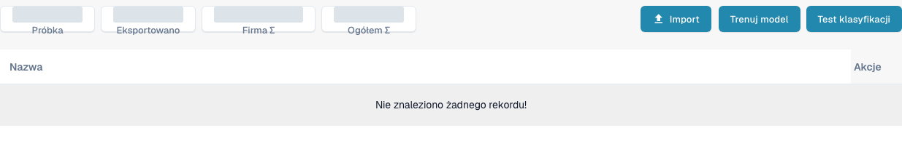

# Trenowanie dokumentów

Trenowanie dokumentów uczy DocBits, gdzie szukać wartości w dokumentach, których system nie odczytuje jeszcze poprawnie. Pola nagłówka i pola pozycji należy trenować oddzielnie.

Aby przejrzeć trenowanie klasyfikacji typu dokumentu, otwórz **Ustawienia** → **Typy dokumentów** i wybierz **Szkolenie modelowe** na karcie istniejącego typu dokumentu. Widok zawiera przykłady treningowe oraz przyciski **Import**, **Trenuj model** i **Test klasyfikacji**. Przed wprowadzeniem zmian przejrzyj istniejące przykłady, a do późniejszego trenowania lub testowania klasyfikacji używaj zatwierdzonych plików testowych.

<figure><figcaption>
Polski widok trenowania modelu dla istniejącego typu faktury. Lista nie zawiera dokumentów przykładowych; liczniki zbiorcze zostały zasłonięte. Nie wykonano importu, trenowania ani testu klasyfikacji.
</figcaption></figure>

* [Trenowanie pól nagłówka](training-header-fields.md): zaznacz miejsce w dokumencie, w którym znajduje się wartość nagłówka, np. data lub kwota całkowita.
* [Trenowanie pól pozycji i tabel](training-line-fields-table-training/README.md): określ strukturę tabeli pozycji dla konkretnego dostawcy.

Wyniki trenowania zależą od użytych dokumentów. Sprawdź wyodrębnione wartości na kolejnym dokumencie testowym, zanim zaczniesz na nich polegać.
