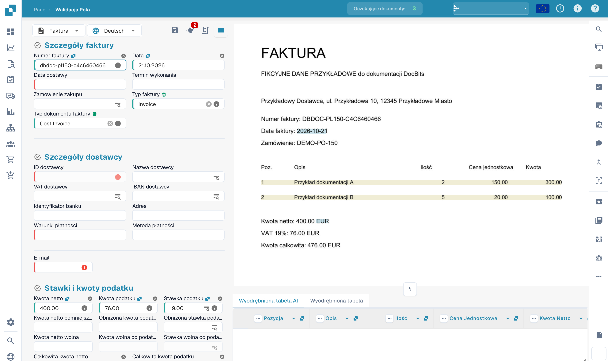

# Pola Nagłówka Szkolenia

Po przesłaniu dokumentu zostaniesz przeniesiony na ekran walidacji.\
Niektóre pola mogą być już wypełnione — jest to zasługa inteligencji zbiorowej DocBits. Jednak inne pola mogą pozostać puste. Zazwyczaj oznacza to, że typ dokumentu nie został jeszcze w pełni przeszkolony, więc DocBits nie wie jeszcze, skąd wydobyć tę informację.

Możesz pomóc w szkoleniu DocBits, aby rozpoznawał te pola, ręcznie identyfikując poprawne dane.\
**Proszę zauważyć:** jeśli pole pozostaje puste, może to po prostu oznaczać, że informacja nie znajduje się w przesłanym dokumencie.

<figure><figcaption>
Walidacja fikcyjnej faktury przed trenowaniem pól nagłówka.
</figcaption></figure>

### Aby przeszkolić pole:

1. Kliknij pole, które chcesz przeszkolić.
2. Następnie albo:
   * **Podwójnie kliknij** na odpowiednich danych w dokumencie, albo
   * **Narysuj prostokąt wyboru** wokół danych za pomocą kursora.

<figure><figcaption>
Wybór numeru faktury jako punktu początkowego treningu.
</figcaption></figure>

Powtórz ten proces dla wszystkich wymaganych pól.\
Gdy wszystkie niezbędne pola zostaną wypełnione, **kliknij "Zapisz Reguły"**, aby zapisać szkolenie. Zapewnia to, że DocBits uczy się, gdzie znaleźć każdy kawałek informacji dla podobnych dokumentów w przyszłości.

Po zapisaniu, twój dokument jest gotowy do wyeksportowania — a następnym razem DocBits automatycznie wydobyje przeszkolone pola.

Po zamierzonym zapisaniu treningu przetestuj inne dokumenty tego samego dostawcy. Eksport zależy również od walidacji i skonfigurowanego przepływu.
