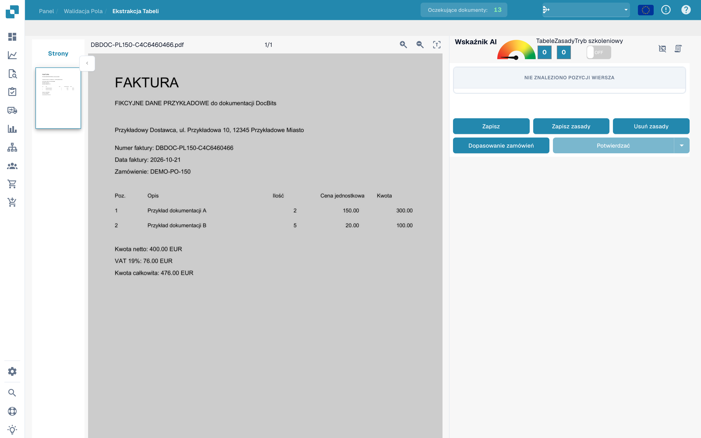
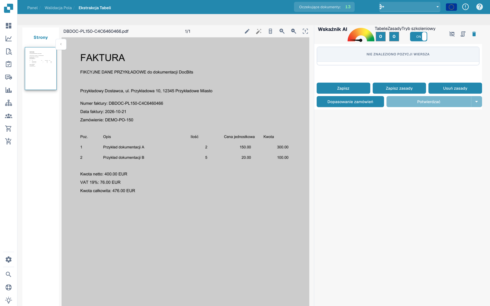
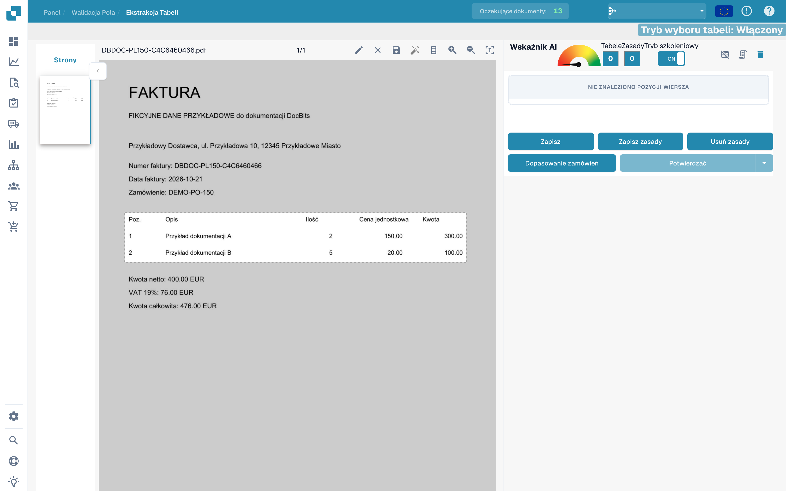
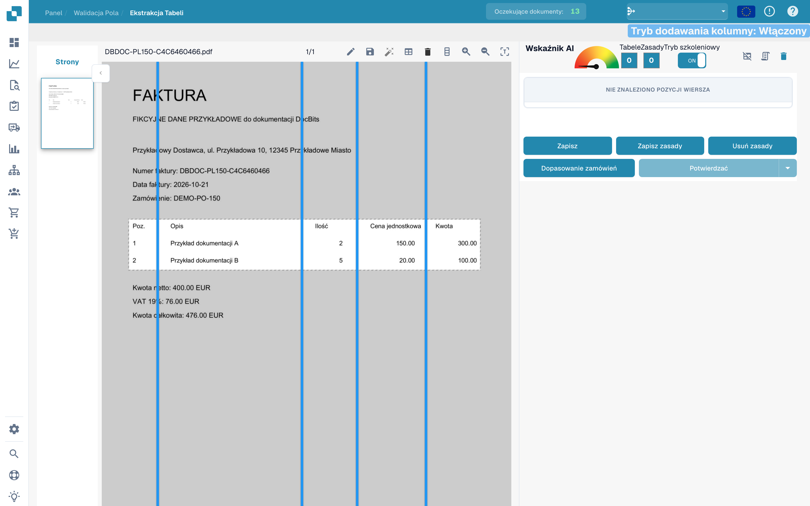
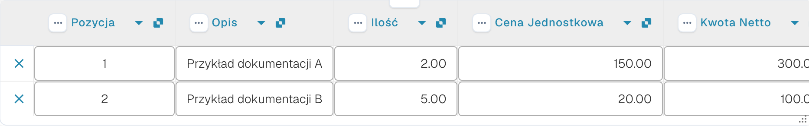

# Definiowanie tabel i kolumn

Jeśli tabela nie została w pełni rozpoznana, trening tabeli pozwala wskazać jej obszar i kolumny. Przykłady wykorzystują fikcyjną fakturę i niezapisany projekt.

## Otwieranie treningu

Otwórz dokument w walidacji pól i przejdź do ekstrakcji tabel.

<figure><figcaption>
Interfejs definiowania tabel i kolumn.
</figcaption></figure>

Włącz tryb treningu, aby wyświetlić narzędzia zaznaczania i kolumn.

<figure><figcaption>
Trenowanie tabeli z włączonym trybem treningu.
</figcaption></figure>

Pasek narzędzi udostępnia również automatyczne wykrywanie. Porównaj wynik z dokumentem: obraz pokazuje dostępne narzędzia i nie potwierdza wykonania wykrywania.

<figure><figcaption>
Narzędzia trenowania tabeli, w tym automatyczne wykrywanie.
</figcaption></figure>

## Wskazywanie obszaru i kolumn

Narysuj ołówkiem prostokąt obejmujący nagłówki i wiersze faktury. Pozostaw podsumowania poza obszarem.

<figure><figcaption>
Niezapisany obszar tabeli obejmujący wiersze fikcyjnej faktury.
</figcaption></figure>

Wybierz narzędzie kolumn i umieść pionowe separatory pomiędzy rzeczywistymi kolumnami.

<figure><figcaption>
Obszar tabeli z pionowymi separatorami kolumn.
</figcaption></figure>

Sprawdź pozycję, opis, ilość, cenę jednostkową i kwotę.

<figure><figcaption>
Separatory kolumn fikcyjnej faktury.
</figcaption></figure>

Sprawdź cały obszar i wszystkie separatory przed zapisaniem dokumentu lub reguł.

<figure><figcaption>
Obszar i separatory w niezapisanym projekcie treningu.
</figcaption></figure>

## Sprawdzanie ekstrakcji

Porównaj odczytane wiersze z fakturą. Następny obraz przedstawia wiersze odczytane wcześniej automatycznie w walidacji. Nie są one wynikiem pokazanego wyżej projektu treningu.

<figure><figcaption>
Automatycznie odczytane wiersze fikcyjnej faktury w walidacji.
</figcaption></figure>

Po zamierzonym zapisaniu sprawdź inne dokumenty tego samego dostawcy. Jedna faktura nie dowodzi poprawnego odczytu wszystkich układów.
