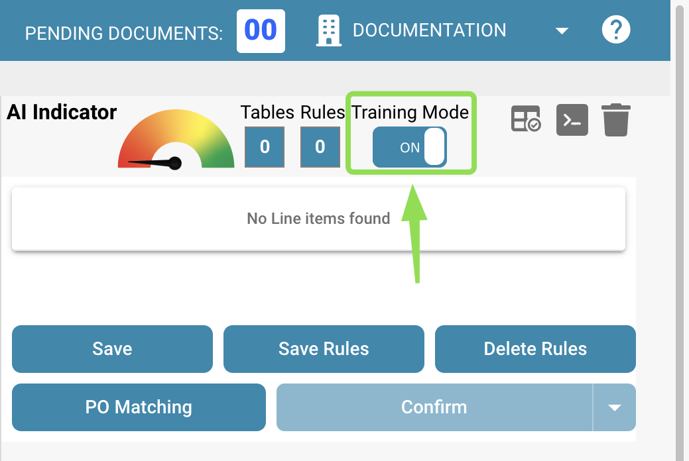

# Definiowanie tabel i kolumn

Skorzystaj z tego przewodnika, aby ręcznie zdefiniować tabele i kolumny do ekstrakcji pozycji liniowych w DocBits. Jest to szczególnie przydatne, gdy automatyczne wykrywanie nie rozpoznaje w pełni struktury tabeli lub gdy trzeba dodać własne pola.

### 1. Otwórz widok ekstrakcji tabel

Otwórz dokument w DocBits i kliknij przycisk **„Table Training”**, aby przejść do widoku ekstrakcji tabel.

<figure><figcaption></figcaption></figure>

### 2. Aktywuj tryb szkolenia

Aby ręcznie zdefiniować lub zmodyfikować tabele i kolumny, kliknij **„TRAINING MODE”**.

<figure><figcaption></figcaption></figure>

### 3. Zdefiniuj obszar tabeli

Po przejściu do trybu szkolenia możesz określić, gdzie na dokumencie znajduje się tabela. Masz do wyboru dwie opcje:

#### Opcja 1: Użyj automatycznego wykrywania

Kliknij przycisk **„Auto-Detect Tables”**, aby DocBits spróbował samodzielnie rozpoznać obszar tabeli.

<figure><figcaption></figcaption></figure>

Jeśli wykrywanie się powiedzie, obrys tabeli zostanie wyświetlony automatycznie. Następnie możesz przejść do definiowania kolumn.

#### Opcja 2: Zdefiniuj tabelę ręcznie

Jeśli automatyczne wykrywanie zawiedzie lub jest niedokładne, możesz zdefiniować tabelę ręcznie:

1. Kliknij przycisk **„Edit”**, aby aktywować tryb wyboru tabeli.
2. Narysuj prostokąt wokół obszaru tabeli w widoku dokumentu po lewej stronie.

<figure><figcaption></figcaption></figure>

### 4. Dodaj i zdefiniuj kolumny

Gdy tabele są zdefiniowane, możesz ręcznie zdefiniować kolumny za pomocą następującego przycisku:\

<figure><figcaption></figcaption></figure>

Zdefiniuj i posortuj kolumny za pomocą przeciągania i upuszczania na dokumencie. Powtórz to samo dla tabel na pozostałych stronach. Jeśli tabele są identyczne na każdej stronie, możesz użyć następującego przycisku, aby zastosować te same kolumny do wszystkich tabel zdefiniowanych w dokumencie. Ta funkcja kopiuje zdefiniowane kolumny również na wszystkie pozostałe strony:

<figure><figcaption></figcaption></figure>

Użyj funkcji **powiększania**, aby lepiej zdefiniować kolumny w zagmatwanych lub złożonych dokumentach, na przykład gdy wiele informacji znajduje się blisko siebie i utrudnia to zdefiniowanie kolumn:

<figure><figcaption></figcaption></figure>

Jeśli kolumna została zdefiniowana przez pomyłkę, możesz ją zaznaczyć, klikając ją, i usunąć za pomocą następującego przycisku:

<figure><figcaption></figcaption></figure>

<mark style="color:red;">**Uwaga**</mark>: Przycisk jest widoczny tylko wtedy, gdy kolumna jest zaznaczona.

Gdy skończysz definiować wszystkie tabele i kolumny w dokumencie, użyj przycisku „Zapisz”, aby aktywować zmiany i wyodrębnić dane z dokumentu:

<figure><figcaption></figcaption></figure>

Dane ze wszystkich zdefiniowanych obszarów zostaną wyodrębnione i wyświetlone po prawej stronie:

<figure><figcaption></figcaption></figure>

### 6. Zapisz i wyodrębnij

Kliknij **„Save Rules”** po zdefiniowaniu wszystkich tabel i kolumn.

* Dzięki temu DocBits wie, gdzie szukać danych tabeli dla tego konkretnego dostawcy.
* Przy następnym przesłaniu dokumentu od tego samego dostawcy DocBits automatycznie wyodrębni tabelę, korzystając z zapisanych reguł.

<mark style="color:red;">**Uwaga**</mark>: To szkolenie jest specyficzne dla dostawcy. Nie będzie stosowane do dokumentów od innych dostawców.
