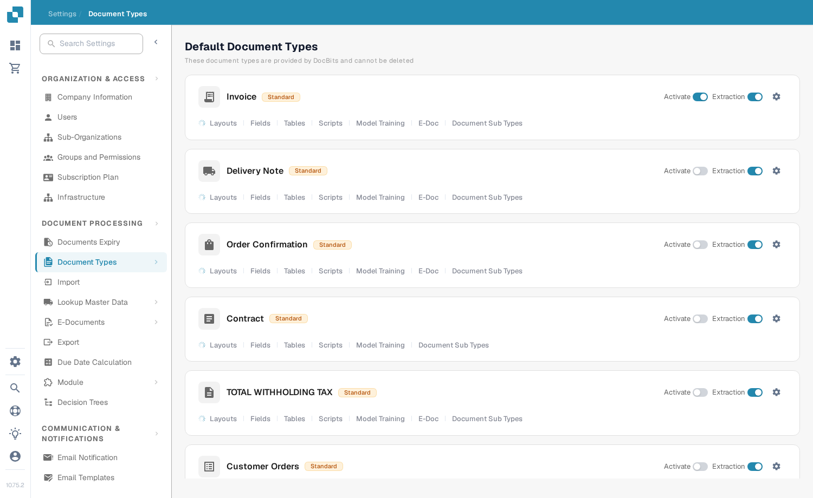

# Typy dokumentów

Typy dokumentów informują DocBits, z jakimi rodzajami dokumentów pracuje Twoja organizacja. Administrator znajdzie je w sekcji **Settings → Document Types** w części **Document Processing** menu ustawień.

Strona pokazuje **Default Document Types**, które udostępnia DocBits i których nie można usunąć, a następnie **Custom Document Types** utworzone dla Twojej organizacji. Każdy typ ma własną kartę.

<figure><figcaption>
Wybierz kartę typu dokumentu, aby go skonfigurować.
</figcaption></figure>

## Co można zrobić na karcie

| Element | Co robi |
| --- | --- |
| **Activate** | Udostępnia lub ukrywa ten typ dokumentu w Twojej organizacji. Niebieski przełącznik oznacza włączony, szary – wyłączony. |
| **Extraction** | Wybiera tryb ekstrakcji: **Flex** po włączeniu lub **Fix** po wyłączeniu. Nie służy po prostu do włączania i wyłączania ekstrakcji. Najedź kursorem na przełącznik, aby zobaczyć bieżący tryb. |
| **Settings** (ikona koła zębatego) | Otwiera **More Settings** dla tego typu. Rozwiń tam kategorię, aby zobaczyć jej opcje. Kategorie zależą od typu dokumentu. |
| **Layouts** | Otwiera konfigurację układów. Kolejne kroki znajdziesz w [Layout Builder](layout-builder.md). |
| **Fields** | Otwiera ustawienia pól i rozpoznawania dla tego typu. Sposób konfiguracji opisano w [Fields](../../settings/global-settings/document-types/fields/README.md). |
| **Tables** | Otwiera konfigurację kolumn tabeli dla tego typu. |
| **Scripts** | Otwiera skrypty przetwarzania, jeśli ta funkcja jest dostępna. |
| **Model Training** | Otwiera trenowanie modelu dla tego typu. |
| **E-Doc** | Otwiera ustawienia dokumentów elektronicznych, jeśli typ je obsługuje. |
| **Document Sub Types** | Otwiera podtypy tego typu dokumentu. |

W zależności od funkcji dostępnych w Twojej organizacji możesz zobaczyć więcej linków, na przykład do reguł walidacji lub transformacji. Wybierz link na karcie typu, który chcesz zmienić.

## Edycja pól i ustawień rozpoznawania

Kliknij **Fields** na karcie, aby zobaczyć grupy pól. U góry tej strony **OCR** i **Match Score** ustawiają progi rozpoznawania, **Restore Defaults** przywraca te progi do wartości domyślnych, a **Search by Name** wyszukuje pole. Użyj **Create new group**, aby uporządkować pola, oraz **Create field** w grupie, aby dodać nowe pole. **Master Data Settings** otwiera powiązaną konfigurację danych podstawowych.

Każdy wiersz pola ma elementy sterujące, takie jak **Required**, **Read Only**, **Hidden**, **Force Validation**, **Use AI**, OCR, Match Score i Formula. Przed zmianą poszczególnych wartości zapoznaj się z [przewodnikiem Fields](../../settings/global-settings/document-types/fields/README.md). Kliknij **Save Settings** na stronie Fields, aby zachować zmiany.

<figure><figcaption>
Strona Fields ma własny przycisk Save Settings.
</figcaption></figure>

## Tworzenie własnego typu dokumentu

Przewiń do **Custom Document Types** i kliknij **+ New**. Aby skonfigurować nowy typ, postępuj zgodnie z [Adding/Editing Document Types](../../settings/global-settings/document-types/adding-editing-document-types.md).

<figure><figcaption>
Użyj przycisku New w sekcji Custom Document Types, aby rozpocząć tworzenie typu.
</figcaption></figure>
