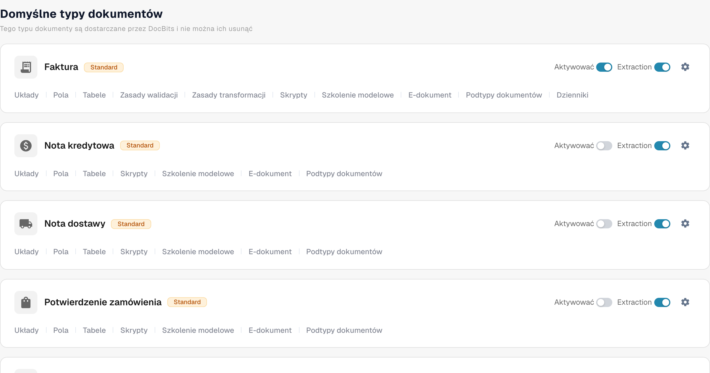
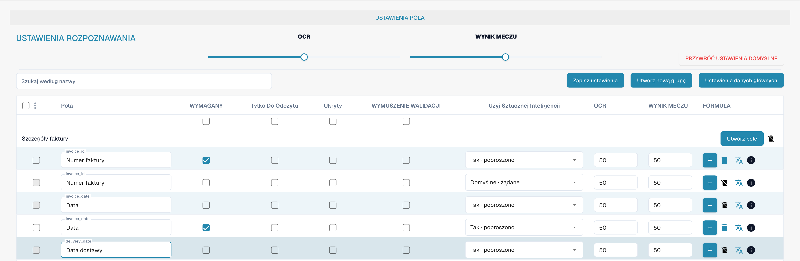
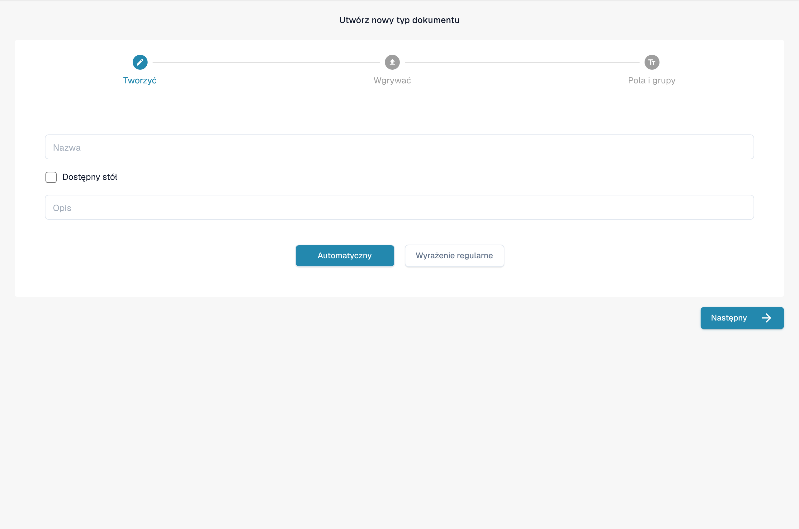

# Typy dokumentów

Typy dokumentów informują DocBits, z jakimi rodzajami dokumentów pracuje Twoja organizacja. Administrator znajdzie je w sekcji **Ustawienia → Typy dokumentów** w części **Przetwarzanie dokumentów** menu ustawień.

Strona pokazuje **Domyślne typy dokumentów**, które udostępnia DocBits i których nie można usunąć, a następnie **Niestandardowe typy dokumentów** utworzone dla Twojej organizacji. Każdy typ ma własną kartę.

<figure><figcaption>
Standardowe typy dokumentów i dostęp do ich ustawień.
</figcaption></figure>

## Co można zrobić na karcie

| Element | Co robi |
| --- | --- |
| **Aktywować** | Udostępnia lub ukrywa ten typ dokumentu w Twojej organizacji. Niebieski przełącznik oznacza włączony, szary – wyłączony. |
| **Ekstrakcja** | Wybiera tryb ekstrakcji: **Flex** po włączeniu lub **Fix** po wyłączeniu. Nie służy po prostu do włączania i wyłączania ekstrakcji. Najedź kursorem na przełącznik, aby zobaczyć bieżący tryb. |
| **Ustawienia** (ikona koła zębatego) | Otwiera **Więcej ustawień** dla tego typu. Rozwiń tam kategorię, aby zobaczyć jej opcje. Kategorie zależą od typu dokumentu. |
| **Układy** | Otwiera konfigurację układów. Kolejne kroki znajdziesz w [Layout Builder](layout-builder.md). |
| **Pola** | Otwiera ustawienia pól i rozpoznawania dla tego typu. Sposób konfiguracji opisano w [Fields](../../settings/global-settings/document-types/fields/README.md). |
| **Tabele** | Otwiera konfigurację kolumn tabeli dla tego typu. |
| **Skrypty** | Otwiera skrypty przetwarzania, jeśli ta funkcja jest dostępna. |
| **Szkolenie modelowe** | Otwiera trenowanie modelu dla tego typu. |
| **E-dokument** | Otwiera ustawienia dokumentów elektronicznych, jeśli typ je obsługuje. |
| **Podtypy dokumentów** | Otwiera podtypy tego typu dokumentu. |

W zależności od funkcji dostępnych w Twojej organizacji możesz zobaczyć więcej linków, na przykład do reguł walidacji lub transformacji. Wybierz link na karcie typu, który chcesz zmienić.

## Edycja pól i ustawień rozpoznawania

Kliknij **Pola** na karcie, aby zobaczyć grupy pól. U góry tej strony **OCR** i **Próg dopasowania** ustawiają progi rozpoznawania, **Przywróć wartości domyślne** przywraca te progi do wartości domyślnych, a **Szukaj według nazwy** wyszukuje pole. Użyj **Utwórz nową grupę**, aby uporządkować pola, oraz **Utwórz pole** w grupie, aby dodać nowe pole. **Ustawienia danych głównych** otwiera powiązaną konfigurację danych podstawowych.

Każdy wiersz pola ma elementy sterujące, takie jak **Obowiązkowe**, **Tylko do odczytu**, **Ukryty**, **Wymuszona walidacja**, **Użyj sztucznej inteligencji**, OCR, Match Score i Formula. Przed zmianą poszczególnych wartości zapoznaj się z [przewodnikiem Fields](../../settings/global-settings/document-types/fields/README.md). Kliknij **Zapisz ustawienia** na stronie Fields, aby zachować zmiany.

<figure><figcaption>
Konfiguracja pól typu dokumentu Faktura. Etykieta WYNIK MECZU oznacza tu próg dopasowania (Match Score), nie wynik sportowy.
</figcaption></figure>

## Tworzenie własnego typu dokumentu

Przewiń do **Niestandardowe typy dokumentów** i kliknij **+ New**. Aby skonfigurować nowy typ, postępuj zgodnie z [Adding/Editing Document Types](../../settings/global-settings/document-types/adding-editing-document-types.md).

<figure><figcaption>
Formularz nowego typu dokumentu przed zapisaniem. Etykieta Dostępny stół oznacza tabelę danych; Wygrywać oznacza przesyłanie plików.
</figcaption></figure>
