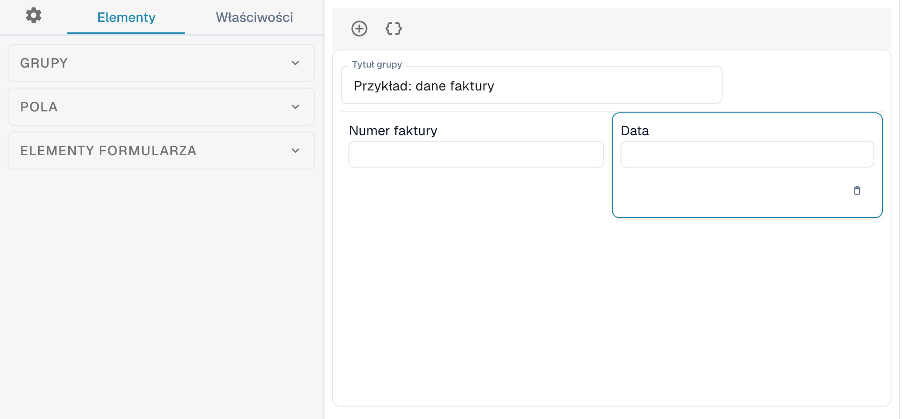
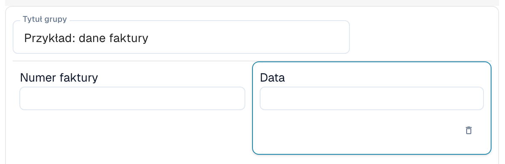
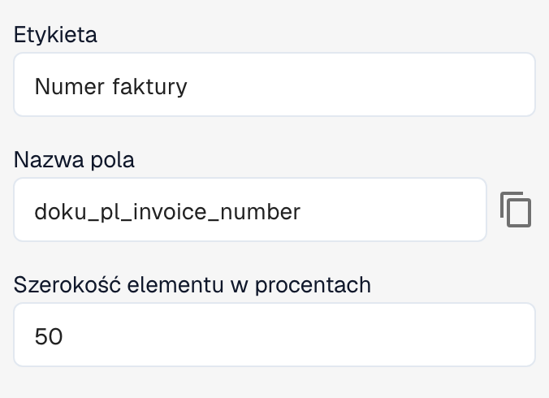

# Edytor układu

Edytor układu służy do rozmieszczania pól i elementów sterujących widocznych podczas walidacji lub zatwierdzania dokumentu. Każdy układ jest przypisany do typu dokumentu, pochodzenia i typu układu. Przed zapisaniem zmian sprawdź, który układ jest otwarty.

## Otwieranie układu

1. Otwórz **Ustawienia → Typy dokumentów**.
2. Otwórz edytor układu dla wybranego typu lub podtypu dokumentu. Jeśli edytor jest niedostępny, administrator może musieć włączyć ten moduł dla Twojej organizacji.
3. Sprawdź pochodzenie wybrane na pasku narzędzi i typ edytora wskazany obok.

<figure><figcaption>
Fragment edytora: sekcje Grupy, Pola i Elementy formularza po lewej oraz uproszczony przykładowy układ faktury pośrodku.
</figcaption></figure>

Zmiana wartości **Pochodzenie** może spowodować utworzenie osobnego układu dla tego pochodzenia. Przed edycją sprawdź wybrane pochodzenie.

## Obszary edytora

Po lewej możesz przełączać się między kartami **Elementy**, **Właściwości** i ustawieniami ogólnymi oznaczonymi ikoną koła zębatego.

* Karta **Elementy** zawiera sekcje **Grupy**, **Pola** i **Elementy formularza**. Rozwiń odpowiednią sekcję, aby zobaczyć dostępne grupy, pola i elementy formularza.
* Obszar pośrodku pokazuje grupy i pola układu. Grupy służą do porządkowania powiązanych pól.
* Po prawej znajduje się podgląd przykładowego dokumentu z możliwością zmiany powiększenia.

Aby dodać grupę, pole lub element formularza, przeciągnij go z odpowiedniej sekcji po lewej do obszaru układu.

<figure><figcaption>
Pola Numer faktury i Data w przykładowej grupie. W tym układzie każde pole zajmuje 50% szerokości grupy.
</figcaption></figure>

Pola dokumentu wielokrotnego użytku skonfiguruj w sekcji [Typy dokumentów](README.md). Dostępne pola zależą od wybranego typu dokumentu i jego konfiguracji.

## Zmiana właściwości elementu

Wybierz grupę lub pole w obszarze układu i otwórz **Właściwości** po lewej. Dostępne opcje zależą od wybranego elementu i obejmują między innymi etykietę, nazwę techniczną, szerokość oraz zachowanie.

<figure><figcaption>
Właściwości wybranego pola: Etykieta, Nazwa pola i Szerokość elementu w procentach.
</figcaption></figure>

W pokazanym przykładzie **Etykieta** zawiera „Numer faktury”, **Nazwa pola** to techniczna nazwa `doku_pl_invoice_number`, a **Szerokość elementu w procentach** wynosi 50.

W przypadku pól predefiniowanych etykieta i nazwa techniczna mogą być nieedytowalne. Zależnie od typu elementu można też ustawić tryb tylko do odczytu, widoczność, kolejność przechodzenia klawiszem Tab, listy wartości oraz uruchamianie przepływu pracy lub skryptu po zmianie wartości. Grupy i pola mają różne opcje.

Po zmianie właściwości sprawdź rezultat w obszarze układu. Szerokość jest wprowadzana jako wartość procentowa za pomocą kontrolki liczbowej; grupy i ich pola mogą mieć różne szerokości. Więcej informacji znajdziesz w artykule [Konfigurowanie właściwości pól](../../settings/global-settings/document-types/layout-manager/configuring-field-properties.md).

## Szablony i JSON

Oprócz zapisywania układu pasek narzędzi udostępnia funkcje generowania szablonu, stosowania domyślnego układu do układów według pochodzenia, używania domyślnego szablonu oraz edycji JSON. Dostępność zależy od otwartego edytora.

Wygenerowanie lub zastosowanie szablonu może zastąpić układ niestandardowy. Najpierw sprawdź typ dokumentu, pochodzenie i bieżący układ. **Edytuj JSON** służy do zaawansowanej konfiguracji i wymaga znajomości formatu szablonu. Konfigurację można skopiować w oknie JSON.

## Sprawdzanie i zapisywanie

Rozmieść grupy i pola oraz sprawdź wynik w obszarze układu. Gdy jest prawidłowy, użyj przycisku **Zapisz** na pasku narzędzi. Informacje o układach specyficznych dla pochodzenia znajdziesz w artykule [Układy według pochodzenia](origin-layouts.md).


Ilustracje przedstawiają uproszczony przykładowy układ faktury. Nazwy pól i dostępne opcje zależą od konfiguracji.

