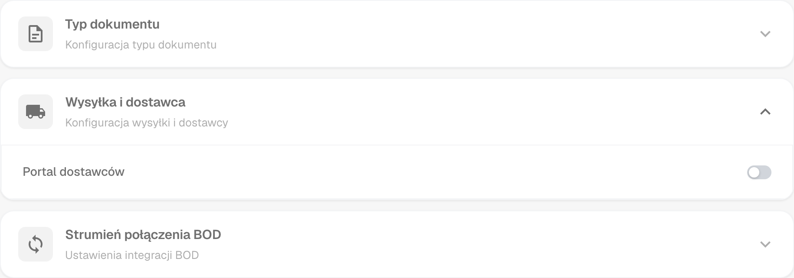
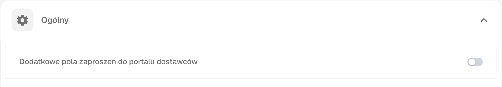
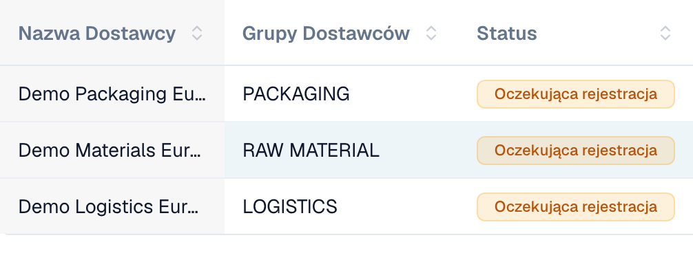
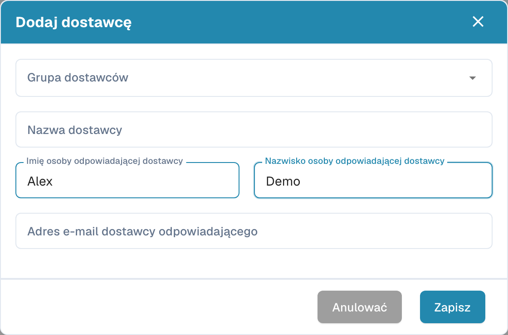

# Portal dostawców

**Portal dostawców** umożliwia administratorowi udostępnienie **DocBits** dostawcom swojej firmy. Administrator aktywuje portal i określa, którzy dostawcy mogą z niego korzystać oraz jakie informacje mogą przeglądać.

Zaproszony dostawca rejestruje się i loguje na własne konto. Może wtedy przeglądać udostępnione mu informacje, na przykład status swoich zamówień zakupu i faktur. Dostępne funkcje zależą od konfiguracji organizacji.

## Film: przygotowanie portalu dostawców i dostępu

Fikcyjny administrator przedstawia opcję portalu, wybór planu, przygotowanie zaproszenia i stronę rejestracji. Aktywacja, wysyłka, rejestracja i zatwierdzenie są wyjaśnione jako osobne kroki.



[Otwórz film z polskimi napisami i wyborem rozdziałów](https://docbits-videos.fra1.cdn.digitaloceanspaces.com/settings-assistant/supplier-portal-access-admin/v1/pl.html)

*Postać i głos są syntetyczne. Interfejs pochodzi z organizacji demonstracyjnej DocBits.*

## Administrator: włączenie portalu

1. W ustawieniach otwórz moduły i wybierz **Integracja dokumentów**.
2. Rozwiń **Wysyłka i dostawca** i włącz **Portal dostawców**.
3. Jeśli pojawi się okno aktywacji, sprawdź wyświetlony plan i potwierdź wybraną aktywację.

<figure><figcaption>
Opcja portalu w module wysyłek i dostawców. Ten przełącznik włącza funkcję dla organizacji.
</figcaption></figure>

## Administrator: konfiguracja portalu

Skonfiguruj portal organizacji przed wysłaniem pierwszych zaproszeń:

- [Ogólne ustawienia dostawców](../../settings/supplier-setting/supplier-general-settings.md): Dodatkowe pola zaproszeń, statusy, logo i informacje o prywatności.
- [Szablony wiadomości e-mail](../../settings/supplier-setting/editing-email-templates.md): Treść i wygląd wiadomości z zaproszeniami.
- [Układ dostawcy](../../settings/supplier-setting/supplier-layout.md): Pola rejestracji dostawców i wewnętrznego zarządzania dostawcami. Wybierz odpowiedni typ układu.
- [Uprawnienia dostawców](../../settings/supplier-setting/supplier-permissions.md): Przypisanie pracowników wewnętrznych do grup dostawców. Te wewnętrzne obowiązki są odrębne od własnego dostępu dostawcy do portalu.

<figure><figcaption>
Ogólne ustawienia dostawców z opcją dodatkowych pól zaproszenia.
</figcaption></figure>

## Administrator: zapraszanie dostawców

Otwórz zarządzanie dostawcami. Przed zaproszeniem sprawdź firmę, grupę dostawców, osobę kontaktową i adres e-mail. Przy tworzeniu dostawcy zapisanie danych zleca wysłanie zaproszenia do rejestracji; nie jest jedynie zapisem wersji roboczej. Dla istniejącego dostawcy użyj odpowiedniej akcji zaproszenia. Potwierdzenie wysłania nie dowodzi doręczenia wiadomości ani ukończenia rejestracji.

<figure><figcaption>
Wewnętrzne zarządzanie trzema fikcyjnymi firmami. Wszystkie trzy statusy wskazują tutaj oczekiwanie na rejestrację.
</figcaption></figure>

<figure><figcaption>
Formularz tworzenia i zapraszania dostawcy. Przed zapisaniem sprawdź firmę, osobę kontaktową i adres e-mail.
</figcaption></figure>

## Dostawca: rejestracja i dostęp do DocBits

Dostawca otwiera zaproszenie, tworzy lub wykorzystuje przewidziane własne konto i przechodzi skonfigurowane etapy rejestracji. Następnie może przeglądać udostępnione mu informacje w DocBits. Dokładny przebieg i dostępne funkcje zależą od organizacji.

[Instrukcja rejestracji dostawców](supplier-registration.md).

## Dostęp i status to różne rzeczy

Włączenie portalu, wysłanie zaproszenia, ukończenie rejestracji i zatwierdzenie są odrębnymi stanami. Rekord dostawcy lub zapisane dane podstawowe nie dowodzą gotowego dostępu do portalu. Widok dostawcy zależy od przypisanych uprawnień i różni się od wewnętrznego widoku administratora.
