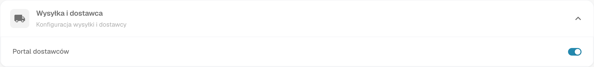
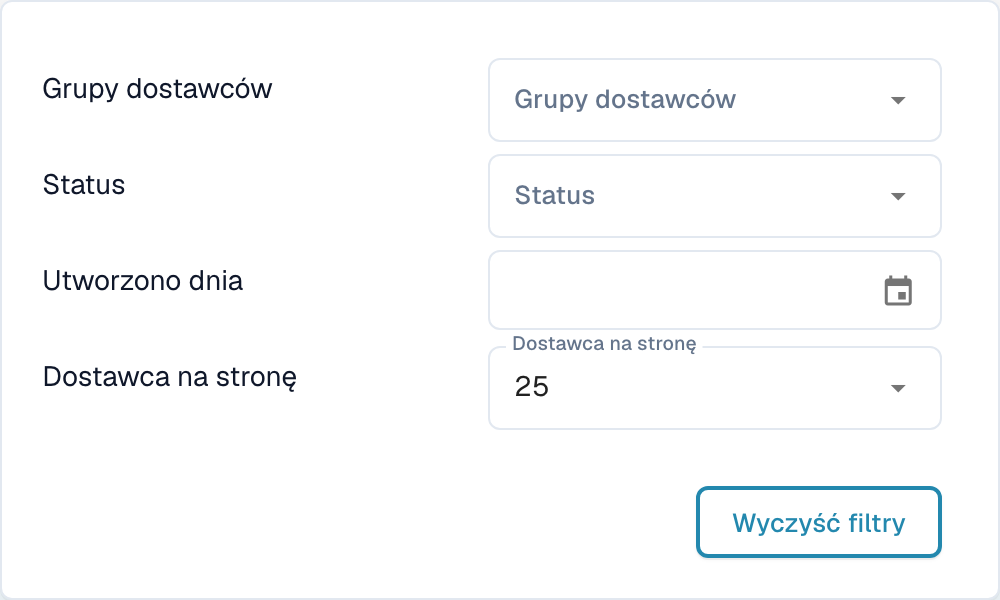
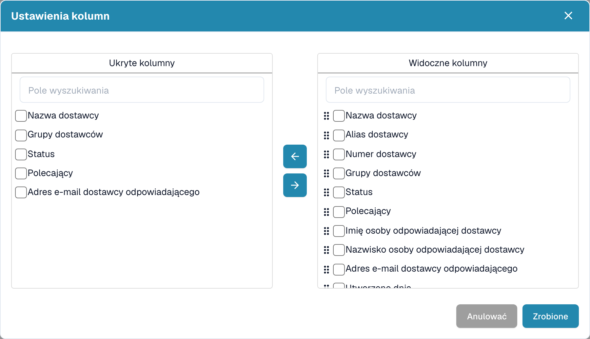
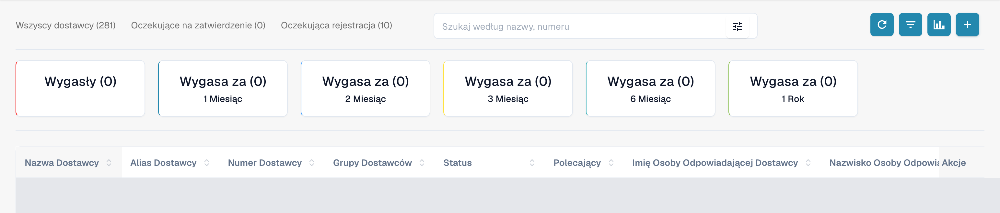
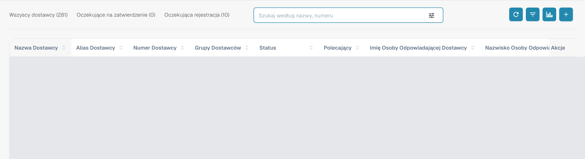
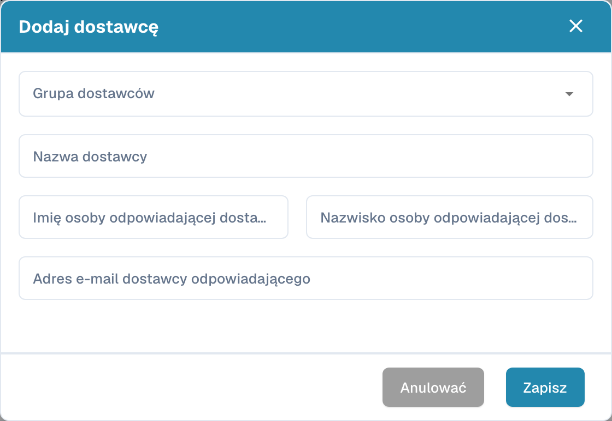

# Portal dostawców

**Portal dostawców** umożliwia administratorowi udostępnienie **DocBits** dostawcom swojej firmy. Administrator aktywuje portal i określa, którzy dostawcy mogą z niego korzystać oraz jakie informacje mogą przeglądać.

Zaproszony dostawca rejestruje się i loguje na własne konto. Może wtedy przeglądać udostępnione mu informacje, na przykład status swoich zamówień zakupu i faktur. Dostępne funkcje zależą od konfiguracji organizacji.

## Film: przygotowanie portalu dostawców i dostępu

Administrator przedstawia opcję portalu, wybór planu, przygotowanie zaproszenia i stronę rejestracji. Aktywacja, wysyłka, rejestracja i zatwierdzenie są wyjaśnione jako osobne kroki.



[Otwórz film z polskimi napisami i wyborem rozdziałów](https://docbits-videos.fra1.cdn.digitaloceanspaces.com/settings-assistant/supplier-portal-access-admin/v1/pl.html)

## Administrator: włączenie portalu

1. W ustawieniach otwórz moduły i wybierz **Integracja dokumentów**.
2. Rozwiń **Wysyłka i dostawca** i włącz **Portal dostawców**.
3. Jeśli pojawi się okno aktywacji, sprawdź wyświetlony plan i potwierdź wybraną aktywację.

<figure><figcaption>
Rzeczywisty widok Dev po polsku, Wysyłka i dostawca: Portal dostawców jest już włączony w tej organizacji testowej. Przełącznika nie zmieniono na potrzeby zrzutu.
</figcaption></figure>

## Administrator: konfiguracja portalu

Skonfiguruj portal organizacji przed wysłaniem pierwszych zaproszeń:

- [Ogólne ustawienia dostawców](../../settings/supplier-setting/supplier-general-settings.md): Dodatkowe pola zaproszeń, statusy, logo i informacje o prywatności.
- [Szablony wiadomości e-mail](../../settings/supplier-setting/editing-email-templates.md): Treść i wygląd wiadomości z zaproszeniami.
- [Układ dostawcy](../../settings/supplier-setting/supplier-layout.md): Pola rejestracji dostawców i wewnętrznego zarządzania dostawcami. Wybierz odpowiedni typ układu.
- [Uprawnienia dostawców](../../settings/supplier-setting/supplier-permissions.md): Przypisanie pracowników wewnętrznych do grup dostawców. Te wewnętrzne obowiązki są odrębne od własnego dostępu dostawcy do portalu.

<figure><figcaption>
Rzeczywisty widok dodatkowych pól zaproszeń: opcja jest już włączona, a Pola zachowują skonfigurowaną wartość Assigned User. Nie zapisano żadnej zmiany.
</figcaption></figure>

## Administrator: wyszukiwanie i filtrowanie dostawców

Otwórz **panel dostawców** do zarządzania wewnętrznego. Liczniki **Wszyscy dostawcy**, **Oczekujące na zatwierdzenie** i **Oczekująca rejestracja** pozwalają ograniczyć wyświetlaną listę. Pole **Szukaj według nazwy, numeru** służy do wyszukiwania dostawcy po nazwie lub numerze.

Otwórz przycisk filtrów w polu wyszukiwania, aby użyć **Grupy dostawców**, **Status** i **Utworzono dnia**. **Dostawca na stronę** określa rozmiar strony; **Wyczyść filtry** usuwa aktywne filtry wyszukiwania. Te elementy dotyczą listy dostawców.

<figure><figcaption>
Menu filtrów z Grupy dostawców, Status, Utworzono dnia, Dostawca na stronę i Wyczyść filtry. Zrzut pokazuje dostępne elementy interfejsu i nie potwierdza funkcjonalnego testu wyniku filtrowania.
</figcaption></figure>

## Administrator: wybór widocznych kolumn

Obok przycisku odświeżania otwórz ustawienia kolumn. Podpowiedź brzmi **Ustaw kolumny tabeli dla organizacji**. Wybierz pola w **Ukryte kolumny** lub **Widoczne kolumny** i przenoś je między listami za pomocą strzałek. Uchwyty przeciągania pozwalają zmienić kolejność widocznych kolumn. **Zrobione** stosuje wybór dla organizacji; **Anulować** zamyka okno bez jego zastosowania. Przewijanie w poziomie umożliwia dostęp do kolumn tabeli szerszej niż ekran.

<figure><figcaption>
Ustawienia kolumn z Ukryte kolumny, Widoczne kolumny, strzałkami, Anulować i Zrobione. Okno zamknięto przez Anulować bez zmiany wyboru.
</figcaption></figure>

## Administrator: analiza terminów ważności

Użyj **Analityka**, czyli ikony wykresu obok ustawień kolumn, aby pokazać lub ukryć zestawienie terminów ważności. Karty pokazują **Wygasły** i **Wygasa za** z okresami **1 Miesiąc**, **2 Miesiąc**, **3 Miesiąc**, **6 Miesiąc** i **1 Rok**, zgodnie z etykietami w interfejsie. Wybranie karty ogranicza listę do odpowiedniego okresu. Liczniki dotyczą terminów ważności związanych z dostawcami.

<figure><figcaption>
Analityka pokazuje Wygasły i Wygasa za dla jednego, dwóch, trzech lub sześciu miesięcy oraz roku. Wiersze są zasłonięte i nie wybrano żadnej karty.
</figcaption></figure>

## Administrator: zapraszanie dostawców

Otwórz zarządzanie dostawcami. Przed zaproszeniem sprawdź firmę, grupę dostawców, osobę kontaktową i adres e-mail. Przy tworzeniu dostawcy zapisanie danych zleca wysłanie zaproszenia do rejestracji; nie jest jedynie zapisem wersji roboczej. Dla istniejącego dostawcy użyj odpowiedniej akcji zaproszenia. Potwierdzenie wysłania nie dowodzi doręczenia wiadomości ani ukończenia rejestracji.

<figure><figcaption>
Panel wewnętrzny z Wszyscy dostawcy, Oczekujące na zatwierdzenie, Oczekująca rejestracja, wyszukiwaniem i paskiem narzędzi. Wiersze istniejących dostawców są zasłonięte.
</figcaption></figure>

<figure><figcaption>
Pusty formularz Dodaj dostawcę z Grupa dostawców, Nazwa dostawcy, polami imienia i nazwiska osoby kontaktowej, adresem e-mail oraz Anulować i Zapisz. Lewe pole dotyczy imienia, prawe nazwiska; aplikacja skraca tutaj długie etykiety. Zapisz zleca wysłanie zaproszenia do rejestracji; na potrzeby zrzutu użyto tylko Anulować.
</figcaption></figure>

## Administrator: otwieranie szczegółów z panelu dostawców

Pracownicy wewnętrzni mogą otworzyć szczegóły z wiersza dostawcy w panelu. Widok zawiera te same sześć sekcji, które wypełnia dostawca, oraz ich status. Umożliwia sprawdzanie i aktualizowanie przekazanych informacji oraz wykonanie odpowiedniego zatwierdzenia. Na potrzeby tych zrzutów nie otwarto żadnego wiersza istniejącego dostawcy.

## Dostawca: rejestracja i dostęp do DocBits

Dostawca otwiera zaproszenie, tworzy lub wykorzystuje przewidziane własne konto i przechodzi skonfigurowane etapy rejestracji. Następnie może przeglądać udostępnione mu informacje w DocBits. Dokładny przebieg i dostępne funkcje zależą od organizacji.

[Instrukcja rejestracji dostawców](supplier-registration.md).

## Dostęp i status to różne rzeczy

Włączenie portalu, wysłanie zaproszenia, ukończenie rejestracji i zatwierdzenie są odrębnymi stanami. Rekord dostawcy lub zapisane dane podstawowe nie dowodzą gotowego dostępu do portalu. Widok dostawcy zależy od przypisanych uprawnień i różni się od wewnętrznego widoku administratora.

Zrzuty wykonano z autoryzowanego konta testowego Dev i polskiego interfejsu. Sprawdzono żądania odczytu interfejsu i list, widoczne elementy oraz formularze anulowane bez zmian. Nie zapisano ustawień portalu ani wyboru kolumn, nie utworzono ani nie zmieniono dostawców i nie wykonano zaproszeń, rejestracji ani zatwierdzeń. Wyniki wyszukiwania i filtrowania oraz doręczenie wiadomości e-mail nie są potwierdzone jako przetestowane funkcjonalnie. Istniejący film zachowano; nie przeprowadzono nowej oceny dźwięku, języka ani synchronizacji.
