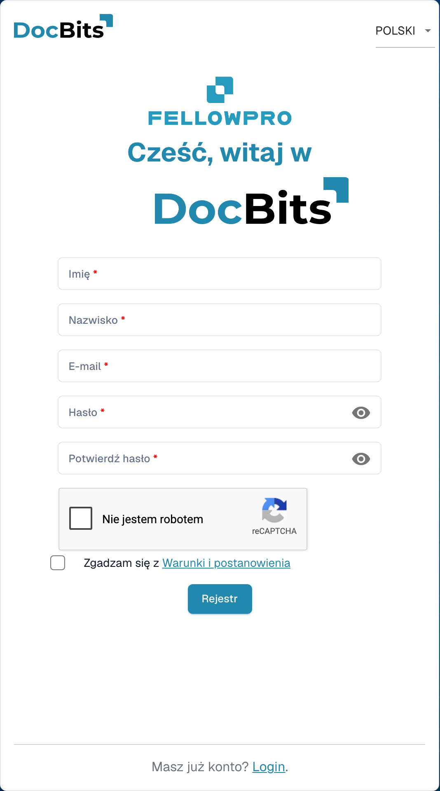

# Rejestracja dostawców

Ta instrukcja jest przeznaczona dla dostawców zaproszonych do portalu DocBits danej organizacji. Użyj linku z zaproszenia. Masz własne konto dostawcy; organizacja zapraszająca określa dostępne informacje i wymagane etapy rejestracji.

## 1. Otwórz zaproszenie

Sprawdź, która organizacja wysłała zaproszenie i dla jakiego adresu e-mail jest przeznaczone. Otwórz link rejestracyjny z tego zaproszenia. Jeśli wygasł lub dotyczy innej osoby, poproś organizację o nowe zaproszenie.

## 2. Skonfiguruj własne konto

Sprawdź wstępnie uzupełnione imię, nazwisko i adres e-mail. Podaj wymagane dane konta i przestrzegaj wyświetlonych zasad dotyczących hasła. Przeczytaj warunki i informacje o prywatności. Zakończ tworzenie konta przy użyciu funkcji rejestracji. Istniejące konto i nowa rejestracja to różne przypadki; postępuj zgodnie ze ścieżką przewidzianą dla zaproszenia.

<figure><figcaption>
Formularz rejestracji konta dostawcy. Pokazano pusty formularz; zaproszenie może wstępnie uzupełnić część danych.
</figcaption></figure>

## 3. Uzupełnij dane dostawcy

Uzupełnij dane i ewentualne dokumenty wymagane przez organizację. Pola i sekcje zależą od skonfigurowanego układu dostawcy. Oznaczenia i komunikaty walidacji wskazują wymagane informacje. Zapisz postęp, jeśli ekran oferuje taką możliwość; zapisanie nie oznacza automatycznie końcowego przesłania.

## 4. Sprawdź rejestrację i zatwierdzenie

Prześlij dane za pomocą przeznaczonej do tego akcji zakończenia. Jeśli skonfigurowano weryfikację lub zatwierdzenie, poczekaj na wynik. Następnie zaloguj się na własne konto. Organizacja określa, jakie zamówienia, faktury i inne informacje możesz przeglądać.

## Jeśli nie możesz uzyskać dostępu

Skontaktuj się z organizacją zapraszającą, jeśli link jest nieprawidłowy, brakuje uprawnień lub wymagane dane są niejasne. Wewnętrzny rekord dostawcy nie zastępuje rejestracji ani niezbędnego zatwierdzenia dostępu.

[Konfiguracja portalu dostawców](README.md).
