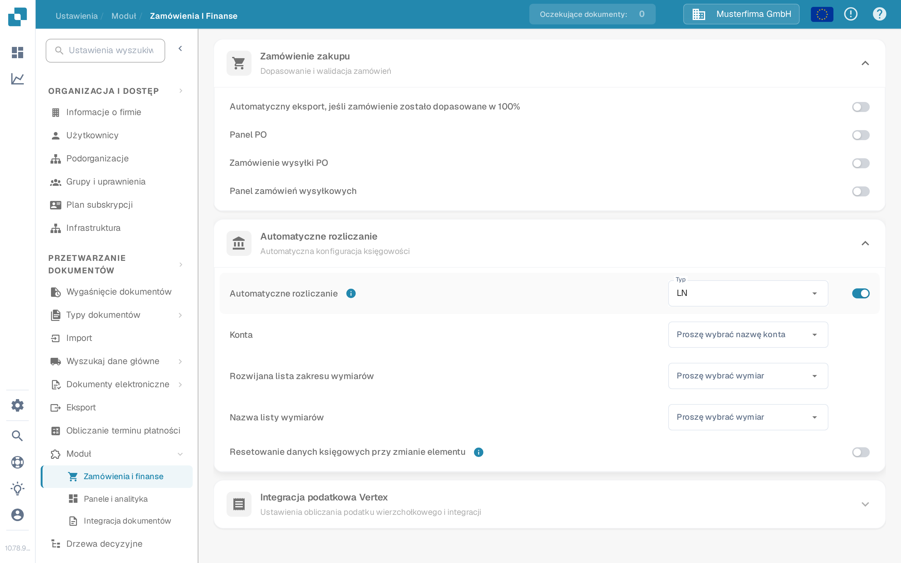

# Testowanie automatycznego rozliczania

Automatyczne rozliczanie wymaga włączonego modułu, danych podstawowych księgowości oraz faktury z użytecznymi kwotami lub pozycjami. Ten przewodnik rozdziela ustawienia, które można sprawdzić przed otwarciem faktury, od kontroli wymagających skonfigurowanego połączenia z LN lub M3.

## Sprawdź ustawienia modułu

1. Otwórz **Ustawienia → Moduł → Zamówienia i finanse** i rozwiń **Automatyczne rozliczanie**. Starsza ścieżka **Przetwarzanie dokumentów → Moduł → Zamówienie zakupu / Automatyczne rozliczanie** nie jest już trasą wyświetlaną w bieżącej aplikacji.
2. Wybierz **Typ** dla podłączonego systemu (**LN** lub **M3**). Włącz **Automatyczne rozliczanie** tylko wtedy, gdy wymagane dane podstawowe i połączenie są gotowe.
3. Po włączeniu wybierz listę **Konta** oraz listy wymiarów odpowiednie dla Twojego systemu. W przypadku LN widoczne pola to między innymi **Rozwijana lista zakresu wymiarów** i **Nazwa listy wymiarów**. M3 ma inne pola. Użyj **Resetowanie danych księgowych przy zmianie elementu** tylko wtedy, gdy zamierzasz przeliczyć dane po zmianie elementu.

<figure><figcaption>
Automatyczne rozliczanie jest wyłączone w polskiej organizacji testowej Sandbox.
</figcaption></figure>

<figure><figcaption>
Pola widoczne po włączeniu ustawienia. Po wykonaniu zrzutu ustawienie zostało ponownie wyłączone; nie skonfigurowano żadnych kont ani wymiarów.
</figcaption></figure>

## Testowanie za pomocą skonfigurowanej faktury

Użyj faktury, której pozycje i dane podstawowe księgowości są dostępne. Otwórz ją na ekranie walidacji i wybierz **Auto Accounting**. Jeśli akcja jest niedostępna, sprawdź ustawienie modułu oraz to, czy ta faktura kwalifikuje się do tej operacji. Zwaliduj fakturę przed przejściem dalej; aplikacja zapisuje i waliduje po wybraniu akcji.

Na ekranie księgowania sprawdź poniższe punkty, korzystając z własnych danych LN lub M3:

1. Uruchom **Validate Setup**, jeśli jest dostępne, i rozwiąż problem brakującej konfiguracji kont lub wymiarów przed kontynuowaniem. Zielony wynik opisuje wyłącznie kontrole w Twoim środowisku.
2. Sprawdź, czy faktura powinna być przypisana według **kwoty łącznej**, czy według **poszczególnych pozycji**. Porównaj kwoty księgowania z oryginalną fakturą.
3. Jeśli dzielisz kwotę, wybierz docelowe konto dla każdego wiersza podziału. Wprowadź kwoty lub wartości procentowe i sprawdź, czy przypisane wartości sumują się do kwoty nadrzędnej. Dodaj lub usuń wiersz tylko wtedy, gdy jest to konieczne.
4. Przejrzyj ewentualną kwotę **Unsettled amount** lub ostrzeżenie walidacji i popraw je przed zapisaniem lub eksportem. Wynik potwierdź osobno w podłączonym systemie.

Organizacja testowa Sandbox użyta do powyższych zrzutów ekranu nie ma skonfigurowanych list kont i wymiarów ani pozycji faktury dla tego przepływu. Ekran księgowania, dzielenie oraz eksport **nie zostały tutaj przetestowane ani przedstawione**. Nie używaj zrzutów ekranu ustawień jako dowodu, że księgowanie lub eksport się powiodły.

Aby przejść do konfiguracji specyficznej dla systemu, kontynuuj z [przewodnikiem LN](ln.md) lub [przewodnikiem M3](m3.md).
