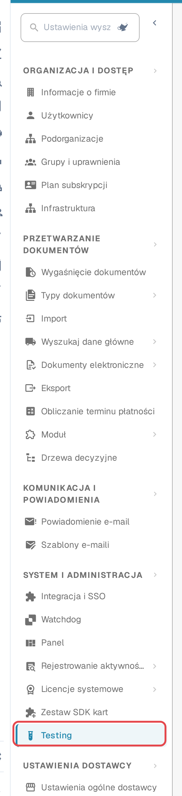
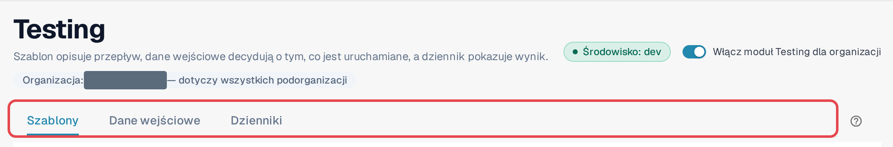
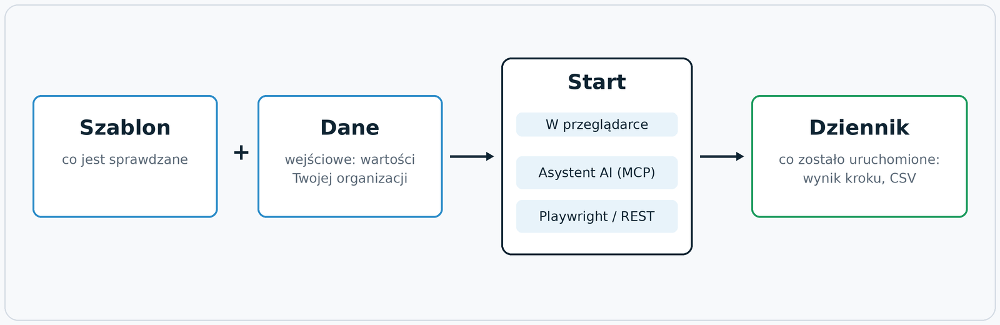
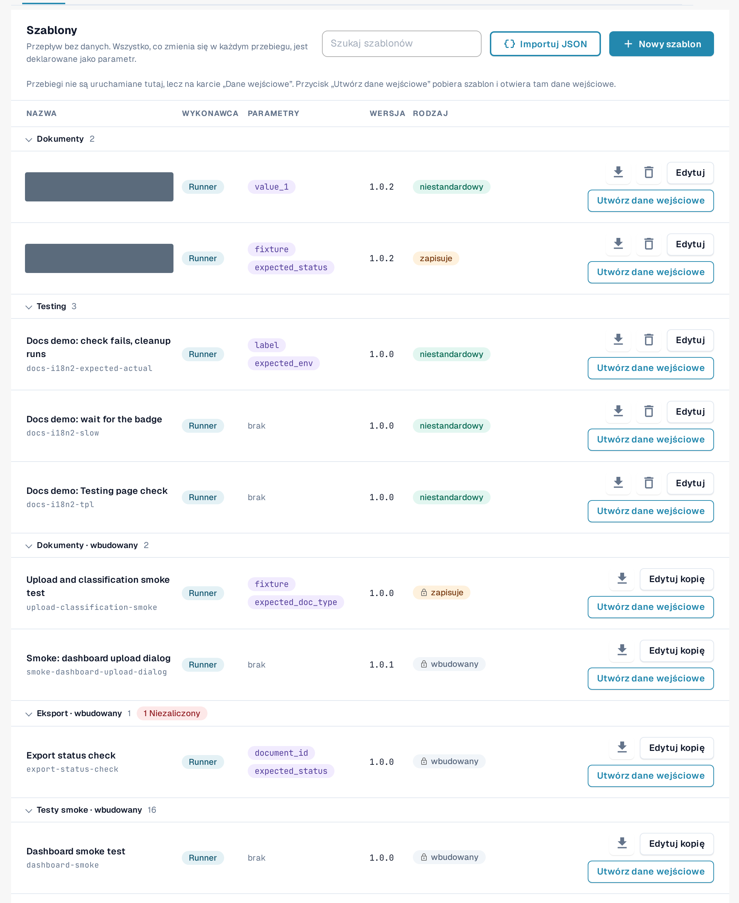

# Moduł Testing

## Do czego służy moduł Testing

Moduł **Testing** uruchamia testy przeglądarkowe w Twojej własnej, zalogowanej sesji DocBits. Test steruje prawdziwymi
ekranami, a nie atrapą: otwiera panel, przesyła przykładową fakturę, sprawdza, czy nowy dokument trafia do walidacji,
albo potwierdza, że eksport zgłasza oczekiwany status. Sprawdza, czy DocBits działa poprawnie
**w Twojej organizacji**, i zapisuje wynik każdego kroku.

Moduł znajdziesz w **Ustawienia → Testing**. Jest przeznaczony dla administratorów, którzy opiekują się zestawami testów
organizacji.

Użyj go, gdy chcesz:

* potwierdzić, że po wydaniu nowej wersji, zmianie konfiguracji lub imporcie ustawień wszystko nadal działa;
* powtórzyć tę samą kontrolę odbiorczą dla kilku organizacji podczas wdrożenia;
* przekazać zespołowi QA listę kontroli, które każdy może uruchomić i których wyniki każdy może przeczytać;
* pozwolić Twojej automatyzacji testów lub asystentowi AI uruchamiać te same kontrole i odczytywać wyniki.

## Kto może z niego korzystać

Moduł jest dostępny dla **administratorów organizacji** (zobacz [Uprawnienia administratora](https://docs.docbits.com/administration-and-setup/settings/global-settings/groups-users-and-permissions/users/admin-privileges)).
Dla każdej organizacji jest wyłączony, dopóki administrator organizacji go nie włączy.

1. Otwórz **Ustawienia**. W panelu bocznym, w sekcji **System i administracja**, wybierz **Testing**.
2. Włącz przełącznik **Włącz moduł Testing dla organizacji**.

<figure><figcaption>
Panel boczny Ustawień z wyróżnioną pozycją Testing.
</figcaption></figure>

<figure><figcaption>
Nagłówek strony Testing ze znacznikiem środowiska, przełącznikiem i trzema zakładkami.
</figcaption></figure>

Pod tytułem napis **Organizacja: … — dotyczy wszystkich podorganizacji** pokazuje organizację, dla której działa ta strona. To, co tu ustawisz, dotyczy tej organizacji i wszystkich jej podorganizacji.

Gdy przełącznik jest wyłączony, strona pokazuje tylko komunikat *Moduł Testing jest wyłączony. Nic nie zostanie uruchomione, dopóki administrator organizacji go nie włączy.* Ponowne wyłączenie przełącznika kończy też wszystkie karty przeglądarki, które zostały zarejestrowane do uruchamiania z zewnątrz.

Znacznik **Środowisko** pokazuje, gdzie jesteś. W środowisku klienta (sandbox lub produkcja) jest czerwony,
a DocBits stosuje dodatkową ochronę: testy zmieniające dane wymagają wyraźnego potwierdzenia, a kroki eksportowania,
usuwania i zatwierdzania są blokowane, chyba że szablon deklaruje, że zapisuje dane.

## Jak to działa: szablon, dane wejściowe, start, dziennik

Strona ma trzy zakładki: **Szablony**, **Dane wejściowe** i **Dziennik**. Szablon opisuje przepływ, dane wejściowe
decydują o tym, z czym test jest uruchamiany, a dziennik pokazuje wynik.

<figure><figcaption>
Diagram: szablon plus dane wejściowe dają test; jest on uruchamiany w przeglądarce, przez asystenta AI lub z zewnątrz; każdy przebieg kończy się w Dzienniku.
</figcaption></figure>

| Element | Zakładka | Czym jest |
|---|---|---|
| **Szablon** | **Szablony** | Wielokrotnego użytku definicja testu: *co* jest sprawdzane, krok po kroku. Nie zawiera żadnych danych Twojej organizacji. Wszystko, co różni się między organizacjami, jest **parametrem**. |
| **Dane wejściowe** | **Dane wejściowe** | Zapisane wartości Twojej organizacji dla parametrów jednego szablonu, na przykład dokument do otwarcia. **Szablon + dane wejściowe = test, który możesz uruchomić.** |
| **Start** | **Dane wejściowe** | Moduł wykonuje test i nim steruje. Są trzy równorzędne sposoby uruchomienia: w przeglądarce, z asystenta AI przez MCP albo z zewnątrz za pomocą Playwright lub wywołania REST. |
| **Dziennik** | **Dziennik** | Co faktycznie zostało wykonane, niezależnie od sposobu uruchomienia: wynik, każdy krok, użyte parametry. Wykres historii pokazuje wyniki w czasie; dzienniki możesz wyeksportować do CSV. |

DocBits dostarcza **szablony domyślne** (ich identyfikatory zaczynają się od `default-smoke-`) oraz kilka szablonów wbudowanych. Są
takie same dla każdej organizacji i nie można ich zmieniać ani usuwać. Szablon domyślny można uruchomić w dowolnej organizacji;
dane wejściowe dostarczają to, co jest specyficzne dla Twojej. Możesz też tworzyć własne szablony i ponownie je usuwać.

## Szybki start: uruchom test domyślny

1. Otwórz **Ustawienia → Testing**, zakładka **Szablony**.
2. W grupie **Testy dymne** znajdź szablon domyślny bez parametrów (w kolumnie **Parametry** widnieje *brak*), na przykład *Default smoke: log metrics*.
3. Wybierz **Utwórz dane wejściowe**. Otworzy się zakładka **Dane wejściowe** z nowymi danymi dla tego szablonu.
4. W polu **Nazwa danych wejściowych** wpisz nazwę i wybierz **Zapisz dane wejściowe**.
5. Wybierz **Start**. Test jest wykonywany w tej karcie przeglądarki; nie przeładowuj i nie zamykaj karty, dopóki trwa.
6. Otwórz zakładkę **Dziennik**. Najnowszy wiersz pokazuje wynik: **Zaliczony**, **Niezaliczony** lub **Zablokowany**.

<figure><figcaption>
Zakładka Szablony z grupą Testy dymne.
</figcaption></figure>

Czytaj dalej:

* [Szablony](templates.md): szablony domyślne, własne szablony, import i usuwanie
* [Gotowe kroki i bloki](steps-and-blocks.md): grupy kroków, ustawienia zaawansowane, czyszczenie, zapamiętane wartości
* [Wybieranie elementu w aplikacji](pick-in-app.md): wybierz element, wskazując go
* [Ponowne załadowanie i wznowienie](reload-and-resume.md): ponowne załadowanie strony w trakcie testu
* [Dane wejściowe](inputs.md): zapisz wartości swojej organizacji
* [Uruchamianie testu](start-a-test.md): w przeglądarce, z asystenta AI lub z Playwright
* [Dziennik i historia](logs.md): wyniki, wykres i eksport do CSV
* [Rozwiązywanie problemów](troubleshooting.md)
* [Dla programistów](for-developers.md)
