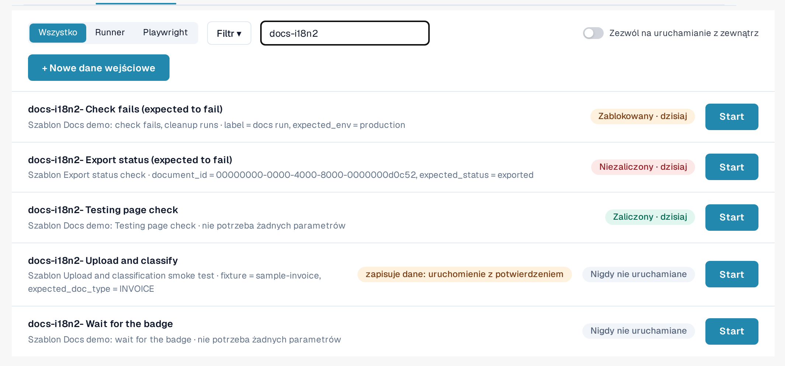
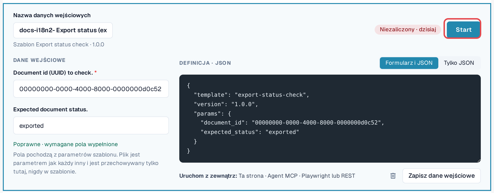
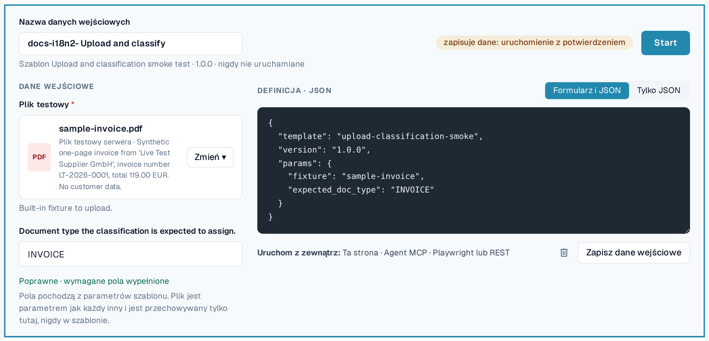

# Dane wejściowe

Dane wejściowe przechowują **wartości Twojej organizacji** dla parametrów jednego szablonu, pod wybraną przez Ciebie nazwą.
Szablon plus dane wejściowe to test, który możesz uruchamiać wielokrotnie, ręcznie lub automatycznie.

Przykład: domyślny szablon *Default smoke: validation contract* otwiera dokument i sprawdza jego status oraz
typ dokumentu. Potrzebuje identyfikatora dokumentu. Twoje dane wejściowe *Invoice LT-2026-0001 ready for validation* przechowują identyfikator
dokumentu z Twojej organizacji oraz oczekiwany status.

Otwórz **Ustawienia → Testing**, zakładka **Dane wejściowe**.

<figure><figcaption>
Zakładka Dane wejściowe z zapisanymi danymi i ich ostatnimi wynikami.
</figcaption></figure>

Każdy wiersz pokazuje nazwę danych wejściowych, ich szablon i wersję, ostatni wynik oraz **Start**. **Dostępna aktualizacja**
oznacza, że szablon ma nowszą wersję niż ta, dla której zapisano te dane wejściowe. Etykieta **zapisuje: uruchom z potwierdzeniem**
oznacza dane wejściowe, których szablon zmienia dane.

## Tworzenie danych wejściowych

1. W zakładce **Szablony** wybierz **Utwórz dane wejściowe** przy szablonie. (Lub w zakładce **Dane wejściowe** wybierz
   **+ Nowe dane wejściowe** i wskaż szablon.)
2. W polu **Nazwa danych wejściowych** wpisz nazwę, na przykład cel i organizację.
3. Wypełnij parametry. Pola wymagane są oznaczone gwiazdką. Możesz przełączać się między **Formularz i JSON**
   oraz **Tylko JSON**; oba widoki pozostają ze sobą zgodne.
4. Sprawdź wiersz pod formularzem: *Poprawne · wymagane pola wypełnione* oznacza, że dane wejściowe można uruchomić.
5. Wybierz **Zapisz dane wejściowe**.

<figure><figcaption>
Edytor danych wejściowych z nazwą, parametrami i wierszem poprawności.
</figcaption></figure>

### Pliki jako parametry

Niektóre szablony przesyłają dokument. Ich parametr pliku oferuje **Pliki organizacji** (PDF, PNG lub JPEG do 10 MB,
które Twoja organizacja przesłała do testowania) oraz **Pliki testowe serwera** (syntetyczne pliki testowe dostarczane przez DocBits).
Plik jest przechowywany w Twojej organizacji, nigdy w szablonie.

<figure><figcaption>
Parametr pliku z plikami organizacji i plikami testowymi serwera.
</figcaption></figure>

### Wartości, które nigdy nie są zapisywane

Parametry oznaczone jako wrażliwe (na przykład hasło do systemu zewnętrznego) nigdy nie są przechowywane. Dane wejściowe
zapamiętują tylko to, że wartość jest potrzebna; podajesz ją przy każdym uruchomieniu (*Wysyłane tylko przy starcie; nigdy nie zapisywane.*).
Dzienniki pokazują takie wartości jako *Podane przy starcie*.

## Zmiana lub usuwanie danych wejściowych

Otwórz dane wejściowe z listy, zmień je i wybierz **Zapisz dane wejściowe**. Aby je usunąć, wybierz ikonę kosza w
edytorze i potwierdź. Usunięcie danych wejściowych nie usuwa ich dzienników.


Jeśli Twoja organizacja prowadzi **przypadki testowe**, łącze **Przypadki testowe** w menu filtrów zakładki Dane wejściowe wyświetla ich
przypadki i pokazuje, które mają szablon. Przypadek bez szablonu może zostać potwierdzony ręcznie przez uprawnioną osobę.

