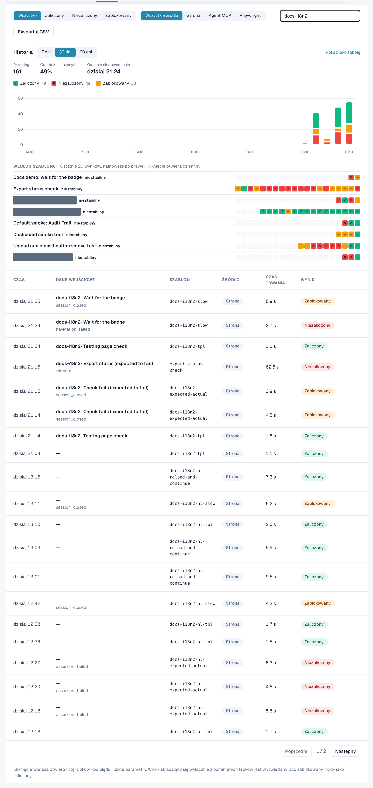
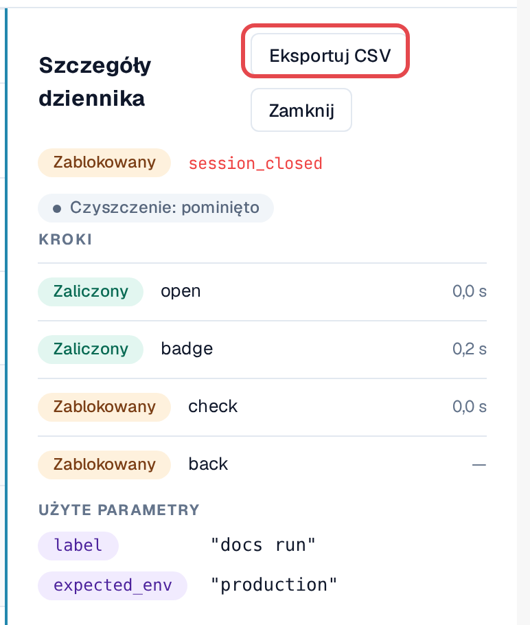
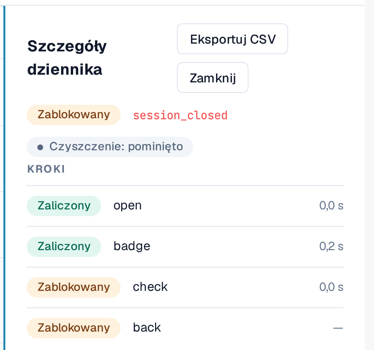
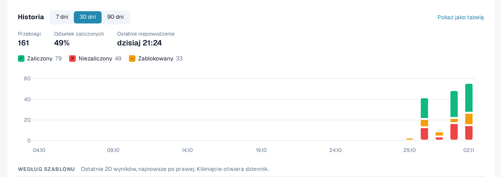
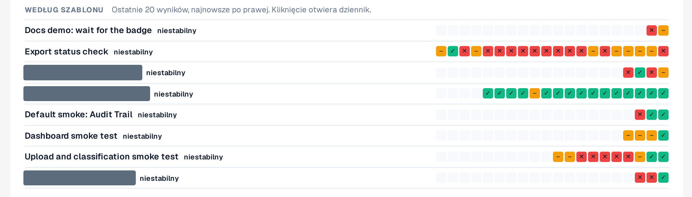

# Dziennik i historia

Każdy przebieg, niezależnie od sposobu uruchomienia, trafia do zakładki **Dziennik**: wynik, kroki, kod błędu nieudanego
kroku i użyte parametry. Dzienniki nie przechowują zawartości stron ani zrzutów ekranu.

Otwórz **Ustawienia → Testing**, zakładka **Dziennik**.

<figure><figcaption>
Zakładka Dziennik z różnymi wynikami i źródłami.
</figcaption></figure>

## Odczytywanie listy

| Kolumna | Znaczenie |
|---|---|
| **Czas** | Kiedy przebieg się rozpoczął. |
| **Dane wejściowe** | Uruchomione dane wejściowe (lub przypadek planu testów). |
| **Szablon** | Identyfikator szablonu. |
| **Źródło** | **Strona** (uruchomiony w przeglądarce), **Agent MCP**, **Playwright**, **Ręcznie** (przypadek potwierdzony ręcznie). |
| **Czas trwania** | Jak długo trwał przebieg. |
| **Wynik** | **Zaliczony**: każdy krok zakończył się powodzeniem. **Niezaliczony**: któryś krok się nie powiódł. **Zablokowany**: przebiegu nie dało się ocenić, na przykład z powodu pominiętych kroków; przebieg złożony wyłącznie z pominiętych kroków nigdy nie jest pokazywany jako zaliczony. |

Filtruj za pomocą **Wszystko / Zaliczony / Niezaliczony / Zablokowany**, za pomocą **Wszystkie źródła / Strona / Agent MCP / Playwright**
albo przez **Szukaj w dzienniku**.

## Otwieranie dziennika

Wybierz wiersz. **Szczegóły dziennika** pokazują każdy krok z jego wynikiem, kod błędu nieudanego kroku oraz
**Użyte parametry** (wartości wrażliwe tylko jako *Podane przy starcie*). **Otwórz przypadek** przechodzi do przypadku planu testów, jeśli
taki istnieje.

<figure><figcaption>
Szczegóły dziennika nieudanego przebiegu.
</figcaption></figure>

### Wartość oczekiwana i rzeczywista

Pod sprawdzeniem, które się nie powiodło, **Szczegóły dziennika** pokazują, czego sprawdzenie oczekiwało i co znalazło:

* **Oczekiwane**: wartość, której wymaga szablon.
* **Rzeczywiste**: wartość, która znajdowała się na stronie.

Obie pojawiają się tylko w **środowiskach deweloperskich i testowych**, są skracane do 120 znaków i pomijane, gdy
krok używa wartości wrażliwej. W środowisku klienta (sandbox, produkcja) dziennik zachowuje tylko kod błędu.

### Czyszczenie

Jeśli szablon ma [kroki czyszczenia](steps-and-blocks.md), etykieta obok wyniku pokazuje, jak się zakończyły:
**Czyszczenie: zaliczone**, **Czyszczenie: niezaliczone** lub **Czyszczenie: pominięte** (na przykład dlatego, że przebieg został zatrzymany). Kroki czyszczenia
są wykonywane nawet po nieudanym sprawdzeniu. Nieudane czyszczenie nie zmienia wyniku przebiegu, ale dane testowe, na przykład
przesłany dokument, mogą zostać po teście. Otwórz dziennik, aby zobaczyć, który krok czyszczenia się nie powiódł.

<figure><figcaption>
Szczegóły dziennika: nieudane sprawdzenie z polami Oczekiwane i Rzeczywiste oraz etykietą Czyszczenie: zaliczone.
</figcaption></figure>

## Wykres historii

Nad listą **Historia** pokazuje, jak testy przebiegały w czasie. Przełączaj się między **Pokaż jako wykres** i **Pokaż jako tabelę**.

* **Wyniki według dni**: ile przebiegów zostało zaliczonych, niezaliczonych lub zablokowanych w każdym dniu, w Twojej strefie czasowej. Wybierz
  **Zakres czasu** (od 7 do 90 dni, domyślnie 30). Wybierz dzień, aby przefiltrować listę do tego dnia; **Pokaż ponownie wszystkie dni** usuwa filtr.
* **Wskaźnik zaliczeń** i **Ostatnie niepowodzenie** podsumowują zakres. Przebiegi, które jeszcze trwają, są liczone jako *bez wyniku*.
* **Według szablonu**: ostatnie 20 wyników każdego szablonu, najnowszy po prawej, z etykietą: **stabilny** (tylko
  zaliczone), **niestabilny** (mieszane wyniki) lub **niezaliczany** (tylko niezaliczone lub zablokowane). Wybierz wynik, aby otworzyć jego dziennik.
  Niestabilne szablony są wymienione jako pierwsze.

<figure><figcaption>
Historia: wyniki według dni.
</figcaption></figure>

<figure><figcaption>
Według szablonu: ostatnie 20 wyników i stabilność.
</figcaption></figure>

## Eksport do CSV

Wybierz **Eksportuj CSV** na pasku narzędzi, aby pobrać dzienniki odpowiadające wybranemu wynikowi i źródłu (do 5000;
tekst wyszukiwania nie jest uwzględniany). W widoku **Szczegóły dziennika** przycisk **Eksportuj CSV** pobiera pojedynczy dziennik ze wszystkimi jego krokami.

Plik otwiera się bezpośrednio w programie Excel (UTF-8). Czasy podano w UTC. Zawiera te same informacje co strona: bez
wartości wrażliwych i bez zawartości stron.

<figure><figcaption>
Eksportuj CSV na pasku narzędzi Dziennika.
</figcaption></figure>
