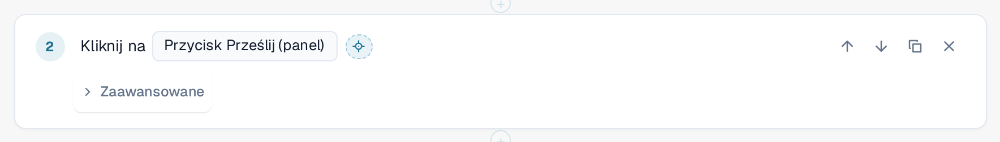
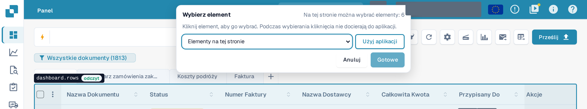
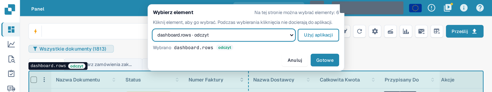
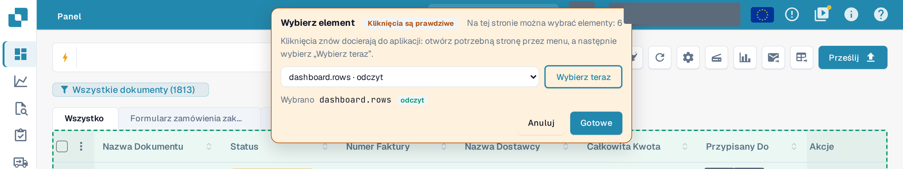

# Wybieranie elementu w aplikacji

Każdy krok musi wiedzieć, **na którym elemencie** strony działa: na przycisku, polu, tabeli. Zamiast szukać go
na długiej liście, możesz wskazać go w prawdziwej aplikacji.

## Wybieranie elementu

1. W edytorze szablonu wybierz przycisk z celownikiem **Wybierz w aplikacji** obok elementu kroku.

<figure><figcaption>
Przycisk Wybierz w aplikacji obok elementu kroku Kliknij
</figcaption></figure>

2. DocBits otwiera stronę, na której test znajduje się w tym kroku: stronę najbliższego wcześniejszego kroku **Otwórz stronę**.
   Jeśli ten krok używa wartości danych wejściowych, DocBits pyta, którą stronę otworzyć. Twój szkic zostaje zachowany, niezapisany, a
   aplikacja pozostaje w tej samej karcie przeglądarki.
3. U góry pojawia się pasek **Wybierz element**. Informuje, ile elementów można wybrać na tej stronie. Przesuń
   mysz nad stroną: DocBits obrysowuje element pod wskaźnikiem i podaje jego nazwę wraz z klasą:
   **tylko do odczytu** (tylko odczytuje), **zmienia dane**, **nieodwracalny** lub **nieznany**.

<figure><figcaption>
Najechanie na listę dokumentów: obrys podaje element dashboard.rows i jego klasę tylko do odczytu
</figcaption></figure>

4. Kliknij element. Pasek pokazuje go w polu **Wybrany**. Element możesz też wybrać z listy
   **Elementy na tej stronie** na pasku, co działa z klawiaturą i z czytnikiem ekranu.

<figure><figcaption>
Pasek po kliknięciu: wybrano dashboard.rows, przycisk Gotowe jest aktywny
</figcaption></figure>

5. Wybierz **Gotowe**. Edytor otwiera się ponownie z Twoim szkicem i elementem w kroku. Wybierz **Anuluj**, aby wrócić
   bez zmian. W obu przypadkach szkic pozostaje niezapisany: wybierz **Zapisz** w edytorze, gdy będziesz z niego zadowolony.

Podczas wybierania **aplikacja nie widzi Twoich kliknięć.** Kliknięcie przycisku **Usuń** niczego nie usuwa. Opuść
selektor przyciskiem **Gotowe** lub **Anuluj**; żaden klawisz (nawet Escape) go nie zamyka. Przycisk jest wyłączony, gdy test
działa w tej karcie.

## Wybieranie tabeli, kolumny lub akcji w wierszu

Kroki z grupy **Tabela** (**Sprawdź wiersz tabeli**, **Kliknij wiersz tabeli**, **Zapamiętaj wartość** z komórki tabeli) akceptują
tylko tabele. Kliknij komórkę tabeli: DocBits bierze tabelę i proponuje kolumnę tej komórki oraz pozostałe
kolumny wiersza jako podpowiedzi dla pól kolumn w kroku. W kroku **Kliknij wiersz tabeli** kliknij przycisk
w wierszu, aby wybrać tę akcję wiersza. **Sprawdź liczbę** akceptuje dowolny element, także tabelę.

## Korzystanie z aplikacji podczas wybierania

Potrzebny element może znajdować się na innej stronie. Wybierz **Korzystaj z aplikacji**. Pasek robi się pomarańczowy i pokazuje **Kliknięcia są prawdziwe**:
od tej chwili Twoje kliknięcia znów trafiają do aplikacji, więc możesz otworzyć inną stronę przez zwykłe menu.
Pasek pozostaje, a jego lista podąża za stroną. Wybierz **Wybieraj teraz**, aby znów wybierać elementy.

<figure><figcaption>
Tryb Korzystaj z aplikacji: kliknięcia są prawdziwe, Wybieraj teraz wraca do wybierania
</figcaption></figure>


W trybie **Korzystaj z aplikacji** kliknięcie jest prawdziwym kliknięciem: może zapisać, usunąć lub wysłać dane w Twojej organizacji.
Wróć przyciskiem **Wybieraj teraz**, zanim klikniesz cokolwiek, czego nie chcesz wykonać.

