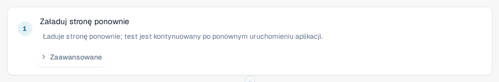

# Ponowne załadowanie i wznowienie

Niektóre rzeczy można sprawdzić dopiero po ponownym załadowaniu strony, na przykład że ustawienie nadal istnieje
po przeładowaniu. Krok **Załaduj stronę ponownie** ładuje stronę przeglądarki ponownie w środku testu, a test jest
potem kontynuowany.

## Dodawanie kroku ponownego załadowania

1. W edytorze szablonu wybierz **+ Dodaj krok**, następnie grupę **Strona**, a potem **Załaduj stronę ponownie**.
2. Umieść krok tam, gdzie ma nastąpić ponowne załadowanie. Kroki po nim są wykonywane na ponownie załadowanej stronie.

<figure><figcaption>
Krok Załaduj stronę ponownie w edytorze szablonu
</figcaption></figure>

## Co dzieje się podczas przebiegu

1. Karta zapisuje postęp testu, a następnie ładuje stronę ponownie.
2. Gdy aplikacja uruchamia się od nowa, baner u góry wyświetla **Strona została załadowana ponownie, test jest kontynuowany**, a po nim
   nazwę testu. Nie zamykaj karty.
3. Ponownie załadowana strona przejmuje przebieg i przechodzi do następnego kroku. Kroki sprzed ponownego załadowania zachowują swoje
   wyniki, krok **Załaduj stronę ponownie** jest pokazany jako zaliczony, a zegar testu biegnie dalej podczas ponownego ładowania.

<figure><figcaption>
Baner po ponownym załadowaniu: Strona została załadowana ponownie, test jest kontynuowany
</figcaption></figure>

Zapamiętane wartości są zachowywane po ponownym załadowaniu, z wyjątkiem wartości oznaczonych jako tajne (zobacz
[Gotowe kroki i bloki](steps-and-blocks.md)). Upewnij się, że żaden krok po ponownym załadowaniu nie potrzebuje tajnej wartości.

## Warto wiedzieć

* Tylko ten krok ładuje stronę ponownie bez kończenia testu. Jeśli sam przeładujesz lub zamkniesz kartę, przebieg kończy się
  jako **Anulowany**.
* Strona musi wrócić w ciągu około dwóch minut. W przeciwnym razie przebieg kończy się jako **Anulowany** lub **Niedostarczony**.
* Test może zawierać do pięciu kroków ponownego załadowania.
* Test jest kontynuowany w tej samej karcie przeglądarki i z tym samym użytkownikiem. Jeśli przeglądarka nie pozwala karcie zapisać
  postępu (na przykład z powodu zablokowanej pamięci), krok ponownego załadowania kończy się niepowodzeniem, zanim strona zostanie załadowana ponownie.
* Test wymaga schematu szablonu 1.3, który edytor ustawia po dodaniu tego kroku.
