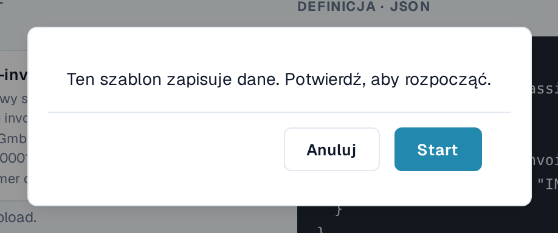
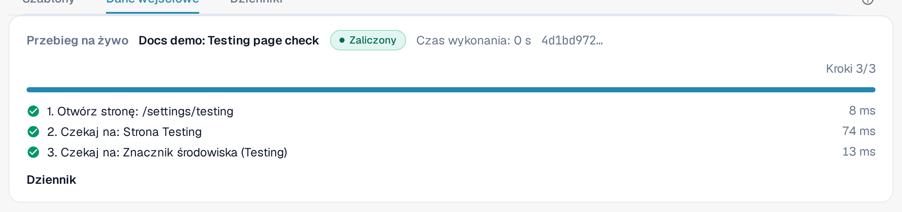
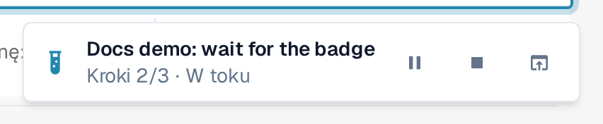
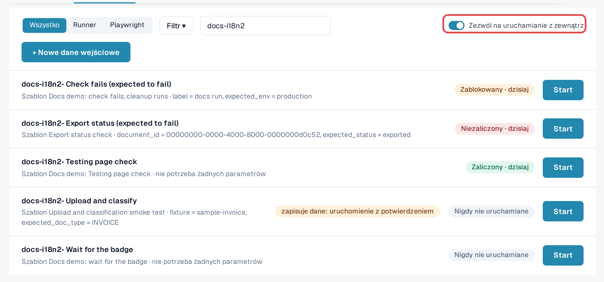
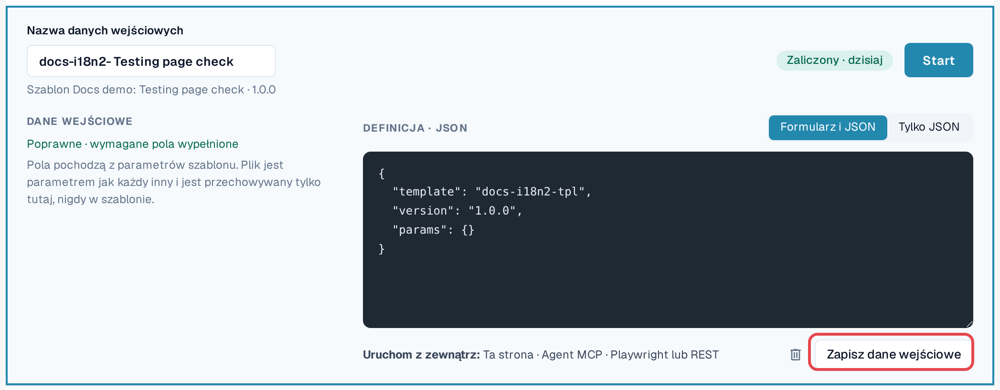

# Uruchamianie testu

Test to szablon plus dane wejściowe. Moduł Testing wykonuje go i nim steruje; Ty wybierasz sposób uruchomienia. Wszystkie trzy
sposoby są równorzędne, a każdy przebieg trafia do [Dziennika](logs.md).

| Sposób | Kiedy go użyć | W dzienniku widoczny jako |
|---|---|---|
| **W przeglądarce** | Chcesz uruchomić kontrolę teraz i obserwować jej przebieg. | **Strona** |
| **Asystent AI (MCP)** | Pracujesz z asystentem AI połączonym z DocBits i chcesz, aby uruchamiał i oceniał kontrole. | **Agent MCP** |
| **Z zewnątrz (Playwright lub REST)** | Twoja automatyzacja testów lub potok CI uruchamia kontrole, na przykład po wdrożeniu. | **Playwright** |

W każdym przypadku kliknięcia odbywają się w **karcie przeglądarki DocBits administratora organizacji**, z uprawnieniami tej
osoby. Karta musi pozostać otwarta; jej przeładowanie lub zamknięcie kończy przebieg. Jedynym wyjątkiem jest krok **Załaduj stronę ponownie**
samego testu (zobacz [Ponowne załadowanie i wznowienie](reload-and-resume.md)).

## Uruchamianie w przeglądarce

1. Otwórz **Ustawienia → Testing**, zakładka **Dane wejściowe**.
2. Wybierz **Start** przy danych wejściowych (lub otwórz dane wejściowe i wybierz **Start**).
3. Jeśli szablon zmienia dane, DocBits pyta: *Ten szablon zapisuje dane. Potwierdź, aby rozpocząć.* Wybierz **Start**, aby kontynuować.
4. Test jest wykonywany w tej karcie. Na stronie Testing panel **Przebieg na żywo** pokazuje status, **Aktualne działanie**,
   postęp kroków oraz **Wstrzymaj**, **Wznów** i **Zatrzymaj**. Gdy test otwiera inną stronę, mały wskaźnik w
   prawym dolnym rogu pokazuje tam postęp. Po zakończeniu testu wskaźnik pokazuje wynik
   wraz z **Otwórz dziennik** i **Zamknij**.
5. Po zakończeniu testu otwórz zakładkę **Dziennik**, aby przeczytać wynik.

<figure><figcaption>
Potwierdzenie przed testem, który zapisuje dane.
</figcaption></figure>

<figure><figcaption>
Panel Przebieg na żywo po zaliczeniu testu.
</figcaption></figure>

<figure><figcaption>
Wskaźnik przebiegu w prawym dolnym rogu na innej stronie.
</figcaption></figure>


**Przesyłanie plików podczas testu:** jeśli Twoja organizacja ma podorganizacje, a panel pokazuje je wszystkie, okno dialogowe
przesyłania zwykle pyta, do której podorganizacji należy dokument. Gdy test działa, przesyłany plik trafia do
**pierwszej podorganizacji, którą oferuje okno dialogowe**, bez pytania. Aby przesłać dokument do konkretnej podorganizacji, uruchom
test z widoku tej podorganizacji.


## Zezwalanie na uruchamianie z zewnątrz

Asystent AI lub skrypt Playwright nie potrafi klikać samodzielnie; prosi DocBits o uruchomienie testu **w zarejestrowanej przez Ciebie
karcie przeglądarki**:

1. W karcie przeglądarki, która ma uruchamiać testy, otwórz **Ustawienia → Testing**, zakładka **Dane wejściowe**.
2. Włącz **Zezwól na uruchamianie z zewnątrz**. Karta przyjmuje teraz uruchomienia i pokazuje swój identyfikator sesji.
3. Pozostaw kartę otwartą. Rejestracja kończy się po przeładowaniu lub zamknięciu karty.

<figure><figcaption>
Włączona opcja Zezwól na uruchamianie z zewnątrz, z identyfikatorem sesji.
</figcaption></figure>

Edytor danych wejściowych przypomina o trzech sposobach w wierszu **Uruchom z zewnątrz:** **Ta strona**, **Agent MCP**,
**Playwright lub REST**.

<figure><figcaption>
Wiersz Uruchom z zewnątrz w edytorze danych wejściowych.
</figcaption></figure>

## Uruchamianie z asystenta AI (MCP)

Jeśli Twój asystent AI jest połączony z DocBits (zobacz [DocBits MCP](https://docs.docbits.com/advanced-functions-and-tools/docbits-mcp)
oraz [Konfigurowanie DocBits przez Claude lub Codex](https://docs.docbits.com/advanced-functions-and-tools/docbits-mcp/configuration-with-claude-or-codex)):

1. Zezwól na uruchamianie z zewnątrz w karcie przeglądarki (zobacz wyżej).
2. Poproś asystenta, na przykład: *„Wyświetl moje dane wejściowe testów DocBits i uruchom »Invoice LT-2026-0001 ready for validation«
   w mojej zarejestrowanej karcie przeglądarki. Potem podaj mi wynik.”*
3. Asystent pyta, której karty użyć, jeśli zarejestrowano więcej niż jedną, i pyta Cię, zanim uruchomi test, który
   zmienia dane. Następnie odczytuje dziennik i zgłasza wynik.

## Uruchamianie z Playwright lub innego narzędzia (REST)

Twoja automatyzacja testów uruchamia dane wejściowe jednym wywołaniem API, a następnie odczytuje ich dziennik. Potrzebuje:

* tokenu administratora organizacji (zobacz [Klucz API](https://docs.docbits.com/administration-and-setup/settings/global-settings/integration/api-key));
* identyfikatora danych wejściowych;
* identyfikatora sesji karty przeglądarki z włączoną opcją **Zezwól na uruchamianie z zewnątrz**.

Wywołanie i przykład znajdziesz na stronie [Dla programistów](for-developers.md).

## Środowiska klientów

W środowiskach sandbox i produkcyjnym znacznik **Środowisko** jest czerwony. Testy zmieniające dane wymagają wyraźnego potwierdzenia przy
każdym uruchomieniu, a kroki eksportowania, usuwania i zatwierdzania są blokowane, chyba że szablon deklaruje, że zapisuje dane. Testy
zapisujące dane uruchamiaj w miarę możliwości w środowisku testowym.
