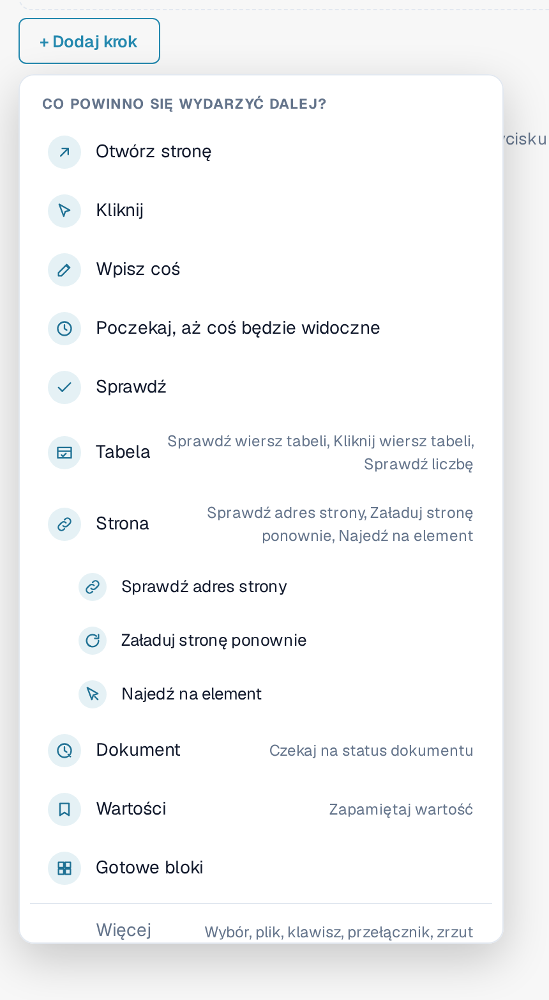
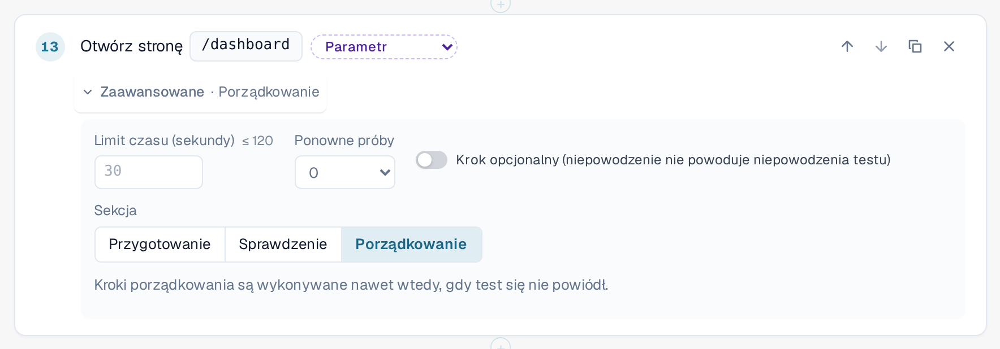
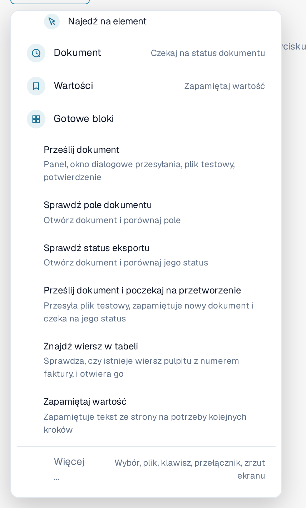
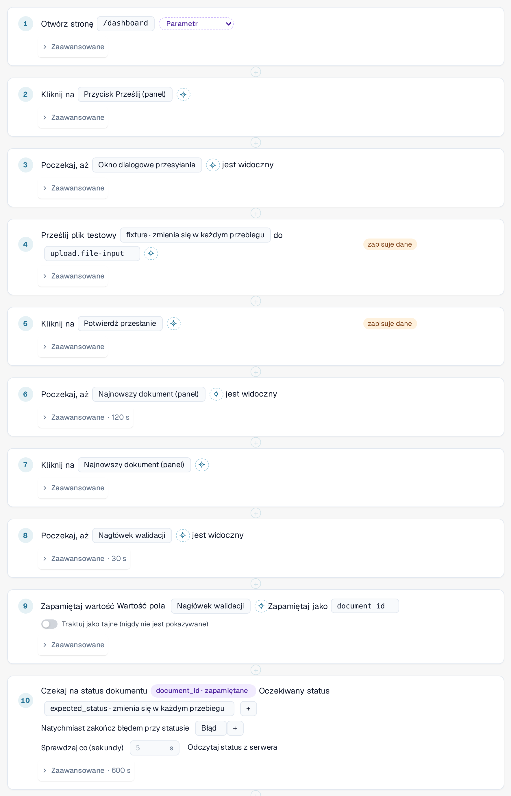
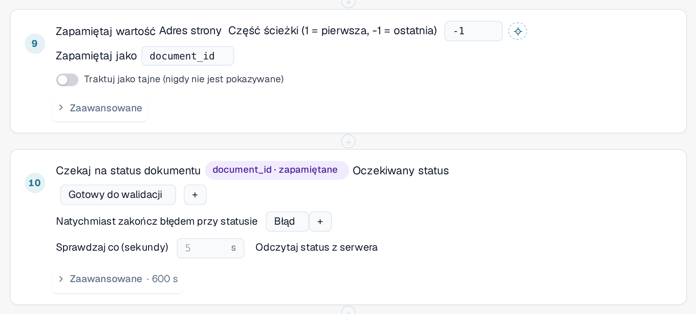
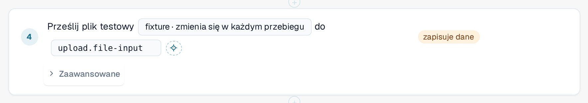

# Gotowe kroki i bloki

Ta strona wyjaśnia, jak zbudować szablon w edytorze ([Szablony](templates.md)): grupy kroków, ustawienia
**Zaawansowane** kroku, gotowe bloki oraz to, jak test przekazuje wartości z jednego kroku do następnego.

## Dodawanie kroku

W edytorze szablonu wybierz **+ Dodaj krok**. Menu **Co powinno się wydarzyć dalej?** wyświetla listę kroków. Pięć
podstawowych kroków to **Otwórz stronę**, **Kliknij**, **Wpisz coś**, **Poczekaj, aż coś będzie widoczne** i **Sprawdź**.
Bardziej wyspecjalizowane kroki znajdują się w czterech **grupach**. Wybierz grupę, aby zobaczyć jej kroki:

| Grupa | Kroki |
|---|---|
| **Tabela** | **Sprawdź wiersz tabeli**, **Kliknij wiersz tabeli**, **Sprawdź liczbę**. Dla list, takich jak lista dokumentów na panelu. |
| **Strona** | **Sprawdź adres strony**, **Załaduj stronę ponownie** (zobacz [Ponowne załadowanie i wznowienie](reload-and-resume.md)), **Najedź na element**. |
| **Dokument** | **Czekaj na status dokumentu**: czeka, aż dokument osiągnie status, na przykład *Gotowy do walidacji*. |
| **Wartości** | **Zapamiętaj wartość**: przechowuje tekst ze strony na potrzeby kolejnych kroków. |

**Gotowe bloki** dodają kilka kroków naraz (zobacz poniżej). **Więcej …** oferuje dalsze kroki: wybór opcji, przesłanie pliku, naciśnięcie klawisza,
przełączenie przełącznika i zrzut ekranu (kroki ze zrzutem ekranu są pomijane przez program uruchamiający w przeglądarce).

<figure><figcaption>
Menu dodawania kroku z grupami Tabela, Strona, Dokument i Wartości; grupa Strona jest otwarta
</figcaption></figure>

Aby skierować krok na element strony, wybierz go z listy lub użyj **Wybierz w aplikacji**
([Wybieranie elementu w aplikacji](pick-in-app.md)).

## Ustawienia zaawansowane kroku

Każdy krok ma wiersz **Zaawansowane**. Wybierz go, aby otworzyć ustawienia tego kroku. Zwinięty wiersz pokazuje, co
zostało zmienione, na przykład *Zaawansowane · 120 s* lub *Zaawansowane · Czyszczenie*.

| Ustawienie | Znaczenie |
|---|---|
| **Limit czasu (sekundy)** | Jak długo krok może trwać, maksymalnie 120 sekund. Zostaw puste, aby zastosować wartość domyślną 30 sekund. Kroki oczekujące na dokument mają własny, dłuższy limit. |
| **Ponowienia** | Ile razy DocBits powtarza krok, jeśli się nie powiedzie (od 0 do 3). |
| **Krok opcjonalny (niepowodzenie nie powoduje niezaliczenia testu)** | Jeśli krok się nie powiedzie, dziennik pokazuje go jako pominięty wraz z błędem, a test jest kontynuowany. |
| **Sekcja** | **Przygotowanie**, **Sprawdzenie** lub **Czyszczenie**. Domyślnie ustawione jest **Sprawdzenie**. |

Kroki **Przygotowania** przygotowują test. Kroki **Sprawdzenia** są samym testem. Kroki **Czyszczenia** usuwają to, co test
po sobie zostawił, na przykład przesłany przez niego dokument. **Kroki czyszczenia są wykonywane nawet wtedy, gdy test się nie powiódł** lub przekroczył limit czasu, a
niepowodzenie kroku czyszczenia nigdy nie zmienia wyniku testu. Muszą być ostatnimi krokami szablonu; edytor zgłasza błąd, jeśli po kroku
czyszczenia występuje zwykły krok. Nie są wykonywane, jeśli zatrzymasz test lub zamkniesz kartę.
Szablon z krokami czyszczenia jest zapisywany jako schemat 1.3 (zobacz [Dla programistów](for-developers.md)).

<figure><figcaption>
Ustawienia zaawansowane kroku: limit czasu, ponowienia, krok opcjonalny i sekcja, z wybranym Czyszczeniem
</figcaption></figure>

## Gotowe bloki

Wybierz **+ Dodaj krok**, a następnie **Gotowe bloki**. Blok dodaje kroki typowej sekwencji wraz z
potrzebnymi parametrami. Każdy krok możesz potem zmienić.

| Blok | Co dodaje |
|---|---|
| **Prześlij dokument** | Otwiera panel, otwiera okno dialogowe przesyłania, wybiera plik testowy i potwierdza. |
| **Sprawdź pole dokumentu** | Otwiera dokument i porównuje pole z oczekiwaną wartością. |
| **Sprawdź status eksportu** | Otwiera dokument i porównuje jego status. |
| **Prześlij dokument i poczekaj na przetworzenie** | Przesyła plik testowy, zapamiętuje nowy dokument i czeka na jego status. |
| **Znajdź wiersz w tabeli** | Sprawdza, czy na liście panelu istnieje wiersz z podanym numerem faktury, i otwiera go. |
| **Zapamiętaj wartość** | Zapamiętuje tekst ze strony na potrzeby kolejnych kroków. |

<figure><figcaption>
Gotowe bloki w menu dodawania kroku
</figcaption></figure>

### Prześlij dokument i poczekaj na przetworzenie

Użyj tego bloku, gdy kolejny krok potrzebuje dokumentu, który test właśnie przesłał. Blok rozpoznaje nowy dokument
samodzielnie, a nie po górnym wierszu listy, więc starszy dokument nigdy nie zostanie wybrany przez pomyłkę. Następnie odczytuje
identyfikator dokumentu z adresu strony i czeka, aż dokument osiągnie oczekiwany status
(domyślnie *Gotowy do walidacji*, maksymalnie 10 minut; kończy się od razu, jeśli dokument otrzyma status *Błąd*).
Dodaje wartości danych wejściowych **fixture** (plik testowy) i **expected_status** oraz zwiększa czas całego testu do co najmniej 15 minut.

<figure><figcaption>
Kroki bloku Prześlij dokument i poczekaj na przetworzenie
</figcaption></figure>


**Dokąd trafiają przesłane pliki:** jeśli Twoja organizacja ma podorganizacje, a panel pokazuje je wszystkie, okno dialogowe
przesyłania zwykle pyta, do której podorganizacji należy dokument. Test nie może odpowiedzieć na to pytanie. Gdy
test działa w karcie, przesyłany plik trafia do **pierwszej podorganizacji, którą oferuje okno dialogowe**, bez pytania.
Poza testem nic się nie zmienia. Aby przesłać dokument do konkretnej podorganizacji, uruchom test z widoku
tej podorganizacji.


### Znajdź wiersz w tabeli

Blok sprawdza, czy lista panelu zawiera wiersz z podanym numerem faktury (wartość danych wejściowych **row_value**)
i otwiera go. Aby wyszukiwać według innej kolumny, zmień kolumnę i wartość w kroku. Oba kroki należą do grupy
**Tabela**; **Sprawdź liczbę** zlicza wiersze lub dowolne inne elementy.

## Zapamiętywanie wartości i używanie jej później

Test często potrzebuje wartości, która istnieje tylko w trakcie jego działania, na przykład identyfikatora dokumentu, który właśnie przesłał.

1. Dodaj **Zapamiętaj wartość** (grupa **Wartości**). Wybierz, skąd pochodzi wartość: z tekstu strony, z adresu strony
   (część ścieżki lub parametr zapytania) albo z komórki wiersza tabeli. Wpisz nazwę w polu **Zapamiętaj jako**,
   na przykład `document_id`. Włącz **Traktuj jako tajne (nigdy nie wyświetlane)** dla wartości, które nie mogą pojawiać się nigdzie.
2. W kolejnym kroku wybierz zapamiętaną wartość zamiast wpisywać ją ręcznie. Krok pokazuje etykietę taką jak
   *document_id · zapamiętane*. W JSON szablonu zapisuje się ją jako `{{vars.document_id}}`.

W kroku można używać dwóch rodzajów wartości:

| Rodzaj | Zapis | Skąd pochodzi | Przykład |
|---|---|---|---|
| **Dane wejściowe** | `{{params.name}}` | Zapisane [dane wejściowe](inputs.md): są takie same przy każdym przebiegu tych danych. Utworzysz je przyciskiem parametru obok wartości. | *fixture · zmienia się w każdym przebiegu* |
| **Zapamiętana wartość** | `{{vars.name}}` | Wcześniejszy krok **Zapamiętaj wartość** w tym samym przebiegu. | *document_id · zapamiętane* |

<figure><figcaption>
Zapamiętaj wartość zapisuje identyfikator dokumentu; następny krok czeka na ten dokument
</figcaption></figure>

<figure><figcaption>
Krok, który używa wartości danych wejściowych fixture
</figcaption></figure>

Zapamiętana wartość istnieje tylko w bieżącym przebiegu i nigdy nie jest zapisywana w szablonie ani w dzienniku. Zapamiętane
wartości zachowują się po [ponownym załadowaniu strony](reload-and-resume.md) w trakcie testu, chyba że zostały oznaczone jako tajne.
